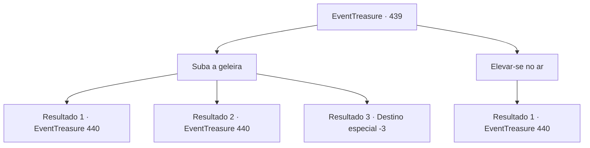

# Eventos de tesouro · 439

[Índice da tabela](index.md) · [Índice geral](../index.md)

ID: `pt:EventTreasure:439` · Fonte: `EventTreasure4` · Versão: 1.2.47.

Mapeamento estático dos arquivos; a disponibilidade e a execução dependem do estado da run.

## Texto do evento

*Sem texto no arquivo.*

## Dados de entrada

```json
{
  "id": 439,
  "grade": 1,
  "place": "",
  "required": ""
}
```

## Mapa das escolhas



## Escolhas e resultados

### Escolha 1

Suba a geleira

Requisitos e outros campos da escolha:

```json
{
  "required": ""
}
```

#### Resultado 1.1

Você se debatia desesperadamente, procurando qualquer coisa a que se agarrar. Por sorte, sua mão se prendeu à parede de gelo, e você se puxou para cima. |drawing_wendigo|  

 "Ajude… me…"

  Você ergueu a cabeça na direção da voz. No lugar onde a mulher havia sido enterrada agora estava de pé uma figura monstruosa.  Seu corpo era esquálido, porém imponente — tinha o dobro do tamanho de um homem adulto. Sobre a cabeça havia o crânio de um cervo, e suas garras longas estavam encrostadas de sangue seco.  

 "Heh… heheheh…"

  A criatura fixou o olhar em você, soltando uma risada grotesca.

Continuação registrada: [Evento 440](0440.md) na mesma tabela.

```json
{
  "required": "",
  "chance": "1|0_5_1",
  "nextEvent": 440,
  "type": 0,
  "reward": ""
}
```

#### Resultado 1.2

Pouco antes de cair, você estendeu a mão desesperadamente. Sua mão agarrou a geleira congelada, e você rapidamente se puxou de volta para cima. Embora você tenha forçado o braço e o ombro no processo, os ferimentos foram leves. |drawing_wendigo|  

 "Ajude… me…"

  Você ergueu a cabeça em direção à voz. No lugar onde a mulher havia sido enterrada agora erguia-se uma figura monstruosa.  Seu corpo era esquálido, porém imponente — o dobro do tamanho de um homem adulto. Na cabeça, havia o crânio de um cervo, e suas longas garras estavam encrostadas de sangue seco.  

 "Heh… heheheh…"

  A criatura fixou o olhar em você, soltando uma risada grotesca.

Continuação registrada: [Evento 440](0440.md) na mesma tabela.

```json
{
  "required": "1_0_2",
  "chance": "16",
  "nextEvent": 440,
  "type": 1,
  "reward": ""
}
```

#### Resultado 1.3

Pouco antes que pudesse cair, estendeu a mão— mas suas mãos só agarraram o ar vazio.  Você despencou na fenda e encontrou seu fim no abismo frio e escuro.

Continuação registrada: [Destino especial `-3`](../destinos-especiais.md).

```json
{
  "required": "2_0_2",
  "chance": "16",
  "nextEvent": -3,
  "type": 1,
  "reward": ""
}
```

### Escolha 2

Elevar-se no ar

Requisitos e outros campos da escolha:

```json
{
  "required": "20_0_2|20_10_1"
}
```

#### Resultado 2.1

Você se lançou ao ar, por pouco evitando a queda. Em seguida, voltou ao lugar onde estivera antes e pousou com cuidado. |drawing_wendigo|  

 "Ajude…-me…"

  Você ergueu a cabeça na direção da voz. No lugar onde a mulher fora enterrada erguia-se agora uma figura monstruosa.  Seu corpo era esquálido, mas imponente — o dobro do tamanho de um homem adulto. Sobre a cabeça, havia o crânio de um cervo, e suas garras longas estavam encrostadas de sangue seco.  

 "Heh… heheheh…"

  A criatura cravou o olhar em você, soltando um sopro grotesco que passava por riso.

Continuação registrada: [Evento 440](0440.md) na mesma tabela.

```json
{
  "required": "",
  "chance": "1",
  "nextEvent": 440,
  "type": 2,
  "reward": ""
}
```

## Referências que chegam a este evento

- [Evento 438 · escolha 1 · resultado 1](0438.md#escolha-1)
