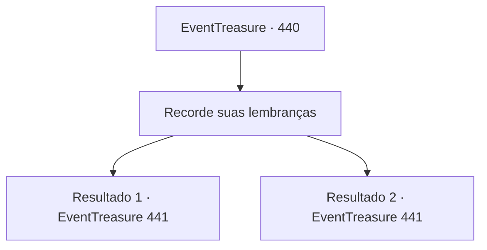

# Eventos de tesouro · 440

[Índice da tabela](index.md) · [Índice geral](../index.md)

ID: `pt:EventTreasure:440` · Fonte: `EventTreasure4` · Versão: 1.2.47.

Mapeamento estático dos arquivos; a disponibilidade e a execução dependem do estado da run.

## Texto do evento

*Sem texto no arquivo.*

## Dados de entrada

```json
{
  "id": 440,
  "grade": 1,
  "place": "",
  "required": ""
}
```

## Mapa das escolhas



## Escolhas e resultados

### Escolha 1

Recorde suas lembranças

Requisitos e outros campos da escolha:

```json
{
  "required": ""
}
```

#### Resultado 1.1

Você encarou diretamente o monstro, vasculhando sua memória. Então, de repente, você se lembrou do que certa vez tinha lido em um livro. 
 Wendigo. 
 Um monstro que, diziam, assombrava montanhas varridas pela neve, caçando viajantes. Não uma mera fera, mas uma criatura astuta que imitava a fala humana e usava cadáveres como isca. A chamada “Maldição da Montanha Nord” de que o caçador falou— era o Wendigo.  <link=shake>

 "Screeeeeech--!!"

</link>  Nesse momento, o Wendigo soltou um guincho horrível e lançou-se contra você.

Continuação registrada: [Evento 441](0441.md) na mesma tabela.

```json
{
  "required": "",
  "chance": "1|0_7_1",
  "nextEvent": 441,
  "type": 0,
  "reward": "6_0_189",
  "place": 9
}
```

#### Resultado 1.2

Você encarou o monstro diretamente, vasculhando sua memória. Mas por mais que pensasse, o nome dele não lhe ocorria.  <link=shake>

 "Screeeeeech--!!"

</link>  Ele soltou um guincho horrendo e investiu contra você. Você se firmou e se preparou para revidar.  Mesmo sem saber o nome dele, uma coisa era certa: a “Maldição da Montanha Nord” referia-se a esse monstro.

Continuação registrada: [Evento 441](0441.md) na mesma tabela.

```json
{
  "required": "",
  "chance": "14",
  "nextEvent": 441,
  "type": 1,
  "reward": "6_4_189",
  "place": 9
}
```

## Referências que chegam a este evento

- [Evento 438 · escolha 2 · resultado 1](0438.md#escolha-2)
- [Evento 439 · escolha 1 · resultado 1](0439.md#escolha-1)
- [Evento 439 · escolha 1 · resultado 2](0439.md#escolha-1)
- [Evento 439 · escolha 2 · resultado 1](0439.md#escolha-2)
