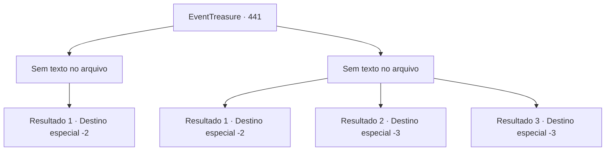

# Eventos de tesouro · 441

[Índice da tabela](index.md) · [Índice geral](../index.md)

ID: `pt:EventTreasure:441` · Fonte: `EventTreasure4` · Versão: 1.2.47.

Mapeamento estático dos arquivos; a disponibilidade e a execução dependem do estado da run.

## Texto do evento

*Sem texto no arquivo.*

## Dados de entrada

```json
{
  "id": 441,
  "grade": 1,
  "place": "",
  "required": ""
}
```

## Mapa das escolhas



## Escolhas e resultados

### Escolha 1

*Sem texto no arquivo; o papel dessa opção depende da interface do jogo.*

Requisitos e outros campos da escolha:

```json
{
  "required": ""
}
```

#### Resultado 1.1

Com um sibilo oco, o monstro desabou. Você se postou sobre ele e desferiu o golpe final.  

 "Ghhk… grrk…"

  Nesse instante, um frio congelante fluiu de seu corpo. O frio penetrou em sua carne, e a criatura se dissolveu na tempestade, esvaecendo.  A maldição da Montanha Nord foi quebrada.  Você limpou o sangue do corpo e olhou para o céu. A nevasca furiosa já havia cessado.  Você deixou para trás os picos silenciosos e continuou sua jornada.

Continuação registrada: [Destino especial `-2`](../destinos-especiais.md).

```json
{
  "required": "",
  "chance": "1",
  "nextEvent": -2,
  "type": 2,
  "reward": "27_54_1|5_877_9"
}
```

### Escolha 2

*Sem texto no arquivo; o papel dessa opção depende da interface do jogo.*

Requisitos e outros campos da escolha:

```json
{
  "required": ""
}
```

#### Resultado 2.1

Em meio à batalha feroz, você foi atingido e arremessado para dentro de uma fenda. O uivo terrível do monstro ecoou pelas montanhas. 

 Um pedaço de neve caiu de cima e atingiu seu rosto, trazendo você de volta à consciência. Por pura sorte, você caiu onde a neve era profunda o bastante para salvar você.  Gemeendo, você obrigou seu corpo machucado a se levantar e olhou ao redor. O fundo da fenda se estendia mais largo do que o esperado, e dentro dela havia um caminho congelado, tenuemente visível, que levava mais ao fundo.  Você seguiu o caminho até que, por fim, ele levou você para fora das montanhas.

Continuação registrada: [Destino especial `-2`](../destinos-especiais.md).

```json
{
  "required": "1_0_2|1_1_2",
  "chance": "1",
  "nextEvent": -2,
  "type": 2,
  "reward": "0_0_-1|0_1_-1|5_877_9"
}
```

#### Resultado 2.2

Suas garras eram afiadas o suficiente para fender até mesmo a rocha congelada. Rasgar a carne humana era fácil demais.  Você foi morto e se tornou mais uma parte da maldição da Montanha Nord.

Continuação registrada: [Destino especial `-3`](../destinos-especiais.md).

```json
{
  "required": "2_0_2",
  "chance": "1",
  "nextEvent": -3,
  "type": 2,
  "reward": "0_0_-1|0_1_-1"
}
```

#### Resultado 2.3

Suas garras eram afiadas o suficiente para fender até mesmo a rocha congelada. Rasgar a carne humana era fácil demais.  Você foi morto e se tornou mais uma parte da maldição da Montanha Nord.

Continuação registrada: [Destino especial `-3`](../destinos-especiais.md).

```json
{
  "required": "2_1_2",
  "chance": "1",
  "nextEvent": -3,
  "type": 2,
  "reward": "0_0_-1|0_1_-1"
}
```

## Referências que chegam a este evento

- [Evento 440 · escolha 1 · resultado 1](0440.md#escolha-1)
- [Evento 440 · escolha 1 · resultado 2](0440.md#escolha-1)
