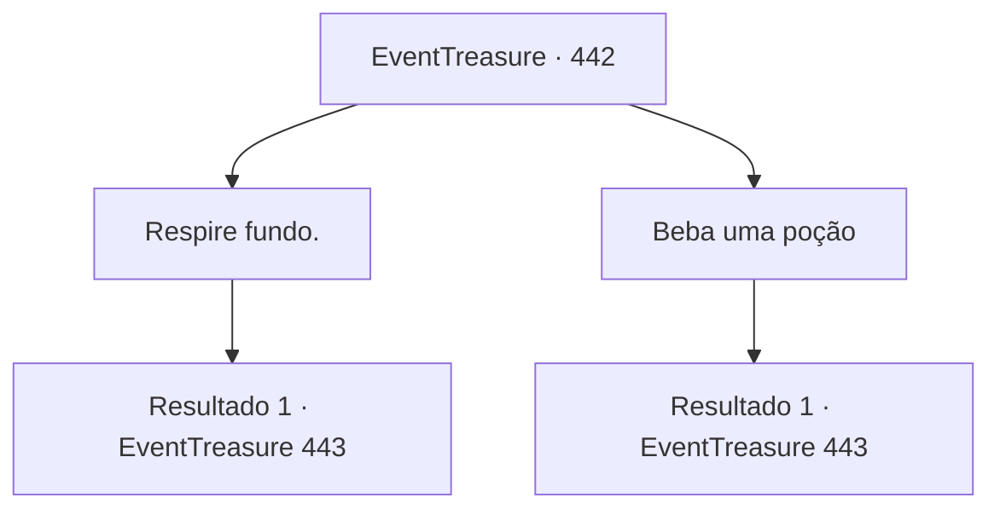

# Eventos de tesouro · 442

[Índice da tabela](index.md) · [Índice geral](../index.md)

ID: `pt:EventTreasure:442` · Fonte: `EventTreasure4` · Versão: 1.2.47.

Mapeamento estático dos arquivos; a disponibilidade e a execução dependem do estado da run.

## Texto do evento

Uma dor repentina atingiu você como um raio. Do fundo do seu peito, um calor abrasador irrompeu sem aviso. Era como se lava incandescente corresse pelas suas veias— a agonia ardente espalhando-se do seu coração, percorrendo todo o seu corpo num instante.  Ofegante, você desabou onde estava.

## Dados de entrada

```json
{
  "id": 442,
  "grade": 2,
  "place": "",
  "required": "1_2_50|5_851_0|26_46_1"
}
```

## Mapa das escolhas



## Escolhas e resultados

### Escolha 1

Respire fundo.

Requisitos e outros campos da escolha:

```json
{
  "required": ""
}
```

#### Resultado 1.1

Você tentou suportar a dor respirando fundo. Mas a agonia lancinante que percorria todo o seu corpo logo tomou conta de você, e você perdeu a consciência.  Um frio repentino roçou sua bochecha. Devagar, você abriu os olhos e se sentou. A dor que antes consumia seu corpo havia desaparecido por completo.  

 "Você acordou? Ótimo. Parece que não cheguei tarde demais, afinal."

  Assustado pela voz repentina, você olhou rapidamente ao redor. Você estava numa pequena cabana impregnada com o forte cheiro de ervas. Feixes de plantas secas pendiam das paredes, e prateleiras no canto guardavam ferramentas estranhas, arcanas. No centro, um ancião em vestes exóticas fitava você com um sorriso caloroso. |drawing_orientalOldman|  

 "Você nasceu com o que chamamos de “Corpo Envenenado”. Uma constituição rara que carrega a própria essência do veneno. Mas você viveu sem saber disso, até que seu equilíbrio ruiu — por isso desmaiou."

  A voz dele era calma enquanto continuava. 

 "Por enquanto, tratei de você. Não precisa se preocupar."


Continuação registrada: [Evento 443](0443.md) na mesma tabela.

```json
{
  "required": "",
  "chance": "1",
  "nextEvent": 443,
  "type": 2,
  "reward": ""
}
```

### Escolha 2

Beba uma poção

Requisitos e outros campos da escolha:

```json
{
  "required": "23_6_1"
}
```

#### Resultado 2.1

Você tentou beber uma poção, mas suas mãos trêmulas não conseguiram levá-la aos lábios. A agonia abrasadora que dilacerava todo o seu corpo logo foi demais, e você perdeu a consciência. 

 Um arrepio repentino roçou sua bochecha. Devagar, você abriu os olhos e se sentou. A dor que antes tomava conta de você havia desaparecido completamente.  

 "Acordou? Ótimo. Parece que não cheguei tarde demais, afinal."

  Sobressaltado pela voz repentina, você olhou ao redor rapidamente. Você estava em uma pequena cabana, impregnada com o forte aroma de ervas. Feixes de plantas secas pendiam das paredes, e prateleiras no canto guardavam instrumentos estranhos e arcanos. No centro, um velho de vestes exóticas estava sentado, olhando para você com um sorriso caloroso. |drawing_orientalOldman|  

 "Você nasceu com o que chamamos de “Corpo Envenenado”. Uma constituição rara que carrega a própria essência do veneno. Mas você viveu sem saber disso, até que seu equilíbrio entrou em colapso — daí o desmaio."

  A voz dele era calma enquanto continuava. 

 "Por ora, eu tratei de você. Não precisa se preocupar."


Continuação registrada: [Evento 443](0443.md) na mesma tabela.

```json
{
  "required": "",
  "chance": "1",
  "nextEvent": 443,
  "type": 2,
  "reward": ""
}
```

## Referências que chegam a este evento

Nenhum `nextEvent` positivo da mesma tabela aponta para este nó. Isso não prova que seja inacessível: sorteio e estado de história podem selecioná-lo.

