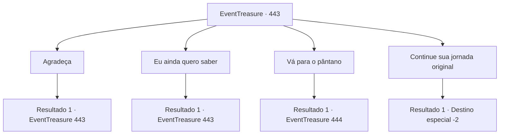

# Eventos de tesouro · 443

[Índice da tabela](index.md) · [Índice geral](../index.md)

ID: `pt:EventTreasure:443` · Fonte: `EventTreasure4` · Versão: 1.2.47.

Mapeamento estático dos arquivos; a disponibilidade e a execução dependem do estado da run.

## Texto do evento

*Sem texto no arquivo.*

## Dados de entrada

```json
{
  "id": 443,
  "grade": 1,
  "place": "",
  "required": ""
}
```

## Mapa das escolhas



## Escolhas e resultados

### Escolha 1

Agradeça

Requisitos e outros campos da escolha:

```json
{
  "required": "5_852_0"
}
```

#### Resultado 1.1

Você ofereceu sinceros agradecimentos ao velho exótico que havia salvo sua vida. Ele apenas deu de ombros, sorrindo com modéstia.  

 "Não foi nada. Pude estudar seu corpo único, então é benefício mútuo."

  Ele tirou um tomo gasto, repleto de estranhas escritas orientais, e começou a folhear suas páginas.  

 "É uma pena, porém. Se eu tivesse nascido com o Corpo Envenenado como você, talvez tivesse me tornado um verdadeiro mestre das Artes do Veneno. Mas os ocidentais não têm motivo para perseguir tal cultivo… que desperdício de talento."

  Seu sorriso tornou-se amargo quando ergueu o olhar novamente, sua expressão agora com um toque de advertência.  

 "Ah — mas se você está pensando em treinar nas Artes do Veneno depois de ouvir isso, abandone a ideia."

 Sua voz ficou séria. 

 "Mesmo na minha terra natal, é uma arte secreta, ensinada a pouquíssimos. É tão provável que o consuma pelo veneno quanto que lhe conceda poder."


Continuação registrada: [Evento 443](0443.md) na mesma tabela.

```json
{
  "required": "",
  "chance": "1",
  "nextEvent": 443,
  "type": 2,
  "reward": "5_852_1"
}
```

### Escolha 2

Eu ainda quero saber

Requisitos e outros campos da escolha:

```json
{
  "required": "5_852_1"
}
```

#### Resultado 2.1

Você insistiu em aprender o método mesmo assim. O velho estalou a língua de leve, mas por fim cedeu.  

 "Que seja. Eis o que posso te dizer. Siga para o leste a partir daqui e encontrará um pântano. Bem no fundo desse pântano há uma caverna, e dentro dessa caverna cresce uma flor chamada Musanghwa."

  Ele abriu seu tomo, mostrando a você uma ilustração da flor. Parecia uma camélia, mas suas pétalas e seu caule eram inteiramente acinzentados.  

 "Manche a flor de carmesim, depois devore-a inteira, raízes e tudo. O veneno inundará seu corpo. Você pode morrer... mas, se suportar, alcançará grande maestria."

  Com as palavras dele em mente, você se preparou para deixar a cabana. Quando você abriu a porta, a luz da aurora se espalhava pela terra.

Continuação registrada: [Evento 443](0443.md) na mesma tabela.

```json
{
  "required": "",
  "chance": "1",
  "nextEvent": 443,
  "type": 2,
  "reward": "5_852_2"
}
```

### Escolha 3

Vá para o pântano

Requisitos e outros campos da escolha:

```json
{
  "required": "5_852_2"
}
```

#### Resultado 3.1

Você agradeceu ao velho mais uma vez e deixou a cabana. Então, apressando-se para o leste, você procurou o brejo de que ele havia falado. 

 Três dias depois, você chegou ao pântano e parou. Uma névoa baixa pairava sobre o chão, e o ar era denso e pegajoso de putrefação. Árvores mortas exalavam o fedor da podridão.  O mais impressionante de tudo era a teia gigantesca que cobria todo o pântano. Fios agarravam-se a galhos, arbustos e rochas, enredando-se em você a cada passo. Você arrancou do corpo os fios pegajosos e olhou ao redor.  Um som tênue e inquietante percorria a teia, ecoando ao seu redor.

Continuação registrada: [Evento 444](0444.md) na mesma tabela.

```json
{
  "required": "",
  "chance": "1",
  "nextEvent": 444,
  "type": 2,
  "reward": ""
}
```

### Escolha 4

Continue sua jornada original

Requisitos e outros campos da escolha:

```json
{
  "required": "5_852_2"
}
```

#### Resultado 4.1

Você agradeceu ao velho mais uma vez e saiu da cabana. Mas, em vez de seguir para o pântano, você escolheu continuar sua jornada original.

Continuação registrada: [Destino especial `-2`](../destinos-especiais.md).

```json
{
  "required": "",
  "chance": "1",
  "nextEvent": -2,
  "type": 2,
  "reward": "5_851_9"
}
```

## Referências que chegam a este evento

- [Evento 442 · escolha 1 · resultado 1](0442.md#escolha-1)
- [Evento 442 · escolha 2 · resultado 1](0442.md#escolha-2)
- [Evento 443 · escolha 1 · resultado 1](0443.md#escolha-1)
- [Evento 443 · escolha 2 · resultado 1](0443.md#escolha-2)
