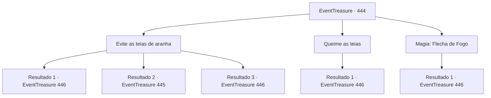

# Eventos de tesouro · 444

[Índice da tabela](index.md) · [Índice geral](../index.md)

ID: `pt:EventTreasure:444` · Fonte: `EventTreasure4` · Versão: 1.2.47.

Mapeamento estático dos arquivos; a disponibilidade e a execução dependem do estado da run.

## Texto do evento

*Sem texto no arquivo.*

## Dados de entrada

```json
{
  "id": 444,
  "grade": 1,
  "place": "",
  "required": ""
}
```

## Mapa das escolhas



## Escolhas e resultados

### Escolha 1

Evite as teias de aranha

Requisitos e outros campos da escolha:

```json
{
  "required": ""
}
```

#### Resultado 1.1

Você se esgueirou pelas teias com movimentos ágeis. Depois de quase uma hora caminhando pântano adentro, você descobriu uma caverna escondida.  Recordando as palavras do velho exótico, você entrou. O teto da caverna erguia-se alto, com estalactites afiadas pendendo perigosamente acima. A passagem se estendia longe na escuridão, sem que a luz alcançasse seu interior.  Você parou, fitando as profundezas. Parecia claro que seria necessária uma fonte de luz.

Continuação registrada: [Evento 446](0446.md) na mesma tabela.

```json
{
  "required": "10_262_1",
  "chance": "1|0_6_1",
  "nextEvent": 446,
  "type": 0,
  "reward": ""
}
```

#### Resultado 1.2

Você tentou se esgueirar pelas teias. Mas os fios se estendiam em todas as direções, impedindo sua passagem. A cada passo, eles prendiam seus ombros, braços e pernas, enquanto lama e cipós se enroscavam em seus pés, puxando você para baixo. 

 Ssssshhhhh! 

 Enquanto você lutava, um silvo arrepiante ecoou ao longe.  Algo se moveu pelas teias em sua direção, exibindo presas venenosas. Uma aranha monstruosa, imensa como uma besta, avançou para atacar.

Continuação registrada: [Evento 445](0445.md) na mesma tabela.

```json
{
  "required": "10_262_1",
  "chance": "14",
  "nextEvent": 445,
  "type": 1,
  "reward": "6_3_5",
  "place": 1
}
```

#### Resultado 1.3

Você avançou tão graciosamente e rapidamente quanto a própria aranha, escapando aos fios pegajosos. Depois de quase uma hora avançando penosamente pântano adentro, você descobriu uma caverna escondida.  Lembrando-se das palavras do velho exótico, você entrou. O teto da caverna erguia-se muito alto, com estalactites afiadas pendendo perigosamente acima. O corredor se estendia longe na escuridão, sem que a luz lá chegasse.  Você parou, fitando as profundezas. Parecia claro que seria necessária uma fonte de luz.

Continuação registrada: [Evento 446](0446.md) na mesma tabela.

```json
{
  "required": "8_262_1",
  "chance": "1",
  "nextEvent": 446,
  "type": 2,
  "reward": ""
}
```

### Escolha 2

Queime as teias

Requisitos e outros campos da escolha:

```json
{
  "required": "23_3_1"
}
```

#### Resultado 2.1

Você ateou fogo às teias, queimando os fios que obstruíam. Após quase uma hora avançando mais fundo pelo pântano, você descobriu uma caverna escondida.  O teto da caverna erguia-se bem alto, com estalactites afiadas pendendo perigosamente acima. O corredor se estendia longe pela escuridão, sem que qualquer luz alcançasse seu interior.  Você parou, fitando as profundezas. Parecia claro que uma fonte de luz seria necessária.

Continuação registrada: [Evento 446](0446.md) na mesma tabela.

```json
{
  "required": "",
  "chance": "1",
  "nextEvent": 446,
  "type": 2,
  "reward": "25_3_1"
}
```

### Escolha 3

Magia: Flecha de Fogo

Requisitos e outros campos da escolha:

```json
{
  "required": "20_0_1"
}
```

#### Resultado 3.1

Você conjurou uma Flecha de Fogo, queimando as teias que obstruíam até que nada restasse. Depois de quase uma hora avançando mais fundo no pântano, você descobriu uma caverna escondida.  O teto da caverna erguia-se bem alto, com estalactites afiadas pendendo perigosamente acima. O corredor se estendia longe pela escuridão, sem que a luz chegasse lá dentro.  Você parou, fitando as profundezas. Parecia claro que uma fonte de luz seria necessária.

Continuação registrada: [Evento 446](0446.md) na mesma tabela.

```json
{
  "required": "",
  "chance": "1",
  "nextEvent": 446,
  "type": 2,
  "reward": ""
}
```

## Referências que chegam a este evento

- [Evento 443 · escolha 3 · resultado 1](0443.md#escolha-3)
