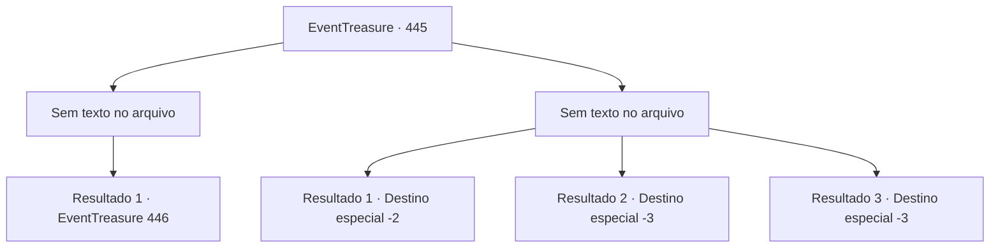

# Eventos de tesouro · 445

[Índice da tabela](index.md) · [Índice geral](../index.md)

ID: `pt:EventTreasure:445` · Fonte: `EventTreasure4` · Versão: 1.2.47.

Mapeamento estático dos arquivos; a disponibilidade e a execução dependem do estado da run.

## Texto do evento

*Sem texto no arquivo.*

## Dados de entrada

```json
{
  "id": 445,
  "grade": 1,
  "place": "",
  "required": ""
}
```

## Mapa das escolhas



## Escolhas e resultados

### Escolha 1

*Sem texto no arquivo; o papel dessa opção depende da interface do jogo.*

Requisitos e outros campos da escolha:

```json
{
  "required": ""
}
```

#### Resultado 1.1

A aranha monstruosa tombou de costas, encolhendo suas oito pernas para dentro ao encontrar seu fim. Você passou por seu cadáver e seguiu adiante.  Depois de cerca de uma hora, você encontrou uma caverna escondida no fundo do pântano. Recordando as palavras do velho exótico, você entrou.  O teto era alto, com estalactites afiadas pendendo de forma precária acima. O corredor se estendia profundamente pela terra, onde nenhuma luz podia alcançar.  Você parou, fitando a escuridão. Não havia como saber que segredos ela ocultava.

Continuação registrada: [Evento 446](0446.md) na mesma tabela.

```json
{
  "required": "",
  "chance": "1",
  "nextEvent": 446,
  "type": 2,
  "reward": ""
}
```

### Escolha 2

*Sem texto no arquivo; o papel dessa opção depende da interface do jogo.*

Requisitos e outros campos da escolha:

```json
{
  "required": ""
}
```

#### Resultado 2.1

O pântano infestado de teias era um lugar hostil para você— mas, para a aranha monstruosa, era um campo de caça perfeito.  Incapaz de superar a desvantagem do terreno, você foi forçado a fugir. Felizmente, a aranha não perseguiu além da margem do pântano.

Continuação registrada: [Destino especial `-2`](../destinos-especiais.md).

```json
{
  "required": "1_0_2|1_1_2",
  "chance": "1",
  "nextEvent": -2,
  "type": 2,
  "reward": "0_0_-1|0_1_-1|5_851_9"
}
```

#### Resultado 2.2

A monstruosa aranha cravou suas presas venenosas em você, roubando-lhe toda a liberdade, e então prendeu você firmemente em suas teias. Quando seu corpo estava completamente impregnado de veneno, ela rasgou o casulo e escancarou as presas mais uma vez.  Sua mente que se esvaía só pôde olhar, vazia— até que o fim o reclamasse.

Continuação registrada: [Destino especial `-3`](../destinos-especiais.md).

```json
{
  "required": "2_0_2",
  "chance": "1",
  "nextEvent": -3,
  "type": 2,
  "reward": "0_0_-1|0_1_-1"
}
```

#### Resultado 2.3

A monstruosa aranha cravou suas presas venenosas em você, roubando-lhe toda a liberdade, e então prendeu você firmemente em suas teias. Quando seu corpo estava completamente impregnado de veneno, ela rasgou o casulo e escancarou as presas mais uma vez.  Sua mente que se esvaía só pôde olhar, vazia— até que o fim o reclamasse.

Continuação registrada: [Destino especial `-3`](../destinos-especiais.md).

```json
{
  "required": "2_1_2",
  "chance": "1",
  "nextEvent": -3,
  "type": 2,
  "reward": "0_0_-1|0_1_-1"
}
```

## Referências que chegam a este evento

- [Evento 444 · escolha 1 · resultado 2](0444.md#escolha-1)
