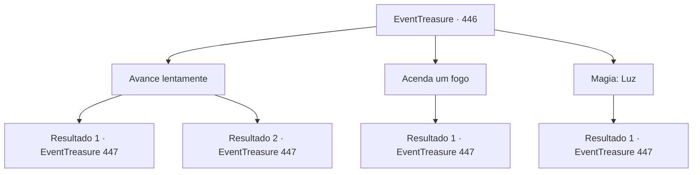

# Eventos de tesouro · 446

[Índice da tabela](index.md) · [Índice geral](../index.md)

ID: `pt:EventTreasure:446` · Fonte: `EventTreasure4` · Versão: 1.2.47.

Mapeamento estático dos arquivos; a disponibilidade e a execução dependem do estado da run.

## Texto do evento

*Sem texto no arquivo.*

## Dados de entrada

```json
{
  "id": 446,
  "grade": 1,
  "place": "",
  "required": ""
}
```

## Mapa das escolhas



## Escolhas e resultados

### Escolha 1

Avance lentamente

Requisitos e outros campos da escolha:

```json
{
  "required": ""
}
```

#### Resultado 1.1

Você seguiu adiante pela caverna sem qualquer luz. A passagem era estreita, embora o chão fosse plano o suficiente para caminhar sem muita dificuldade.  Após uns vinte passos, um leve chiado chegou aos seus ouvidos. Momentos depois, algo negro caiu do teto e envolveu você.  A coisa agarrou-se a você, como se tentasse devorar você por completo — uma Gosma Negra.

Continuação registrada: [Evento 447](0447.md) na mesma tabela.

```json
{
  "required": "21_26_1|21_27_1",
  "chance": "1",
  "nextEvent": 447,
  "type": 2,
  "reward": "6_3_142",
  "place": 1
}
```

#### Resultado 1.2

Você forçou a visão, espiando na escuridão. Seus olhos especiais podiam ver com clareza mesmo onde as sombras da caverna tentavam ocultar. A passagem era estreita, embora o piso fosse regular o suficiente para caminhar sem muita dificuldade.  Após uns vinte passos, um leve chiado chegou aos seus ouvidos. Do teto, uma massa negra caiu à sua frente e começou a serpentear em sua direção.  Você rapidamente se preparou para a batalha quando sua forma ficou nítida. Exalando um fedor de podridão, um Pudim Negro escorria em sua direção.

Continuação registrada: [Evento 447](0447.md) na mesma tabela.

```json
{
  "required": "-1|20_26_1|20_27_1",
  "chance": "1",
  "nextEvent": 447,
  "type": 2,
  "reward": "6_0_142",
  "place": 1
}
```

### Escolha 2

Acenda um fogo

Requisitos e outros campos da escolha:

```json
{
  "required": "23_3_1"
}
```

#### Resultado 2.1

Você acendeu uma chama e avançou cautelosamente pela caverna. A passagem era estreita, embora o chão fosse regular o suficiente para caminhar sem muita dificuldade.  Após uns vinte passos, um leve som de chiado chegou aos seus ouvidos. Do teto, uma massa negra caiu à sua frente e começou a rastejar para mais perto.  Você rapidamente se preparou para a batalha à medida que sua forma se tornava nítida. Exalando cheiro de podridão, um Pudim Negro escorria em sua direção.

Continuação registrada: [Evento 447](0447.md) na mesma tabela.

```json
{
  "required": "",
  "chance": "1",
  "nextEvent": 447,
  "type": 2,
  "reward": "6_0_142",
  "place": 1
}
```

### Escolha 3

Magia: Luz

Requisitos e outros campos da escolha:

```json
{
  "required": "20_0_1"
}
```

#### Resultado 3.1

Você conjurou Luz e avançou com cautela para dentro da caverna. A passagem era estreita, embora o piso fosse plano o bastante para caminhar sem muita dificuldade.  Após uns vinte passos, um leve chiado chegou aos seus ouvidos. Do teto, uma massa negra caiu à sua frente e começou a se arrastar para mais perto.  Você rapidamente se preparou para a batalha à medida que sua forma se tornava clara. Exalando fedor de podridão, uma Gosma Negra escorria em sua direção.

Continuação registrada: [Evento 447](0447.md) na mesma tabela.

```json
{
  "required": "",
  "chance": "1",
  "nextEvent": 447,
  "type": 2,
  "reward": "6_0_142",
  "place": 1
}
```

## Referências que chegam a este evento

- [Evento 444 · escolha 1 · resultado 1](0444.md#escolha-1)
- [Evento 444 · escolha 1 · resultado 3](0444.md#escolha-1)
- [Evento 444 · escolha 2 · resultado 1](0444.md#escolha-2)
- [Evento 444 · escolha 3 · resultado 1](0444.md#escolha-3)
- [Evento 445 · escolha 1 · resultado 1](0445.md#escolha-1)
