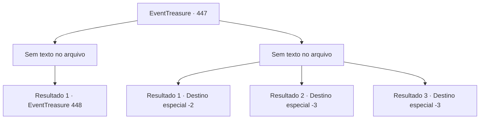

# Eventos de tesouro · 447

[Índice da tabela](index.md) · [Índice geral](../index.md)

ID: `pt:EventTreasure:447` · Fonte: `EventTreasure4` · Versão: 1.2.47.

Mapeamento estático dos arquivos; a disponibilidade e a execução dependem do estado da run.

## Texto do evento

*Sem texto no arquivo.*

## Dados de entrada

```json
{
  "id": 447,
  "grade": 1,
  "place": "",
  "required": ""
}
```

## Mapa das escolhas



## Escolhas e resultados

### Escolha 1

*Sem texto no arquivo; o papel dessa opção depende da interface do jogo.*

Requisitos e outros campos da escolha:

```json
{
  "required": ""
}
```

#### Resultado 1.1

O Pudim Negro, com seu núcleo destruído, já não conseguia manter a forma e desabou em uma lama informe. Você passou pelos restos e seguiu em frente.  No fundo da caverna profunda, uma única flor desabrochava. Você parou, fitando a solitária flor.  Um tênue luar, filtrando-se por alguma fenda invisível, brilhava sobre as pétalas acinzentadas. Aproximando-se, você confirmou que se tratava de fato da Musanghwa.  Segundo as palavras do velho, você teria de tingir a flor de carmesim— e então consumi-la inteira, raiz e tudo.

Continuação registrada: [Evento 448](0448.md) na mesma tabela.

```json
{
  "required": "",
  "chance": "1",
  "nextEvent": 448,
  "type": 2,
  "reward": ""
}
```

### Escolha 2

*Sem texto no arquivo; o papel dessa opção depende da interface do jogo.*

Requisitos e outros campos da escolha:

```json
{
  "required": ""
}
```

#### Resultado 2.1

Seus ataques mostraram-se ineficazes contra a Gosma Negra. Por mais que você golpeasse, apenas sua pele e suas roupas se consumiam, enquanto a criatura permanecia ilesa.  Por fim, incapaz de encontrar uma forma de derrotá-la, você fugiu da caverna.

Continuação registrada: [Destino especial `-2`](../destinos-especiais.md).

```json
{
  "required": "1_0_2|1_1_2",
  "chance": "1",
  "nextEvent": -2,
  "type": 2,
  "reward": "0_0_-1|0_1_-1|5_851_9"
}
```

#### Resultado 2.2

O Pudim Negro deslizou para a frente e o engoliu por inteiro. Dentro de sua massa viscosa, sua pele começou a derreter. A agonia foi consumindo sua consciência— até que a escuridão o tomou.

Continuação registrada: [Destino especial `-3`](../destinos-especiais.md).

```json
{
  "required": "2_0_2",
  "chance": "1",
  "nextEvent": -3,
  "type": 2,
  "reward": "0_0_-1|0_1_-1"
}
```

#### Resultado 2.3

O Pudim Negro deslizou para a frente e o engoliu por inteiro. Dentro de sua massa viscosa, sua pele começou a derreter. A agonia foi consumindo sua consciência— até que a escuridão o tomou.

Continuação registrada: [Destino especial `-3`](../destinos-especiais.md).

```json
{
  "required": "2_1_2",
  "chance": "1",
  "nextEvent": -3,
  "type": 2,
  "reward": "0_0_-1|0_1_-1"
}
```

## Referências que chegam a este evento

- [Evento 446 · escolha 1 · resultado 1](0446.md#escolha-1)
- [Evento 446 · escolha 1 · resultado 2](0446.md#escolha-1)
- [Evento 446 · escolha 2 · resultado 1](0446.md#escolha-2)
- [Evento 446 · escolha 3 · resultado 1](0446.md#escolha-3)
