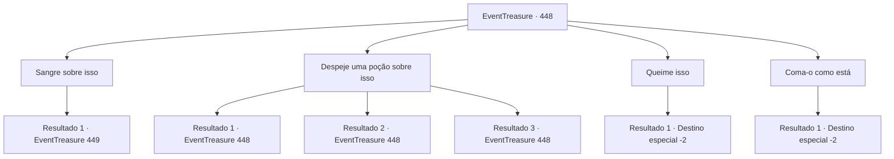

# Eventos de tesouro · 448

[Índice da tabela](index.md) · [Índice geral](../index.md)

ID: `pt:EventTreasure:448` · Fonte: `EventTreasure4` · Versão: 1.2.47.

Mapeamento estático dos arquivos; a disponibilidade e a execução dependem do estado da run.

## Texto do evento

*Sem texto no arquivo.*

## Dados de entrada

```json
{
  "id": 448,
  "grade": 1,
  "place": "",
  "required": ""
}
```

## Mapa das escolhas



## Escolhas e resultados

### Escolha 1

Sangre sobre isso

Requisitos e outros campos da escolha:

```json
{
  "required": "1_0_2"
}
```

#### Resultado 1.1

Você cortou o antebraço e deixou seu sangue pingar sobre o Musanghwa. As pétalas o absorveram lentamente, tornando-se carmesim gota a gota.  Por mais de cinco minutos, a flor bebeu de você. Por fim, quando ficou completamente vermelha, ela se voltou para você como um girassol acompanhando o sol.  Da flor encharcada de sangue exalava um fedor como o de cadáveres há muito apodrecidos. Você fitou o Musanghwa carmesim e então estendeu lentamente a mão.

Continuação registrada: [Evento 449](0449.md) na mesma tabela.

```json
{
  "required": "",
  "chance": "1",
  "nextEvent": 449,
  "type": 2,
  "reward": "0_0_-1"
}
```

### Escolha 2

Despeje uma poção sobre isso

Requisitos e outros campos da escolha:

```json
{
  "required": "5_851_0"
}
```

#### Resultado 2.1

Você despejou uma poção de cura sobre a Musanghwa. Mas as gotas vermelhas apenas se prenderam às pétalas— a flor permaneceu acinzentada.

Continuação registrada: [Evento 448](0448.md) na mesma tabela.

```json
{
  "required": "8_36_1",
  "chance": "1",
  "nextEvent": 448,
  "type": 2,
  "reward": "4_36_1|5_851_1"
}
```

#### Resultado 2.2

Você derramou uma pequena poção de cura sobre a Musanghwa. Mas as gotas vermelhas apenas se agarraram às pétalas— a flor permaneceu acinzentada.

Continuação registrada: [Evento 448](0448.md) na mesma tabela.

```json
{
  "required": "8_190_1",
  "chance": "1",
  "nextEvent": 448,
  "type": 2,
  "reward": "4_190_1|5_851_1"
}
```

#### Resultado 2.3

Você tentou derramar uma poção sobre a Musanghwa, mas não lhe restava nenhuma.  Depois de remexer em sua mochila em vão, você voltou o olhar para a flor. Ela permanecia de um cinza pálido.

Continuação registrada: [Evento 448](0448.md) na mesma tabela.

```json
{
  "required": "10_36_1|10_190_1",
  "chance": "2",
  "nextEvent": 448,
  "type": 2,
  "reward": "5_851_1"
}
```

### Escolha 3

Queime isso

Requisitos e outros campos da escolha:

```json
{
  "required": "23_3_1"
}
```

#### Resultado 3.1

Você acendeu um fogo e queimou a Musanghwa. As chamas tingiram as pétalas de carmesim— mas, em instantes, não passava de cinzas enegrecidas.  Nada restou. Você fitou o lugar onde antes havia florescido e então se virou.

Continuação registrada: [Destino especial `-2`](../destinos-especiais.md).

```json
{
  "required": "",
  "chance": "1",
  "nextEvent": -2,
  "type": 2,
  "reward": "5_851_9"
}
```

### Escolha 4

Coma-o como está

Requisitos e outros campos da escolha:

```json
{
  "required": ""
}
```

#### Resultado 4.1

Você consumiu a Musanghwa sem a tingir de vermelho. Seu sabor era amargo na sua língua, mas nenhuma mudança ocorreu em seu corpo.  Mesmo com o passar do tempo, mesmo ao se mover, nada aconteceu.  Você fitou o lugar onde a flor havia desabrochado, então se virou.

Continuação registrada: [Destino especial `-2`](../destinos-especiais.md).

```json
{
  "required": "",
  "chance": "1",
  "nextEvent": -2,
  "type": 2,
  "reward": "5_851_9"
}
```

## Referências que chegam a este evento

- [Evento 447 · escolha 1 · resultado 1](0447.md#escolha-1)
- [Evento 448 · escolha 2 · resultado 1](0448.md#escolha-2)
- [Evento 448 · escolha 2 · resultado 2](0448.md#escolha-2)
- [Evento 448 · escolha 2 · resultado 3](0448.md#escolha-2)
