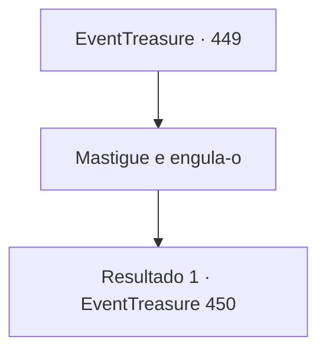

# Eventos de tesouro · 449

[Índice da tabela](index.md) · [Índice geral](../index.md)

ID: `pt:EventTreasure:449` · Fonte: `EventTreasure4` · Versão: 1.2.47.

Mapeamento estático dos arquivos; a disponibilidade e a execução dependem do estado da run.

## Texto do evento

*Sem texto no arquivo.*

## Dados de entrada

```json
{
  "id": 449,
  "grade": 1,
  "place": "",
  "required": ""
}
```

## Mapa das escolhas



## Escolhas e resultados

### Escolha 1

Mastigue e engula-o

Requisitos e outros campos da escolha:

```json
{
  "required": ""
}
```

#### Resultado 1.1

Você arrancou cuidadosamente a Musanghwa e a engoliu inteira. Um gosto amargo se espalhou pela sua língua, e um veneno poderoso percorreu lentamente o seu corpo.  Você o suportou em silêncio. Suor negro escorria pela sua pele, mas o veneno da flor não te matou. Ele se contorceu dentro do seu estômago como uma serpente viva.

Continuação registrada: [Evento 450](0450.md) na mesma tabela.

```json
{
  "required": "",
  "chance": "1",
  "nextEvent": 450,
  "type": 2,
  "reward": ""
}
```

## Referências que chegam a este evento

- [Evento 448 · escolha 1 · resultado 1](0448.md#escolha-1)
