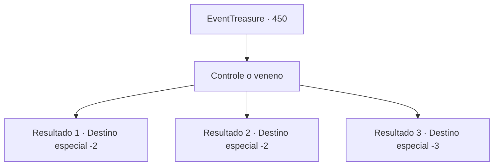

# Eventos de tesouro · 450

[Índice da tabela](index.md) · [Índice geral](../index.md)

ID: `pt:EventTreasure:450` · Fonte: `EventTreasure4` · Versão: 1.2.47.

Mapeamento estático dos arquivos; a disponibilidade e a execução dependem do estado da run.

## Texto do evento

*Sem texto no arquivo.*

## Dados de entrada

```json
{
  "id": 450,
  "grade": 1,
  "place": "",
  "required": ""
}
```

## Mapa das escolhas



## Escolhas e resultados

### Escolha 1

Controle o veneno

Requisitos e outros campos da escolha:

```json
{
  "required": ""
}
```

#### Resultado 1.1

Você se sentou e buscou dominar o veneno de Musanghwa. Mas ele irrompeu por suas veias, debatendo-se contra sua vontade.  Você tentou novamente assumir o controle dele. Ainda assim, ele vagava fundo dentro do seu corpo, recusando-se a obedecer.  Horas se passaram e, por fim, o veneno começou a aquietar-se. Quando você tentou alcançá-lo mais uma vez, ele enfureceu-se como fogo, irrompendo descontrolado novamente.  Você firmou a respiração e fez uma última tentativa de subjugá-lo. O veneno percorreu suas veias, sacudindo seu corpo por horas antes de finalmente se enroscar no lugar dentro do seu ventre.  Você vomitou um jorro de sangue negro e então se levantou lentamente. O potente veneno de Musanghwa não podia mais lhe fazer mal. Mais forte do que antes, você deixou a caverna em silêncio.

Continuação registrada: [Destino especial `-2`](../destinos-especiais.md).

```json
{
  "required": "",
  "chance": "1|0_13_1",
  "nextEvent": -2,
  "type": 0,
  "reward": "27_55_1|5_851_9"
}
```

#### Resultado 1.2

Você se sentou e tentou dominar o veneno de Musanghwa. Mas ele irrompeu pelas suas veias, debatendo-se contra a sua vontade.  Você tentou novamente assumir o controle dele. Ainda assim, ele vagava nas profundezas do seu corpo, recusando-se a obedecer.  Horas se passaram e, por fim, o veneno começou a se aquietar. Quando você tentou alcançá-lo mais uma vez, ele enfureceu-se como fogo, voltando a irromper descontroladamente.  No fim, você não conseguiu suportá-lo. Você vomitou o veneno. Apesar de horas de esforço, você não conseguiu reivindicar o poder de Musanghwa.  Limpando o sangue negro dos lábios, você deixou a caverna em silêncio.

Continuação registrada: [Destino especial `-2`](../destinos-especiais.md).

```json
{
  "required": "1_0_2",
  "chance": "16",
  "nextEvent": -2,
  "type": 1,
  "reward": "0_0_-1|5_851_9"
}
```

#### Resultado 1.3

Você se sentou e buscou dominar o veneno de Musanghwa. Mas ele irrompeu por suas veias, debatendo-se contra sua vontade. 

 Você tentou novamente assumir o controle dele. Ainda assim, ele vagava nas profundezas do seu corpo, recusando-se a obedecer. 

 Horas se passaram, e o veneno ficou ainda mais violento. Espalhou-se como um incêndio fora de controle, consumindo todo o seu corpo.  Por fim, você já não conseguia resistir a ele— e o veneno ceifou sua vida.

Continuação registrada: [Destino especial `-3`](../destinos-especiais.md).

```json
{
  "required": "2_0_2",
  "chance": "16",
  "nextEvent": -3,
  "type": 1,
  "reward": "0_0_-1|5_851_9"
}
```

## Referências que chegam a este evento

- [Evento 449 · escolha 1 · resultado 1](0449.md#escolha-1)
