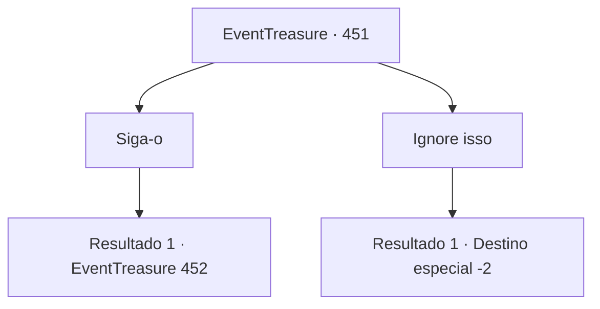

# Eventos de tesouro · 451

[Índice da tabela](index.md) · [Índice geral](../index.md)

ID: `pt:EventTreasure:451` · Fonte: `EventTreasure4` · Versão: 1.2.47.

Mapeamento estático dos arquivos; a disponibilidade e a execução dependem do estado da run.

## Texto do evento

|drawing_pegasus| Nas silenciosas profundezas da floresta, você se deparou com uma criatura maravilhosa que irradiava uma presença de outro mundo.  Sua pelagem era branca e macia como seda, seus olhos claros como um lago límpido, e suas grandes asas cintilavam à luz do sol com uma elegância sem igual. Era um Pégaso.  Surpreendentemente, parecia que o Pégaso estivera à sua espera. Fitou você em silêncio e soltou um relincho suave e delicado.  Então, dando alguns passos lentos à frente, parou e virou a cabeça de volta para você. Naquele movimento gracioso e em seus olhos sábios, estava escrita uma mensagem clara—  “Siga-me.”

## Dados de entrada

```json
{
  "id": 451,
  "grade": 2,
  "place": "",
  "required": "1_2_50|5_853_0|26_62_1"
}
```

## Mapa das escolhas



## Escolhas e resultados

### Escolha 1

Siga-o

Requisitos e outros campos da escolha:

```json
{
  "required": ""
}
```

#### Resultado 1.1

A graciosa criatura guiou-te como um guia silencioso. Onde o Pégaso finalmente parou, sob uma árvore, jazia uma jovem de cabelos castanho-claros e orelhas pontudas.  O rosto dela estava pálido, o corpo imóvel, e apenas a respiração rasa provava que ainda se agarrava à vida. O Pégaso relinchou baixinho, preocupado, depois empurrou de leve a mochila dela com o focinho antes de te fitar com um olhar significativo.  Naquele olhar sábio havia um apelo desesperado. Nesse momento, um pequeno frasco de vidro rolou para fora da mochila e caiu no chão — uma poção cheia de líquido vermelho cintilante.

Continuação registrada: [Evento 452](0452.md) na mesma tabela.

```json
{
  "required": "",
  "chance": "1",
  "nextEvent": 452,
  "type": 2,
  "reward": ""
}
```

### Escolha 2

Ignore isso

Requisitos e outros campos da escolha:

```json
{
  "required": ""
}
```

#### Resultado 2.1

Você ignorou o Pégaso e foi embora. Ele olhou para você em silêncio por um momento, então desapareceu na floresta.

Continuação registrada: [Destino especial `-2`](../destinos-especiais.md).

```json
{
  "required": "",
  "chance": "1",
  "nextEvent": -2,
  "type": 2,
  "reward": "5_853_9"
}
```

## Referências que chegam a este evento

Nenhum `nextEvent` positivo da mesma tabela aponta para este nó. Isso não prova que seja inacessível: sorteio e estado de história podem selecioná-lo.

