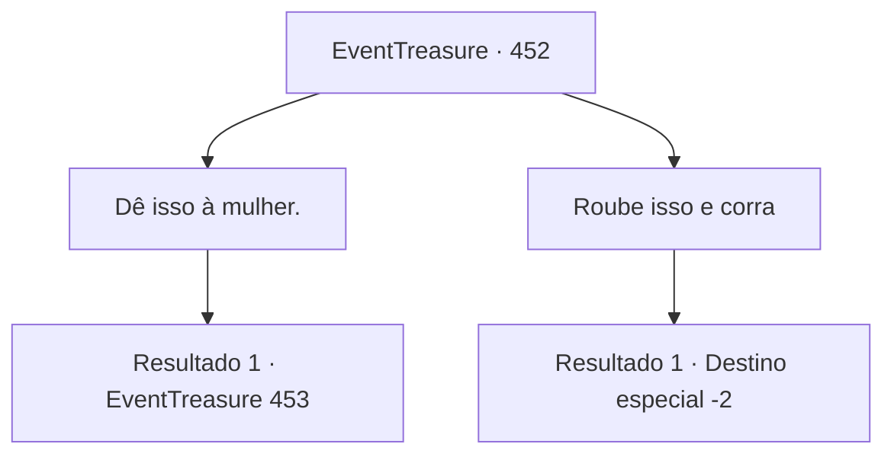

# Eventos de tesouro · 452

[Índice da tabela](index.md) · [Índice geral](../index.md)

ID: `pt:EventTreasure:452` · Fonte: `EventTreasure4` · Versão: 1.2.47.

Mapeamento estático dos arquivos; a disponibilidade e a execução dependem do estado da run.

## Texto do evento

*Sem texto no arquivo.*

## Dados de entrada

```json
{
  "id": 452,
  "grade": 1,
  "place": "",
  "required": ""
}
```

## Mapa das escolhas



## Escolhas e resultados

### Escolha 1

Dê isso à mulher.

Requisitos e outros campos da escolha:

```json
{
  "required": ""
}
```

#### Resultado 1.1

Você cuidadosamente ergueu a meio-elfa e pressionou a poção aos lábios dela. O líquido vermelho tocou sua boca pálida e, com um leve gemido, ela despertou lentamente.  

 "…Wendy?"

 murmurou fracamente.  O pégaso, encantado, deu um passo à frente e lambeu de leve sua bochecha. A mulher soltou uma risada aliviada, afagando o pescoço da criatura antes de se voltar para você.  

 "Ah… Sou Aira. E esta garota é Wendy. Você me salvou, não foi? Obrigada, de verdade."

  Você se apresentou em resposta e se aproximou de Aira.

Continuação registrada: [Evento 453](0453.md) na mesma tabela.

```json
{
  "required": "",
  "chance": "1",
  "nextEvent": 453,
  "type": 2,
  "reward": ""
}
```

### Escolha 2

Roube isso e corra

Requisitos e outros campos da escolha:

```json
{
  "required": ""
}
```

#### Resultado 2.1

Você agarrou a poção e saiu correndo. O Pégaso empinou-se, alarmado, mas, preocupado com a mulher meio-elfa, não perseguiu.

Continuação registrada: [Destino especial `-2`](../destinos-especiais.md).

```json
{
  "required": "",
  "chance": "1",
  "nextEvent": -2,
  "type": 2,
  "reward": "0_3_-2|3_36_1|5_853_9"
}
```

## Referências que chegam a este evento

- [Evento 451 · escolha 1 · resultado 1](0451.md#escolha-1)
