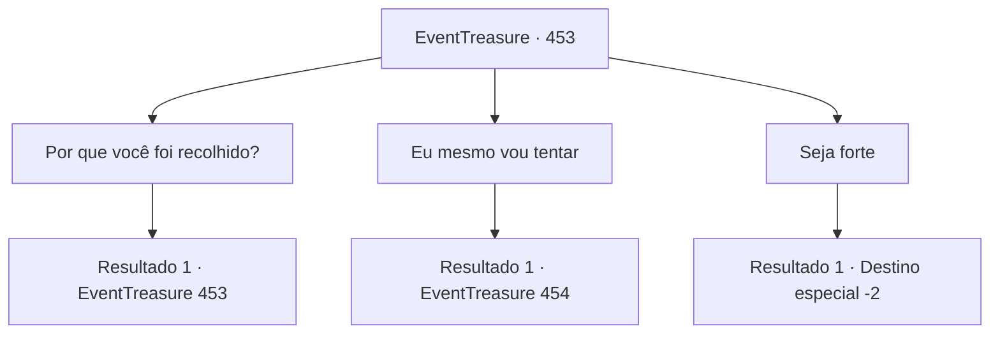

# Eventos de tesouro · 453

[Índice da tabela](index.md) · [Índice geral](../index.md)

ID: `pt:EventTreasure:453` · Fonte: `EventTreasure4` · Versão: 1.2.47.

Mapeamento estático dos arquivos; a disponibilidade e a execução dependem do estado da run.

## Texto do evento

*Sem texto no arquivo.*

## Dados de entrada

```json
{
  "id": 453,
  "grade": 1,
  "place": "",
  "required": ""
}
```

## Mapa das escolhas



## Escolhas e resultados

### Escolha 1

Por que você foi recolhido?

Requisitos e outros campos da escolha:

```json
{
  "required": "5_854_0"
}
```

#### Resultado 1.1

À sua pergunta, Aira soltou um suspiro. 

 "A verdade é que eu administro um santuário para criaturas mágicas. Não apenas Pégasos como a Wendy, mas unicórnios, grifos—até ursos-coruja. Muitos seres maravilhosos vivem sob meus cuidados."

  Ela afagou a crina do Pégaso enquanto continuava. 

 "Mas manter o santuário custa uma quantia enorme. Às vezes recebo pedidos de torres de magos, academias ou nobres—mas está longe de ser suficiente. Então ouvi falar da Corrida Aérea de Bernel."

  Quando você perguntou sobre a corrida, Aira explicou melhor. 

 "É uma grande competição realizada nos céus, com cavaleiros de Pégasos ou Grifos competindo em demonstrações de velocidade e habilidade enquanto voam por entre as nuvens. É realmente um evento de tirar o fôlego."

  Aira olhou para Wendy com um sorriso melancólico. 

 "Se eu vencer, vou receber um prêmio em dinheiro… e talvez, com sorte, um patrocinador para nos apoiar. É por isso que Wendy e eu estávamos treinando. Mas… eu cometi um erro, e caímos. Não é fácil."


Continuação registrada: [Evento 453](0453.md) na mesma tabela.

```json
{
  "required": "",
  "chance": "1",
  "nextEvent": 453,
  "type": 2,
  "reward": "5_854_1"
}
```

### Escolha 2

Eu mesmo vou tentar

Requisitos e outros campos da escolha:

```json
{
  "required": "5_854_1"
}
```

#### Resultado 2.1

Aira arregalou os olhos e olhou para você, surpresa. Depois de um breve silêncio, ela falou em um tom preocupado. 

 "Agradeço o gesto… mas mesmo para você, {1}, não será fácil. Montar um Pégaso não é nada como montar um cavalo comum."

  Nesse momento, Wendy, a Pégaso, deu um passo à frente, fixando você com um olhar firme. Em seus olhos havia a intenção de medir sua sinceridade e força.  Aira afagou suavemente a branca crina de sua preciosa parceira enquanto continuava. 

 "O que mais importa é conquistar a confiança da Wendy. Ela é muito teimosa — não deixa qualquer um montá-la."

  Alternando o olhar entre você e Wendy, Aira perguntou cautelosamente, 

 "Mas se você realmente quiser tentar… você tentaria montá-la? Precisamos ver se ela aceita você."


Continuação registrada: [Evento 454](0454.md) na mesma tabela.

```json
{
  "required": "",
  "chance": "1",
  "nextEvent": 454,
  "type": 2,
  "reward": "5_854_1"
}
```

### Escolha 3

Seja forte

Requisitos e outros campos da escolha:

```json
{
  "required": "5_854_1"
}
```

#### Resultado 3.1


 "Ah, por favor, aceite isto. É um gesto de agradecimento."

 Aira lhe entregou uma poção de cura enquanto você se preparava para partir. Você desejou boa sorte a Aira e Wendy e então partiu mais uma vez em sua jornada.

Continuação registrada: [Destino especial `-2`](../destinos-especiais.md).

```json
{
  "required": "",
  "chance": "1",
  "nextEvent": -2,
  "type": 2,
  "reward": "3_36_1|5_853_9"
}
```

## Referências que chegam a este evento

- [Evento 452 · escolha 1 · resultado 1](0452.md#escolha-1)
- [Evento 453 · escolha 1 · resultado 1](0453.md#escolha-1)
