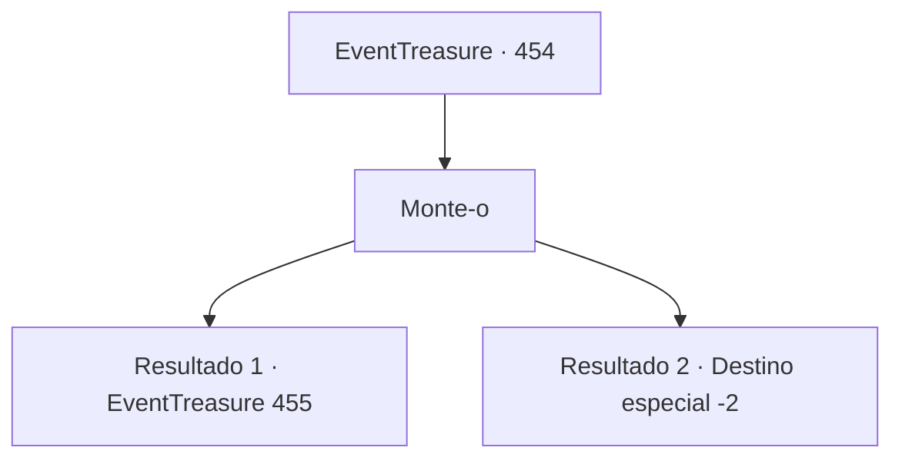

# Eventos de tesouro · 454

[Índice da tabela](index.md) · [Índice geral](../index.md)

ID: `pt:EventTreasure:454` · Fonte: `EventTreasure4` · Versão: 1.2.47.

Mapeamento estático dos arquivos; a disponibilidade e a execução dependem do estado da run.

## Texto do evento

*Sem texto no arquivo.*

## Dados de entrada

```json
{
  "id": 454,
  "grade": 1,
  "place": "",
  "required": ""
}
```

## Mapa das escolhas



## Escolhas e resultados

### Escolha 1

Monte-o

Requisitos e outros campos da escolha:

```json
{
  "required": ""
}
```

#### Resultado 1.1

Você saltou para as costas de Wendy sem hesitar. No momento em que o pelo quente e sedoso dela roçou suas pernas, a égua alada bateu suas grandes asas com força, como se reconhecesse você. Num instante, você e Wendy sobrevoaram a densa floresta, e o céu azul sem limites encheu sua visão. Abaixo estendia-se um tapete verde de terra, enquanto nuvens flutuavam tão perto que pareciam ao alcance da mão. Como Aira dissera, voar numa égua alada não era nada parecido com montar um cavalo comum. De repente, Wendy subiu alto aos céus e, em seguida, mergulhou em quedas eletrizantes; ela descreveu espirais elegantes entre as nuvens e até realizou audazes acrobacias aéreas junto a penhascos íngremes, desviando no último instante. Você acompanhou cada movimento com facilidade, como se voassem juntos há anos. Em perfeita harmonia, você e Wendy dançaram pelo céu. Por fim, Wendy desceu em um pouso suave. Aira, que havia observado o voo, aproximou-se com uma expressão de assombro. 

 "Como eu pensei… Sou muito mais indicada para cuidar dela do que para ser sua cavaleira. Afinal, há um cavaleiro muito mais capaz bem aqui. Você levaria Wendy ao torneio em meu lugar?"

 Você assentiu e, até a véspera da corrida, treinou lado a lado com Wendy.

Continuação registrada: [Evento 455](0455.md) na mesma tabela.

```json
{
  "required": "",
  "chance": "1|0_12_1",
  "nextEvent": 455,
  "type": 0,
  "reward": ""
}
```

#### Resultado 1.2

Você saltou para as costas de Wendy sem hesitar. No momento em que o pelo quente e sedoso dela roçou suas pernas, o pégaso bateu suas grandes asas com força, como se reconhecesse você. Num instante, você e Wendy voaram sobre a densa floresta, e o céu azul sem limites encheu sua visão. Abaixo estendia-se um tapete verde de terra, enquanto nuvens flutuavam tão perto que pareciam ao alcance da mão. Mas o voo selvagem de Wendy logo se mostrou demais para você. Subidas súbitas, mergulhos vertiginosos e curvas imprevisíveis começaram a abalar seu equilíbrio. Por fim, você escorregou de suas costas e despencou no matagal abaixo. Felizmente, a queda não foi de grande altura, poupando você de um ferimento mortal. Aira correu até você com um olhar preocupado, ajudando você a se levantar. 

 "Sinto muito. A Wendy pode ser brusca... Aqui, pegue isto — é o mínimo que posso oferecer pela sua ajuda antes."

 Ela lhe entregou uma poção, e você partiu mais uma vez em sua jornada.

Continuação registrada: [Destino especial `-2`](../destinos-especiais.md).

```json
{
  "required": "",
  "chance": "16",
  "nextEvent": -2,
  "type": 1,
  "reward": "5_853_9"
}
```

## Referências que chegam a este evento

- [Evento 453 · escolha 2 · resultado 1](0453.md#escolha-2)
