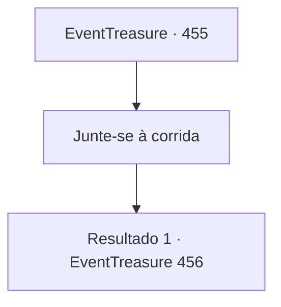

# Eventos de tesouro · 455

[Índice da tabela](index.md) · [Índice geral](../index.md)

ID: `pt:EventTreasure:455` · Fonte: `EventTreasure4` · Versão: 1.2.47.

Mapeamento estático dos arquivos; a disponibilidade e a execução dependem do estado da run.

## Texto do evento

*Sem texto no arquivo.*

## Dados de entrada

```json
{
  "id": 455,
  "grade": 2,
  "place": "",
  "required": ""
}
```

## Mapa das escolhas



## Escolhas e resultados

### Escolha 1

Junte-se à corrida

Requisitos e outros campos da escolha:

```json
{
  "required": ""
}
```

#### Resultado 1.1

Por fim, o dia do torneio chegou. O local era uma vasta terra aberta conhecida como Planícies da Nuvem Branca, onde grandes nuvens errantes flutuavam preguiçosamente sobre as pradarias sem fim — um palco perfeito para uma corrida aérea. Você e Aira chegaram com Wendy para testemunhar a grande cena. A arena já estava lotada de espectadores vibrando, e a empolgação deles preenchia o ar. Por toda parte, cavaleiros e suas feras aladas se preparavam: grifos guinchavam, pégasos batiam suas elegantes asas, vívernas rosnavam baixo, e os cavaleiros murmuravam palavras tensas a seus parceiros. 

 "Vou estar nas arquibancadas. Por favor… dê o seu melhor!"

 disse Aira. Você guiou Wendy até a linha de largada, onde os olhares afiados dos outros competidores recaíram sobre você. Havia em seus olhos curiosidade e cautela, como se avaliassem um rival novo e perigoso. Imperturbável, você revisou calmamente as regras. O formato era simples: completar a rota designada, retornar à arena, e a primeira dupla a chegar seria a vencedora. 

 "Em breve, começará a Corrida Aérea de Bernu! Cavaleiros, preparem-se!"

 A voz retumbante do anunciador ribombou pela arena, recebida por um rugido de aplausos que sacudiu os céus. Você montou nas costas quentes de Wendy, firmou o aperto nas rédeas e aguardou o sinal de partida. Wendy também parecia cheia de tensão e entusiasmo, com as asas se contraindo inquietas.

Continuação registrada: [Evento 456](0456.md) na mesma tabela.

```json
{
  "required": "",
  "chance": "1",
  "nextEvent": 456,
  "type": 2,
  "reward": ""
}
```

## Referências que chegam a este evento

- [Evento 454 · escolha 1 · resultado 1](0454.md#escolha-1)
