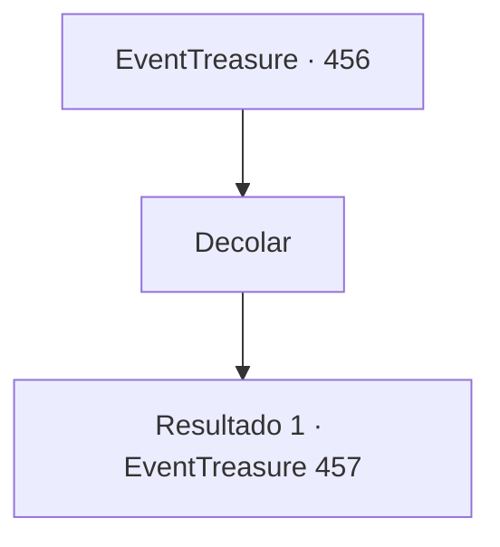

# Eventos de tesouro · 456

[Índice da tabela](index.md) · [Índice geral](../index.md)

ID: `pt:EventTreasure:456` · Fonte: `EventTreasure4` · Versão: 1.2.47.

Mapeamento estático dos arquivos; a disponibilidade e a execução dependem do estado da run.

## Texto do evento

*Sem texto no arquivo.*

## Dados de entrada

```json
{
  "id": 456,
  "grade": 1,
  "place": "",
  "required": ""
}
```

## Mapa das escolhas



## Escolhas e resultados

### Escolha 1

Decolar

Requisitos e outros campos da escolha:

```json
{
  "required": ""
}
```

#### Resultado 1.1

Um momento depois, uma explosão estrondosa sinalizou o início.  BUM! BUM! BUM!  Você cravou os calcanhares no flanco de Wendy e puxou as rédeas com força. Ela respondeu na hora, suas asas enormes impulsionando enquanto você disparava para o céu. Inclinando-se para a frente, você examinou os outros competidores. Alguns colidiram e despencaram cedo, mas a maioria estabilizou o voo. Logo, o percurso se dividiu em dois. À direita havia uma rota pelo desfiladeiro — mais curta e rápida, mas mortal, com penhascos irregulares como as presas de uma fera. Um único erro poderia ser fatal. À esquerda estendia-se uma rota pela floresta — mais segura, mas muito mais longa, serpenteando acima das copas densas. Um caminho prometia velocidade a um risco imenso; o outro, segurança ao custo de um tempo precioso.

Continuação registrada: [Evento 457](0457.md) na mesma tabela.

```json
{
  "required": "",
  "chance": "1",
  "nextEvent": 457,
  "type": 2,
  "reward": ""
}
```

## Referências que chegam a este evento

- [Evento 455 · escolha 1 · resultado 1](0455.md#escolha-1)
