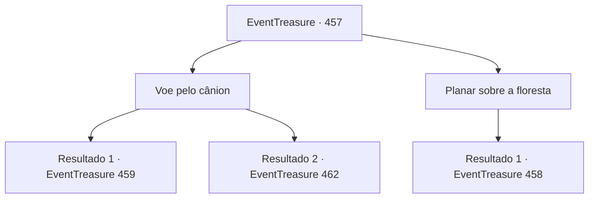

# Eventos de tesouro · 457

[Índice da tabela](index.md) · [Índice geral](../index.md)

ID: `pt:EventTreasure:457` · Fonte: `EventTreasure4` · Versão: 1.2.47.

Mapeamento estático dos arquivos; a disponibilidade e a execução dependem do estado da run.

## Texto do evento

*Sem texto no arquivo.*

## Dados de entrada

```json
{
  "id": 457,
  "grade": 1,
  "place": "",
  "required": ""
}
```

## Mapa das escolhas



## Escolhas e resultados

### Escolha 1

Voe pelo cânion

Requisitos e outros campos da escolha:

```json
{
  "required": ""
}
```

#### Resultado 1.1

Você conduziu Wendy com ousadia para dentro do cânion. O pégaso entendeu de imediato, batendo as asas com força enquanto você entrava na estreita garganta. Lá dentro, reinava o caos. 

 "Mexa-se! Saia da frente!"

 "Argh, o penhasco!"

 Os gritos desesperados de outros cavaleiros ecoaram enquanto o cânion se transformava numa prova mortal. As correntes poderosas ofereciam velocidade estonteante, mas os ventos imprevisíveis e as rochas irregulares a transformavam num percurso letal. Ainda assim, você e Wendy voavam como acrobatas, serpenteando entre penhascos e ajustando-se sem esforço às rajadas repentinas. Juntos, vocês traçaram um caminho impecável pela garganta. Quando as rotas voltaram a convergir, restavam apenas uns dez competidores. Nesse momento, uma gota fria atingiu sua bochecha. Ao erguer o olhar, você viu nuvens escuras de tempestade se formando, e uma chuva pesada começou a cair.

Continuação registrada: [Evento 459](0459.md) na mesma tabela.

```json
{
  "required": "",
  "chance": "1|0_12_1|0_14_1",
  "nextEvent": 459,
  "type": 0,
  "reward": ""
}
```

#### Resultado 1.2

Você conduziu Wendy corajosamente para o desfiladeiro. A pégaso entendeu de imediato, batendo as asas com força enquanto você entrava na garganta estreita. Lá dentro, reinava o caos. 

 "Mexa-se! Sai da frente!"

 "Argh, o penhasco!"

 Os gritos desesperados de outros cavaleiros ecoavam enquanto o desfiladeiro se transformava numa provação mortal. As correntes poderosas ofereciam uma velocidade estonteante, mas os ventos imprevisíveis e as rochas irregulares transformavam aquilo num percurso letal. 

 Hiiiiii! 

 Wendy gritou de dor. Um erro de fração de segundo havia lançado sua reluzente asa branca contra um penhasco irregular. Você perdeu o controle enquanto ela despencava em espiral, com as asas rasgadas, o equilíbrio perdido. O vento uivava ao passar por seus ouvidos enquanto o céu se afastava acima de você. Então, a escuridão tomou seus sentidos.

Continuação registrada: [Evento 462](0462.md) na mesma tabela.

```json
{
  "required": "",
  "chance": "16",
  "nextEvent": 462,
  "type": 1,
  "reward": ""
}
```

### Escolha 2

Planar sobre a floresta

Requisitos e outros campos da escolha:

```json
{
  "required": ""
}
```

#### Resultado 2.1

Você cautelosamente conduziu Wendy para a trilha da floresta. Ela imediatamente se ajustou, batendo as asas de forma constante enquanto você sobrevoava as copas das árvores. Mas os céus sobre a floresta estavam longe de seguros. 

 "Saia da frente!"

 "Mais rápido! Mais rápido!"

 Gritos de cavaleiros rivais ecoavam ao seu redor. Embora mais seguro do que o cânion, o caminho pela floresta exigia um tempo de voo muito maior. Alguns cavaleiros, desesperados para vencer, tornaram-se cruéis. Empurravam, bloqueavam e até golpeavam rivais em pleno ar sem hesitar. 

 "Cai, seu moleque!"

 De repente, um wyvern negro montado por um competidor brutal avançou para perto, mirando deliberadamente em você e Wendy. Suas garras reluziam, não para atrapalhar, mas para arrancar vocês do céu.

Continuação registrada: [Evento 458](0458.md) na mesma tabela.

```json
{
  "required": "",
  "chance": "1",
  "nextEvent": 458,
  "type": 2,
  "reward": ""
}
```

## Referências que chegam a este evento

- [Evento 456 · escolha 1 · resultado 1](0456.md#escolha-1)
