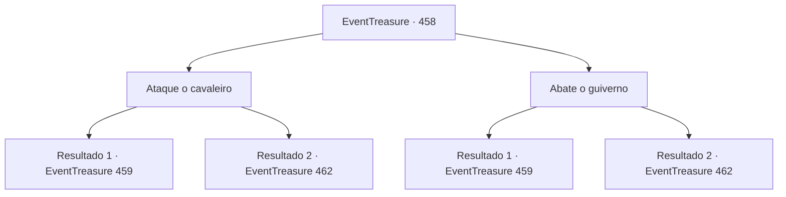

# Eventos de tesouro · 458

[Índice da tabela](index.md) · [Índice geral](../index.md)

ID: `pt:EventTreasure:458` · Fonte: `EventTreasure4` · Versão: 1.2.47.

Mapeamento estático dos arquivos; a disponibilidade e a execução dependem do estado da run.

## Texto do evento

*Sem texto no arquivo.*

## Dados de entrada

```json
{
  "id": 458,
  "grade": 1,
  "place": "",
  "required": ""
}
```

## Mapa das escolhas



## Escolhas e resultados

### Escolha 1

Ataque o cavaleiro

Requisitos e outros campos da escolha:

```json
{
  "required": ""
}
```

#### Resultado 1.1

O ataque do guiverno foi certamente rápido, mas direto demais. Você puxou com força as rédeas, guiando Wendy para o lado. O guiverno não atingiu nada além do ar, expondo as costas de seu cavaleiro, e você golpeou o cavaleiro indefeso. 

 "Arghhh!!"

 O grito desesperado do cavaleiro ecoou pelo céu. Você lançou um breve olhar para suas figuras em queda, então voltou sua atenção à corrida. A disputa ainda não havia terminado. Depois da floresta, as duas rotas divergentes tornavam a se unir. Olhando ao redor, você viu que mal dez competidores haviam sobrevivido à luta feroz. Nesse momento, uma gota de chuva fria atingiu sua bochecha. Ao olhar para cima, você percebeu que nuvens negras de tempestade haviam se acumulado, e uma chuva pesada começou a cair.

Continuação registrada: [Evento 459](0459.md) na mesma tabela.

```json
{
  "required": "",
  "chance": "1|0_12_2|0_5_1",
  "nextEvent": 459,
  "type": 0,
  "reward": ""
}
```

#### Resultado 1.2

Você tentou desviar da investida do guiverno e golpear o cavaleiro dele. Mas a velocidade do guiverno superou seu contra-ataque. No fim, as garras do guiverno o atingiram, e você caiu do céu.

Continuação registrada: [Evento 462](0462.md) na mesma tabela.

```json
{
  "required": "",
  "chance": "24",
  "nextEvent": 462,
  "type": 1,
  "reward": ""
}
```

### Escolha 2

Abate o guiverno

Requisitos e outros campos da escolha:

```json
{
  "required": ""
}
```

#### Resultado 2.1

O ataque do wyvern foi rápido, mas previsível. Você impeliu Wendy para a frente e desferiu um golpe forte na cabeça da besta que investia. Com um baque pesado, o wyvern desabou inconsciente. 

 "Arghhh!!"

 O wyvern e seu cavaleiro tombaram juntos, despencando para baixo. Você lançou um breve olhar para a queda deles e voltou a fixar o olhar na corrida. A disputa ainda não havia terminado. Além da floresta, as rotas divididas voltaram a se unir. Olhando ao redor, você viu que mal dez competidores haviam sobrevivido à luta feroz. Então, uma gota de chuva fria atingiu sua bochecha. Ao erguer o olhar, você viu o céu coberto por nuvens escuras, despejando uma chuva forte.

Continuação registrada: [Evento 459](0459.md) na mesma tabela.

```json
{
  "required": "",
  "chance": "1|0_12_2|0_6_1",
  "nextEvent": 459,
  "type": 0,
  "reward": ""
}
```

#### Resultado 2.2

Você tentou usar a investida do guiverno contra ele e abatê-lo. Mas a velocidade do guiverno foi maior que o seu contragolpe. No fim, suas garras atingiram você, e você despencou do céu.

Continuação registrada: [Evento 462](0462.md) na mesma tabela.

```json
{
  "required": "",
  "chance": "24",
  "nextEvent": 462,
  "type": 1,
  "reward": ""
}
```

## Referências que chegam a este evento

- [Evento 457 · escolha 2 · resultado 1](0457.md#escolha-2)
