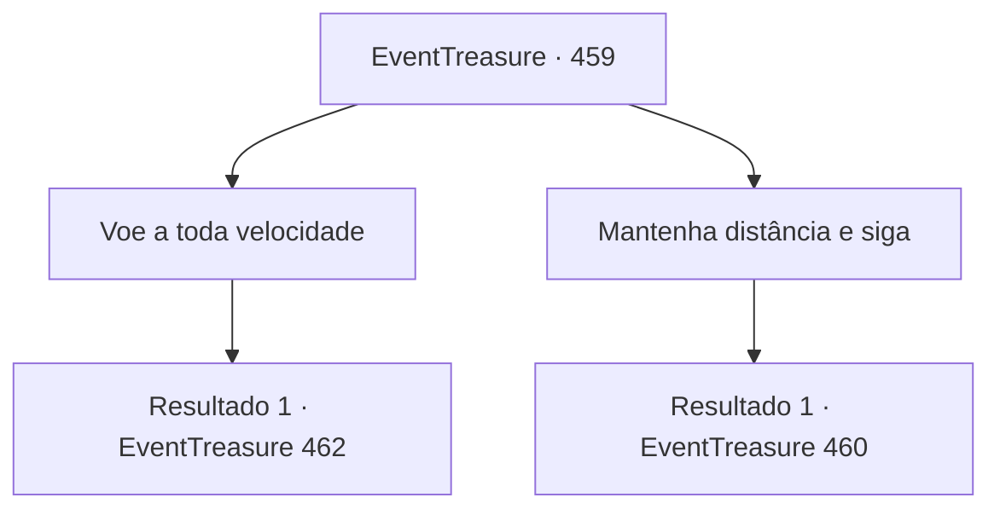

# Eventos de tesouro · 459

[Índice da tabela](index.md) · [Índice geral](../index.md)

ID: `pt:EventTreasure:459` · Fonte: `EventTreasure4` · Versão: 1.2.47.

Mapeamento estático dos arquivos; a disponibilidade e a execução dependem do estado da run.

## Texto do evento

*Sem texto no arquivo.*

## Dados de entrada

```json
{
  "id": 459,
  "grade": 1,
  "place": "",
  "required": ""
}
```

## Mapa das escolhas



## Escolhas e resultados

### Escolha 1

Voe a toda velocidade

Requisitos e outros campos da escolha:

```json
{
  "required": ""
}
```

#### Resultado 1.1

Quando o aguaceiro repentino se abateu, os outros corredores diminuíram, passando a um voo cauteloso. Era a única escolha sensata com a visão reduzida e ventos instáveis. Mas você aproveitou o momento, cravando o calcanhar no flanco de Wendy e avançando à frente. Essa aposta ousada logo se mostrou um erro fatal. Exausta por manter velocidade máxima sob tempestade e vendaval, Wendy não viu o enorme obstáculo à frente. A chuva cegou sua visão, as rajadas sacudiram seu corpo, e você não percebeu o perigo iminente. Com um impacto esmagador, você e Wendy perderam o equilíbrio. Juntos, vocês entraram numa queda em espiral incontrolável. Gotas de chuva fustigaram seu rosto, o vento rugia em seus ouvidos, e a escuridão tomou seus sentidos.

Continuação registrada: [Evento 462](0462.md) na mesma tabela.

```json
{
  "required": "",
  "chance": "1",
  "nextEvent": 462,
  "type": 2,
  "reward": "5_853_9"
}
```

### Escolha 2

Mantenha distância e siga

Requisitos e outros campos da escolha:

```json
{
  "required": ""
}
```

#### Resultado 2.1

Você manteve Wendy estável, mantendo a velocidade enquanto se controlava. Foi a escolha certa. Na tempestade, alguns competidores à frente caíram de exaustão. Você contornou o pico da montanha e voltou em direção à arena. Restavam apenas três competidores, incluindo você. 

 <link=shake>'Estrondo! Bum! Crec!'</link> 

 A essa altura, as nuvens de tempestade despejavam não apenas chuva, mas também trovões e relâmpagos. Clarões ofuscantes e estrondos ensurdecedores rasgavam o céu ao seu redor.

Continuação registrada: [Evento 460](0460.md) na mesma tabela.

```json
{
  "required": "",
  "chance": "1",
  "nextEvent": 460,
  "type": 2,
  "reward": ""
}
```

## Referências que chegam a este evento

- [Evento 457 · escolha 1 · resultado 1](0457.md#escolha-1)
- [Evento 458 · escolha 1 · resultado 1](0458.md#escolha-1)
- [Evento 458 · escolha 2 · resultado 1](0458.md#escolha-2)
