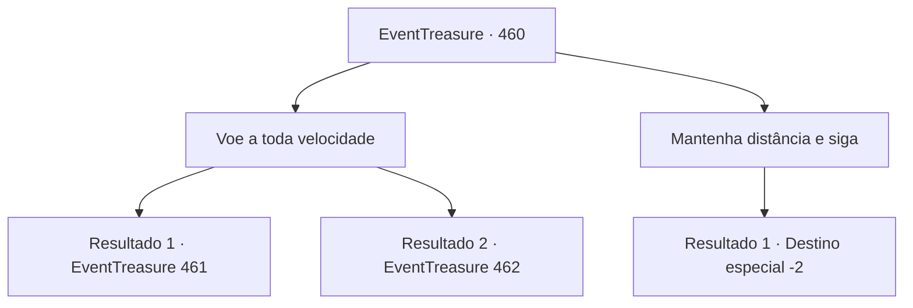

# Eventos de tesouro · 460

[Índice da tabela](index.md) · [Índice geral](../index.md)

ID: `pt:EventTreasure:460` · Fonte: `EventTreasure4` · Versão: 1.2.47.

Mapeamento estático dos arquivos; a disponibilidade e a execução dependem do estado da run.

## Texto do evento

*Sem texto no arquivo.*

## Dados de entrada

```json
{
  "id": 460,
  "grade": 1,
  "place": "",
  "required": ""
}
```

## Mapa das escolhas



## Escolhas e resultados

### Escolha 1

Voe a toda velocidade

Requisitos e outros campos da escolha:

```json
{
  "required": ""
}
```

#### Resultado 1.1

Exaustos do longo voo, os outros competidores mal conseguiam aumentar a velocidade. Todos estavam no limite. Você afagou suavemente a crina da Wendy e sussurrou, implorando por uma arrancada final. Wendy soltou um leve relincho e então abriu as asas com toda a força, acelerando com tudo. Do meio do pelotão, você disparou à frente. Quarto… terceiro… segundo… e então primeiro! Você finalmente assumiu a liderança. 

 <link=shake>'Whoooosh!!'</link> 

 Uma tempestade feroz os atingiu, sacudindo você e Wendy violentamente.

Continuação registrada: [Evento 461](0461.md) na mesma tabela.

```json
{
  "required": "",
  "chance": "1|0_12_1",
  "nextEvent": 461,
  "type": 0,
  "reward": ""
}
```

#### Resultado 1.2

Exaustos do longo voo, os outros corredores mal conseguiam acompanhar o ritmo. Todos haviam chegado ao limite. Você acariciou suavemente a crina de Wendy e sussurrou, implorando por uma última arrancada. Wendy soltou um relincho suave e então avançou com toda a sua força, as asas batendo com mais vigor. Do meio do pelotão, você disparou à frente. Quarto... terceiro... segundo...! Mas você não conseguiu assumir a liderança. A súbita explosão de velocidade fez você perder o equilíbrio, e você perdeu as rédeas. Você sentiu que estava caindo, e a escuridão tomou conta de você.

Continuação registrada: [Evento 462](0462.md) na mesma tabela.

```json
{
  "required": "",
  "chance": "18",
  "nextEvent": 462,
  "type": 1,
  "reward": ""
}
```

### Escolha 2

Mantenha distância e siga

Requisitos e outros campos da escolha:

```json
{
  "required": ""
}
```

#### Resultado 2.1

Mais uma vez você escolheu a estratégia cautelosa—segurando-se, esperando pela chance final. Mas desta vez, foi a escolha errada. A distância restante era curta demais para poupar forças, e os outros corredores deram tudo no último sprint. No fim, você cruzou a linha de chegada em último. 

 "O vencedor deste torneio é William e seu grifo, Terius!!"

 Aplausos ensurdecedores irromperam das arquibancadas. Você o fitou por um momento, então caminhou até Aira, que esperava perto da multidão. 

 "Você foi bem, {1}. Um resultado decepcionante, mas não havia o que fazer."

 Embora tingida de decepção, sua voz não continha reprovação. 

 "Isto é o meu agradecimento pela sua ajuda."

 Você aceitou o ouro que ela ofereceu e afagou a crina de Wendy uma última vez.

Continuação registrada: [Destino especial `-2`](../destinos-especiais.md).

```json
{
  "required": "",
  "chance": "1",
  "nextEvent": -2,
  "type": 2,
  "reward": "0_4_60|5_853_9"
}
```

## Referências que chegam a este evento

- [Evento 459 · escolha 2 · resultado 1](0459.md#escolha-2)
