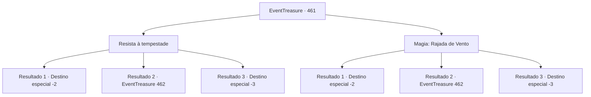

# Eventos de tesouro · 461

[Índice da tabela](index.md) · [Índice geral](../index.md)

ID: `pt:EventTreasure:461` · Fonte: `EventTreasure4` · Versão: 1.2.47.

Mapeamento estático dos arquivos; a disponibilidade e a execução dependem do estado da run.

## Texto do evento

*Sem texto no arquivo.*

## Dados de entrada

```json
{
  "id": 461,
  "grade": 1,
  "place": "",
  "required": ""
}
```

## Mapa das escolhas



## Escolhas e resultados

### Escolha 1

Resista à tempestade

Requisitos e outros campos da escolha:

```json
{
  "required": ""
}
```

#### Resultado 1.1

Você apertou as rédeas e incitou Wendy para a frente, recusando-se a recuar diante da tempestade furiosa. Como se fosse uma só com você, Wendy lançou-se à tormenta sem hesitar.  'Iiiihhh!!'  Momentos depois, você cruzou a linha de chegada, fazendo Wendy desacelerar suavemente. Encharcados até os ossos, você e Wendy haviam se tornado ratos encharcados — mas você havia vencido. Por um breve instante, a arena emudeceu, incrédula. 

 "Aquele cavaleiro acabou de atravessar a tempestade?"

 "Incrível! Uma sincronização perfeita!"

  Saindo do transe, o locutor bradou: 

 "O vencedor do torneio deste ano é {1}! E o Pégaso, Wendy!!"

  Explodiram aplausos e aclamações ensurdecedores, sacudindo os próprios céus. Você conduziu Wendy em uma lenta volta da vitória, acenando em resposta à multidão em delírio. 

 "Parabéns, {1}! Tudo isso é graças a você!"

  Ao final da volta, Aira correu até você, incapaz de conter a alegria. Graças à sua vitória, ela havia conseguido um patrocinador.  Você desmontou, olhando nos olhos de Wendy. Neles havia uma confiança tão profunda que parecia que vocês haviam voado juntos por toda uma vida. Você acariciou suavemente sua crina uma vez e então se virou para partir.

Continuação registrada: [Destino especial `-2`](../destinos-especiais.md).

```json
{
  "required": "",
  "chance": "1|0_12_1",
  "nextEvent": -2,
  "type": 0,
  "reward": "27_63_1|0_4_200|5_853_9"
}
```

#### Resultado 1.2

Você se recusou a recuar diante da tempestade furiosa, apertando ainda mais as rédeas e firmando todo o corpo. Mas os ventos afiados como lâminas castigaram você e Wendy sem piedade. A pressão esmagadora da tormenta enroscou-se em seu pescoço. Por fim, você acabou soltando as rédeas e despencou.

Continuação registrada: [Evento 462](0462.md) na mesma tabela.

```json
{
  "required": "1_0_2",
  "chance": "18",
  "nextEvent": 462,
  "type": 1,
  "reward": "0_0_-1"
}
```

#### Resultado 1.3

Você não recuou diante da tempestade em fúria. Você apertou as rédeas com mais força e firmou todo o corpo. Mas os ventos como lâminas castigaram você e Wendy sem misericórdia, e a pressão esmagadora da tormenta enrolou-se ao redor do seu pescoço. Por fim, você perdeu o controle das rédeas e despencou. Enquanto seu corpo caía, sua visão se apagou na escuridão.

Continuação registrada: [Destino especial `-3`](../destinos-especiais.md).

```json
{
  "required": "2_0_2",
  "chance": "18",
  "nextEvent": -3,
  "type": 1,
  "reward": "0_0_-1"
}
```

### Escolha 2

Magia: Rajada de Vento

Requisitos e outros campos da escolha:

```json
{
  "required": "1_1_2|20_0_2"
}
```

#### Resultado 2.1

Você lançou rapidamente Rajada de Vento, dissipando a tempestade. Wendy, como se já esperasse sua ação, acelerou ainda mais.  

  'Hiiiin!!'  

  Momentos depois, você alcançou a linha de chegada e fez Wendy parar. Por um breve instante, a arena silenciou. 

 "Aquele cavaleiro acabou de bloquear o raio?"

 "Incrível! Que sincronização perfeita!"

 "O vencedor do torneio deste ano é {1}! E o Pégaso, Wendy!!"

  O estádio explodiu em aplausos e vivas estrondosos. Você circulou a arena lentamente com Wendy, acenando em resposta. 

 "Parabéns, {1}! Tudo isso é graças a você!"

  Ao fim da volta, Aira correu até você, sem conseguir esconder a alegria no rosto. Ela explicou que, graças à sua vitória, havia conseguido um patrocinador.  Você desmontou de Wendy e olhou nos olhos dela. Neles havia uma confiança profunda, como se tivessem voado juntos por uma vida inteira. Você afagou suavemente sua crina uma vez e então se virou para partir.

Continuação registrada: [Destino especial `-2`](../destinos-especiais.md).

```json
{
  "required": "",
  "chance": "1|0_7_1|0_12_1",
  "nextEvent": -2,
  "type": 0,
  "reward": "27_63_1|0_4_200|5_853_9|0_1_-1"
}
```

#### Resultado 2.2

Você tentou conjurar Rajada de Vento para dissipar a tempestade. Mas a tormenta atingiu você e Wendy antes que seu feitiço surtisse efeito. Os ventos como lâminas castigaram vocês dois impiedosamente, e a pressão esmagadora da tormenta se enrolou em torno do seu pescoço. Por fim, você soltou as rédeas e despencou.

Continuação registrada: [Evento 462](0462.md) na mesma tabela.

```json
{
  "required": "1_0_2",
  "chance": "18",
  "nextEvent": 462,
  "type": 1,
  "reward": "0_0_-1"
}
```

#### Resultado 2.3

Você tentou conjurar Rajada de Vento para dissipar a tempestade. Mas a tormenta atingiu você e Wendy antes que seu feitiço pudesse fazer efeito. Os ventos cortantes os castigaram impiedosamente, e a pressão esmagadora da tormenta enroscou-se em seu pescoço. Por fim, você soltou as rédeas e despencou. Enquanto seu corpo caía, sua visão lentamente se apagou na escuridão.

Continuação registrada: [Destino especial `-3`](../destinos-especiais.md).

```json
{
  "required": "2_0_2",
  "chance": "18",
  "nextEvent": -3,
  "type": 1,
  "reward": "0_0_-1"
}
```

## Referências que chegam a este evento

- [Evento 460 · escolha 1 · resultado 1](0460.md#escolha-1)
