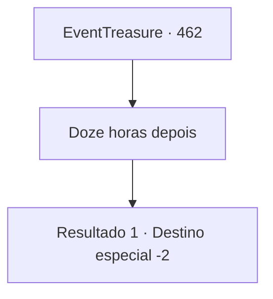

# Eventos de tesouro · 462

[Índice da tabela](index.md) · [Índice geral](../index.md)

ID: `pt:EventTreasure:462` · Fonte: `EventTreasure4` · Versão: 1.2.47.

Mapeamento estático dos arquivos; a disponibilidade e a execução dependem do estado da run.

## Texto do evento

*Sem texto no arquivo.*

## Dados de entrada

```json
{
  "id": 462,
  "grade": 1,
  "place": "",
  "required": ""
}
```

## Mapa das escolhas



## Escolhas e resultados

### Escolha 1

Doze horas depois

Requisitos e outros campos da escolha:

```json
{
  "required": ""
}
```

#### Resultado 1.1

Cerca de doze horas depois, você recobrou a consciência. Olhando ao redor, você percebeu que estava no que parecia ser a enfermaria ao lado da arena. 

 "{1}! Você acordou?"

 Você virou o olhar na direção da voz. Aira, sentada numa cadeira ali perto, aproximou-se lentamente. 

 "...O torneio acabou. Você foi bem, {1}."

  Você ouviu enquanto Aira explicava os resultados. No fim, você caiu e foi eliminado, e outro cavaleiro saiu vencedor. 

 "Não se preocupe com Wendy. Ela é forte. Agora está descansando num estábulo aqui perto."

  Aira conferiu seu estado antes de se levantar. 

 "Bem, então, vou indo. Ah, por favor, aceite isto. Você se feriu no meu lugar no torneio. Pelo menos deixe-me cobrir os custos do tratamento."

  Deixando essas palavras de despedida, ela saiu silenciosamente da enfermaria.

Continuação registrada: [Destino especial `-2`](../destinos-especiais.md).

```json
{
  "required": "",
  "chance": "1",
  "nextEvent": -2,
  "type": 2,
  "reward": "5_853_9"
}
```

## Referências que chegam a este evento

- [Evento 457 · escolha 1 · resultado 2](0457.md#escolha-1)
- [Evento 458 · escolha 1 · resultado 2](0458.md#escolha-1)
- [Evento 458 · escolha 2 · resultado 2](0458.md#escolha-2)
- [Evento 459 · escolha 1 · resultado 1](0459.md#escolha-1)
- [Evento 460 · escolha 1 · resultado 2](0460.md#escolha-1)
- [Evento 461 · escolha 1 · resultado 2](0461.md#escolha-1)
- [Evento 461 · escolha 2 · resultado 2](0461.md#escolha-2)
