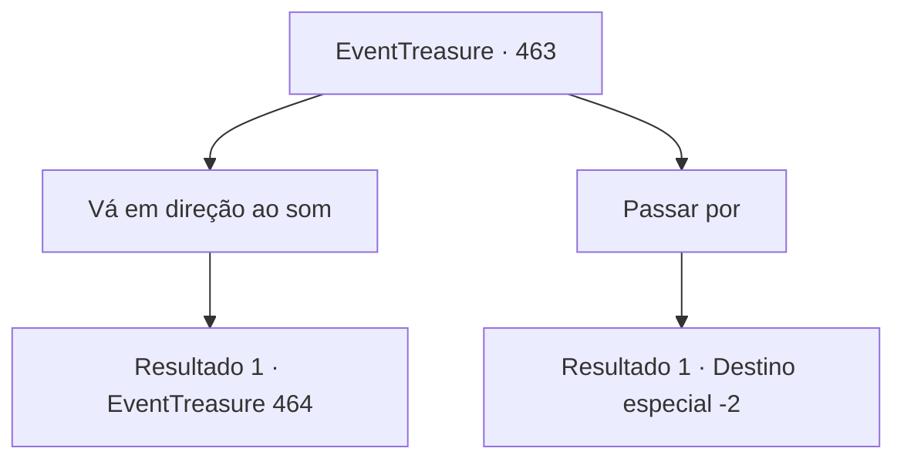

# Eventos de tesouro · 463

[Índice da tabela](index.md) · [Índice geral](../index.md)

ID: `pt:EventTreasure:463` · Fonte: `EventTreasure4` · Versão: 1.2.47.

Mapeamento estático dos arquivos; a disponibilidade e a execução dependem do estado da run.

## Texto do evento

Suave luar derramava-se por entre as nuvens, iluminando seus passos. Enquanto procurava um lugar para acampar, você percebeu que o chão sob seus pés havia afundado. Ao olhar mais de perto, percebeu que não era apenas um buraco comum. Era parte de uma antiga ruína, enterrada profundamente e coberta por terra e folhas caídas ao longo de incontáveis anos. Impelido por uma curiosidade desconhecida, você desceu pela fenda. Pela estreita fissura por onde o luar se infiltrava, você viu um antigo templo totalmente preservado. Como se o próprio tempo tivesse parado, a estrutura permanecia congelada no estado em que estivera centenas de anos atrás.  

 "...Hhh... Uh."

  Nesse momento, uma voz fraca agarrou seu tornozelo. O som vinha de algum lugar dentro das ruínas.

## Dados de entrada

```json
{
  "id": 463,
  "grade": 2,
  "place": "",
  "required": "1_2_50|5_855_0|26_49_1"
}
```

## Mapa das escolhas



## Escolhas e resultados

### Escolha 1

Vá em direção ao som

Requisitos e outros campos da escolha:

```json
{
  "required": ""
}
```

#### Resultado 1.1

Você seguiu cuidadosamente a voz fraca para o interior das ruínas. Embora o antigo templo estivesse meio desabado, sua estrutura principal ainda se mantinha de pé, o que não tornava muito difícil encontrar um caminho para dentro. A fonte da voz era uma estranha câmara circular no coração das ruínas. Por um buraco no teto parcialmente desabado, a luz da lua entrava — revelando um homem acorrentado. Uma estaca de madeira atravessava seu peito, e sangue seco manchava o chão abaixo dele. |drawing_chainedVamp| 

 "...Finalmente, um visitante."

 Os olhos carmesins do homem brilhavam de forma inquietante sob o luar enquanto ele fitava você diretamente. Pela aparência, você reconheceu imediatamente quem ele era: olhos vermelho-sangue, pele pálida como a morte e presas afiadas à mostra entre os lábios. Ele era um vampiro, um predador que se alimentava de vida humana.

Continuação registrada: [Evento 464](0464.md) na mesma tabela.

```json
{
  "required": "",
  "chance": "1",
  "nextEvent": 464,
  "type": 2,
  "reward": ""
}
```

### Escolha 2

Passar por

Requisitos e outros campos da escolha:

```json
{
  "required": ""
}
```

#### Resultado 2.1

A voz fraca logo se desvaneceu, abafada pelo vento. Você fitou em silêncio o templo em ruínas antes de partir em sua jornada mais uma vez.

Continuação registrada: [Destino especial `-2`](../destinos-especiais.md).

```json
{
  "required": "",
  "chance": "1",
  "nextEvent": -2,
  "type": 2,
  "reward": "5_855_9"
}
```

## Referências que chegam a este evento

Nenhum `nextEvent` positivo da mesma tabela aponta para este nó. Isso não prova que seja inacessível: sorteio e estado de história podem selecioná-lo.

