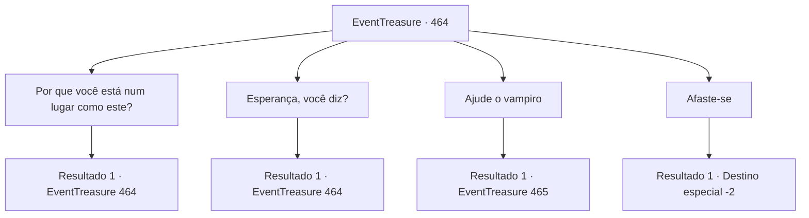

# Eventos de tesouro · 464

[Índice da tabela](index.md) · [Índice geral](../index.md)

ID: `pt:EventTreasure:464` · Fonte: `EventTreasure4` · Versão: 1.2.47.

Mapeamento estático dos arquivos; a disponibilidade e a execução dependem do estado da run.

## Texto do evento

*Sem texto no arquivo.*

## Dados de entrada

```json
{
  "id": 464,
  "grade": 1,
  "place": "",
  "required": ""
}
```

## Mapa das escolhas



## Escolhas e resultados

### Escolha 1

Por que você está num lugar como este?

Requisitos e outros campos da escolha:

```json
{
  "required": "5_856_0"
}
```

#### Resultado 1.1

Você perguntou a ele por que ele estava em um lugar como este. O vampiro soltou uma risada amarga antes de responder. 

 "Você pergunta o óbvio. Por que um nobre da noite estaria aqui? Porque fui capturado por aqueles tolos que voluntariamente se escravizaram aos deuses."

 Ele soltou um suspiro pesado e continuou. 

 "Mas aqueles tolos não puderam me matar. Sou um nobre entre nobres; uma mera estaca de madeira não pode acabar comigo. Então mudaram a punição—não a morte, mas o tormento eterno."

 Você ouviu o relato de sua punição. Ela se aproveitava da fraqueza de um vampiro à luz do sol. Eles o prenderam aqui, queimando-o com a luz do sol dia após dia. Ele suportou dessa forma por séculos. 

 "Mas por fim eles pararam de vir. Eles me esqueceram completamente. Esta ruína, minha existência—tudo esquecido. Ainda assim, o destino não me abandonou. Pois agora ele me enviou… esperança."


Continuação registrada: [Evento 464](0464.md) na mesma tabela.

```json
{
  "required": "",
  "chance": "1",
  "nextEvent": 464,
  "type": 2,
  "reward": "5_856_1"
}
```

### Escolha 2

Esperança, você diz?

Requisitos e outros campos da escolha:

```json
{
  "required": "5_856_1"
}
```

#### Resultado 2.1

Em resposta à sua pergunta, o vampiro falou em voz calma. 

 "Minha esperança… você faria um acordo comigo? Liberte-me deste tormento, e eu lhe darei tudo o que desejar. Eu juro, pelo meu sangue nobre."

 Ele olhou para a estaca em seu peito enquanto continuava. 

 "Se você arrancar esta coisa amaldiçoada, é tudo o que peço. Vá em frente."

 O vampiro ficou em silêncio, fitando você. Um brilho hipnotizante tremeluziu em seus olhos carmesim.

Continuação registrada: [Evento 464](0464.md) na mesma tabela.

```json
{
  "required": "",
  "chance": "1",
  "nextEvent": 464,
  "type": 2,
  "reward": "5_856_2"
}
```

### Escolha 3

Ajude o vampiro

Requisitos e outros campos da escolha:

```json
{
  "required": "5_856_2"
}
```

#### Resultado 3.1

Você escolheu ajudar o vampiro. Ele rapidamente acrescentou um aviso, com expressão urgente. 

 "Cuidado agora. Esta estaca é encantada—se tocá-la de forma imprudente, você será reduzido a cinzas."

 Você direcionou cautelosamente o olhar para a estaca. Sob a suave luz do luar, runas e marcas estranhas cintilavam tenuemente em sua superfície.

Continuação registrada: [Evento 465](0465.md) na mesma tabela.

```json
{
  "required": "",
  "chance": "1",
  "nextEvent": 465,
  "type": 2,
  "reward": ""
}
```

### Escolha 4

Afaste-se

Requisitos e outros campos da escolha:

```json
{
  "required": "5_856_2"
}
```

#### Resultado 4.1

Você recusou a oferta do vampiro e se virou. 

 "E–espere! Por favor, qualquer coisa! Eu lhe darei qualquer coisa…!!"

 Sua voz desesperada ecoou atrás de você, mas você não parou. Em pouco tempo, o sol nasceu, e um grito horrível ecoou pelas ruínas.

Continuação registrada: [Destino especial `-2`](../destinos-especiais.md).

```json
{
  "required": "",
  "chance": "1",
  "nextEvent": -2,
  "type": 2,
  "reward": "5_855_9"
}
```

## Referências que chegam a este evento

- [Evento 463 · escolha 1 · resultado 1](0463.md#escolha-1)
- [Evento 464 · escolha 1 · resultado 1](0464.md#escolha-1)
- [Evento 464 · escolha 2 · resultado 1](0464.md#escolha-2)
