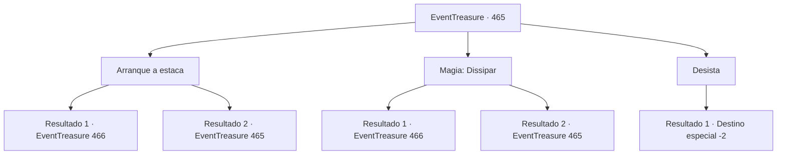

# Eventos de tesouro · 465

[Índice da tabela](index.md) · [Índice geral](../index.md)

ID: `pt:EventTreasure:465` · Fonte: `EventTreasure4` · Versão: 1.2.47.

Mapeamento estático dos arquivos; a disponibilidade e a execução dependem do estado da run.

## Texto do evento

*Sem texto no arquivo.*

## Dados de entrada

```json
{
  "id": 465,
  "grade": 1,
  "place": "",
  "required": ""
}
```

## Mapa das escolhas



## Escolhas e resultados

### Escolha 1

Arranque a estaca

Requisitos e outros campos da escolha:

```json
{
  "required": "1_0_2|5_857_0"
}
```

#### Resultado 1.1

No momento em que sua mão tocou a estaca, uma chama branca irrompeu. As chamas rapidamente se espalharam pelo seu antebraço, e uma dor lancinante penetrou até os seus ossos. Suportando a agonia ardente, você arrancou a estaca com toda a sua força. Nesse instante, a vida voltou aos olhos do vampiro. 

 "...Hhh—hahaha! Liberdade! Estou livre!!"

 O vampiro despedaçou, num instante, as correntes que prendiam seus braços e levantou-se. Rindo descontroladamente, ele se virou para olhar para você. O ferimento onde a estaca havia perfurado seu peito já havia cicatrizado. Ainda rindo loucamente, por fim ele olhou para você com um sorriso calmo. 

 "Minha esperança… Você se saiu muito bem. Agora é hora de cumprir minha promessa. O que você deseja?"


Continuação registrada: [Evento 466](0466.md) na mesma tabela.

```json
{
  "required": "",
  "chance": "1|0_5_1|0_13_1",
  "nextEvent": 466,
  "type": 0,
  "reward": ""
}
```

#### Resultado 1.2

No momento em que sua mão tocou a estaca, uma chama branca irrompeu. As chamas rapidamente se espalharam pelo seu braço, e uma terrível dor abrasadora se alojou profundamente nos seus ossos. Era uma agonia muito além do que você poderia suportar. Por fim, você puxou a mão para longe da estaca e cambaleou para trás. As chamas brancas desapareceram como uma ilusão.

Continuação registrada: [Evento 465](0465.md) na mesma tabela.

```json
{
  "required": "",
  "chance": "20",
  "nextEvent": 465,
  "type": 1,
  "reward": "0_0_-1|5_857_0"
}
```

### Escolha 2

Magia: Dissipar

Requisitos e outros campos da escolha:

```json
{
  "required": "20_0_1|1_1_2|5_858_0"
}
```

#### Resultado 2.1

Você conjurou Dissipar para quebrar a magia vinculada à estaca. Então você a agarrou com as duas mãos e a arrancou com toda a sua força. Nesse instante, a vida voltou aos olhos do vampiro. 

 "...Hhh—hahaha! Liberdade! Estou livre!!"

 O vampiro despedaçou, num instante, as correntes que prendiam seus braços e pôs-se de pé. Rindo descontroladamente, ele se virou para olhar para você. O ferimento onde a estaca havia perfurado seu peito já havia cicatrizado. Ainda rindo loucamente, ele por fim olhou para você com um sorriso calmo. 

 "Minha esperança… Você se saiu muito bem, de fato. Agora é hora de cumprir minha promessa. O que você deseja?"


Continuação registrada: [Evento 466](0466.md) na mesma tabela.

```json
{
  "required": "",
  "chance": "1|0_7_1",
  "nextEvent": 466,
  "type": 0,
  "reward": ""
}
```

#### Resultado 2.2

Você tentou conjurar Dissipar para remover a magia da estaca. Mas camadas e mais camadas de encantamentos foram lançadas sobre ela — muito além da sua capacidade de desfazê-los. 

 "Com habilidade comum, isso não pode ser feito. Se fosse tão fácil desfazer, eu mesmo o teria feito há muito tempo."

 O vampiro, observando você, murmurou com voz amarga.

Continuação registrada: [Evento 465](0465.md) na mesma tabela.

```json
{
  "required": "",
  "chance": "16",
  "nextEvent": 465,
  "type": 1,
  "reward": "5_858_1"
}
```

### Escolha 3

Desista

Requisitos e outros campos da escolha:

```json
{
  "required": ""
}
```

#### Resultado 3.1

Você desistiu de libertar o vampiro e se virou. 

 "E—Espera! Por favor! Eu te dou qualquer coisa! Só...!!"

 Uma voz desesperada gritou atrás de você, mas seus passos não vacilaram. Não muito depois, o sol nasceu, e um grito horrendo ecoou pelas ruínas.

Continuação registrada: [Destino especial `-2`](../destinos-especiais.md).

```json
{
  "required": "",
  "chance": "1",
  "nextEvent": -2,
  "type": 2,
  "reward": "5_855_9"
}
```

## Referências que chegam a este evento

- [Evento 464 · escolha 3 · resultado 1](0464.md#escolha-3)
- [Evento 465 · escolha 1 · resultado 2](0465.md#escolha-1)
- [Evento 465 · escolha 2 · resultado 2](0465.md#escolha-2)
