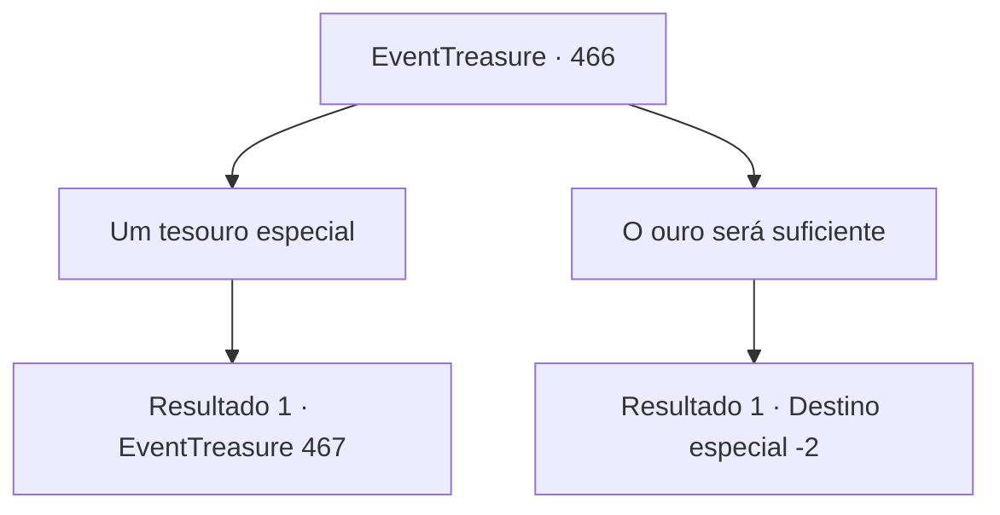

# Eventos de tesouro · 466

[Índice da tabela](index.md) · [Índice geral](../index.md)

ID: `pt:EventTreasure:466` · Fonte: `EventTreasure4` · Versão: 1.2.47.

Mapeamento estático dos arquivos; a disponibilidade e a execução dependem do estado da run.

## Texto do evento

*Sem texto no arquivo.*

## Dados de entrada

```json
{
  "id": 466,
  "grade": 1,
  "place": "",
  "required": ""
}
```

## Mapa das escolhas



## Escolhas e resultados

### Escolha 1

Um tesouro especial

Requisitos e outros campos da escolha:

```json
{
  "required": ""
}
```

#### Resultado 1.1

O vampiro sorriu levemente e estendeu a mão para o ar. Sua mão desapareceu como se entrasse em outro espaço e, logo, ele puxou algo. Era um cálice dourado adornado com joias. Ele mordeu com força o próprio dedo, deixando o sangue pingar no cálice. O líquido carmesim quase o encheu até a metade, reluzindo enquanto oscilava. 

 "Aqui. Meu sangue. Beba isto, e você obterá um fragmento do meu poder. Se puder suportar a magia contida no meu sangue, é claro."

 O vampiro estendeu a mão e colocou o cálice nas suas mãos. O sangue carmesim reluzia dentro do cálice dourado.

Continuação registrada: [Evento 467](0467.md) na mesma tabela.

```json
{
  "required": "",
  "chance": "1",
  "nextEvent": 467,
  "type": 2,
  "reward": ""
}
```

### Escolha 2

O ouro será suficiente

Requisitos e outros campos da escolha:

```json
{
  "required": ""
}
```

#### Resultado 2.1


 "Bom."

 O vampiro esboçou um sorriso estranho e enfiou a mão no ar. Sua mão desapareceu como se entrasse em outro espaço e, logo, ele retirou um saquinho carmesim. Dentro havia pilhas de antigas moedas imperiais. 

 "Espero que isto seja suficiente. Aqui, pegue."

 Ao entregar o ouro, o vampiro falou novamente. 

 "Nosso acordo está encerrado agora. Talvez um dia nos encontremos novamente. Até lá, adeus."

 Com uma risada, puxou a capa ao redor de si e desapareceu na escuridão. Você ficou nas ruínas silenciosas por um momento antes de partir.

Continuação registrada: [Destino especial `-2`](../destinos-especiais.md).

```json
{
  "required": "",
  "chance": "1",
  "nextEvent": -2,
  "type": 2,
  "reward": "0_4_200|5_855_9"
}
```

## Referências que chegam a este evento

- [Evento 465 · escolha 1 · resultado 1](0465.md#escolha-1)
- [Evento 465 · escolha 2 · resultado 1](0465.md#escolha-2)
