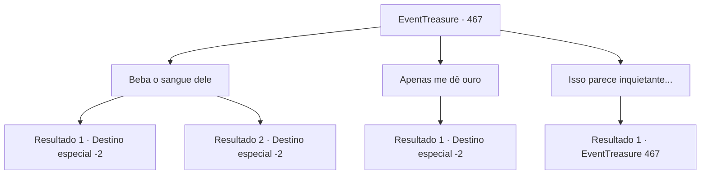

# Eventos de tesouro · 467

[Índice da tabela](index.md) · [Índice geral](../index.md)

ID: `pt:EventTreasure:467` · Fonte: `EventTreasure4` · Versão: 1.2.47.

Mapeamento estático dos arquivos; a disponibilidade e a execução dependem do estado da run.

## Texto do evento

*Sem texto no arquivo.*

## Dados de entrada

```json
{
  "id": 467,
  "grade": 1,
  "place": "",
  "required": ""
}
```

## Mapa das escolhas



## Escolhas e resultados

### Escolha 1

Beba o sangue dele

Requisitos e outros campos da escolha:

```json
{
  "required": ""
}
```

#### Resultado 1.1

Você tragou o sangue do vampiro. À medida que se espalhava, seu coração disparou e a magia irrompeu por suas veias. Sua respiração ficou ofegante enquanto sua visão se tingia de vermelho. 

 "Acalme-se. Aceite-o devagar."

 Seguindo o conselho dele, você controlou a respiração. Aos poucos, a magia turbulenta começou a se acalmar. O vampiro observou com interesse antes de falar suavemente. 

 "Impressionante. Nosso acordo está concluído agora. Talvez um dia nos encontremos novamente. Até lá, adeus."

 Ele riu, cobriu-se com a capa e desapareceu na escuridão. Você olhou ao redor das ruínas silenciosas mais uma vez e partiu.

Continuação registrada: [Destino especial `-2`](../destinos-especiais.md).

```json
{
  "required": "",
  "chance": "1|0_12_1|0_13_1",
  "nextEvent": -2,
  "type": 0,
  "reward": "27_58_1|5_855_9"
}
```

#### Resultado 1.2

Você engoliu o sangue do vampiro de um gole. À medida que se espalhava, seu coração disparou e a magia irrompeu por suas veias. Sua respiração ficou ofegante enquanto sua visão ficava vermelha. 

 "Acalme-se. Aceite-o lentamente."

 Ainda assim, apesar do conselho dele, você não conseguiu controlar o poder furioso. No fim, você desabou, incapaz de suportar a tempestade de magia.  Quando você acordou, o sol abrasador o saudou. Você abriu os olhos lentamente, deitado sozinho no coração das ruínas. O vampiro da noite anterior havia desaparecido sem deixar vestígios. Ao lado da sua cabeça jaziam os restos secos do sangue dele que você havia vomitado na noite anterior. Com o corpo rígido, você se levantou e deixou para trás as ruínas desmoronando.

Continuação registrada: [Destino especial `-2`](../destinos-especiais.md).

```json
{
  "required": "",
  "chance": "30",
  "nextEvent": -2,
  "type": 1,
  "reward": "0_2_1|5_855_9"
}
```

### Escolha 2

Apenas me dê ouro

Requisitos e outros campos da escolha:

```json
{
  "required": ""
}
```

#### Resultado 2.1


 "Muito bem."

 O vampiro esboçou um sorriso estranho e mais uma vez enfiou a mão no ar. A mão dele desapareceu como se entrasse em outro espaço, e desta vez puxou uma pequena bolsa carmesim. Dentro havia pilhas de moedas imperiais antigas. 

 "Espero que isto seja suficiente. Aqui, pegue."

 Entregando o ouro, o vampiro falou novamente. 

 "Nosso acordo está encerrado agora. Talvez um dia nos encontremos novamente. Até lá, adeus."

 Com uma risada, ele cobriu-se com a capa e desapareceu na escuridão. Você permaneceu nas ruínas silenciosas por um momento antes de partir.

Continuação registrada: [Destino especial `-2`](../destinos-especiais.md).

```json
{
  "required": "",
  "chance": "1",
  "nextEvent": -2,
  "type": 2,
  "reward": "0_4_200|5_855_9"
}
```

### Escolha 3

Isso parece inquietante...

Requisitos e outros campos da escolha:

```json
{
  "required": "5_859_0"
}
```

#### Resultado 3.1

Ao notar sua expressão inquieta, o vampiro acrescentou uma explicação. 

 "Beber isto não vai torná-lo meu servo, se isso é o que lhe preocupa. Não tenho interesse em ter mais servos. Não passam de intrigantes, sempre tramando traições..."

 Ele fitou o vazio como se recordasse antigas lembranças, então continuou. 

 "Ainda assim, se recusar, que seja. Alguns punhados de ouro devem bastar em vez disso. Leve isso, se preferir."


Continuação registrada: [Evento 467](0467.md) na mesma tabela.

```json
{
  "required": "",
  "chance": "1",
  "nextEvent": 467,
  "type": 2,
  "reward": "5_859_1"
}
```

## Referências que chegam a este evento

- [Evento 466 · escolha 1 · resultado 1](0466.md#escolha-1)
- [Evento 467 · escolha 3 · resultado 1](0467.md#escolha-3)
