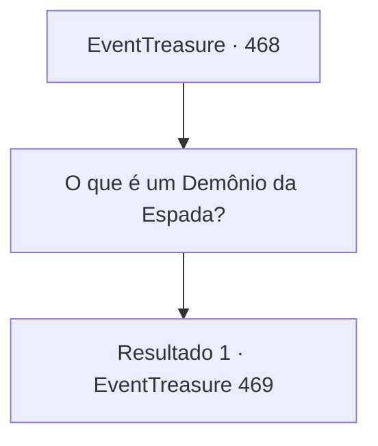

# Eventos de tesouro · 468

[Índice da tabela](index.md) · [Índice geral](../index.md)

ID: `pt:EventTreasure:468` · Fonte: `EventTreasure4` · Versão: 1.2.47.

Mapeamento estático dos arquivos; a disponibilidade e a execução dependem do estado da run.

## Texto do evento

No meio da cidade jazia o cadáver de um homem vestido com armadura. Uma espada ainda estava firmemente segurada em sua mão, e o sangue de seu pescoço havia secado no chão. Não parecia que ele estivesse morto há muito tempo.  

 "Até o instrutor de espada Archen caiu…"

 "Você viu aquele ferimento no pescoço dele? Deve ser aquele ‘Demônio da Espada’ de novo, não é?"

  A multidão ao redor do corpo sussurrava entre si enquanto fitava. Alguns trocaram olhares inquietos, repetindo o nome ‘Demônio da Espada’ em voz baixa.

## Dados de entrada

```json
{
  "id": 468,
  "grade": 2,
  "place": "",
  "required": "1_2_50|5_863_0|26_51_1"
}
```

## Mapa das escolhas



## Escolhas e resultados

### Escolha 1

O que é um Demônio da Espada?

Requisitos e outros campos da escolha:

```json
{
  "required": ""
}
```

#### Resultado 1.1

Você se aproximou deles e perguntou o que era um Demônio da Espada. Um dos homens estremeceu, como se o simples pensamento lhe causasse arrepios, e respondeu. 

 "Ele é um assassino louco e errante. Carrega uma longa espada de um só gume com uma lâmina afiadíssima, não veste nada além de túnicas esvoaçantes, sem armadura, deixa o cabelo crescer até virar uma bagunça selvagem e usa nos pés algo que parece blocos de madeira."

 Em seguida, apontou para o cadáver de Archen e continuou. 

 "Dizem que ele escolhe pessoas habilidosas com a espada para matar, como aquele Archen ali. É melhor você ficar fora disso e evitar cruzar o caminho dele."

 Pouco depois, guardas chegaram ao local e dispersaram a multidão. Você também se esgueirou silenciosamente entre as pessoas.  Algum tempo depois, enquanto o sol se punha lentamente no oeste, uma brisa fresca passou por você — trazendo consigo o fedor de sangue. Você virou a cabeça na direção da origem do cheiro. Ele vinha do campo de juncos logo fora da aldeia. Arrepios percorreram sua pele quando uma sensação gelada de pavor tomou conta de você. E, pouco depois, ecoou o som de aços se chocando.

Continuação registrada: [Evento 469](0469.md) na mesma tabela.

```json
{
  "required": "",
  "chance": "1",
  "nextEvent": 469,
  "type": 2,
  "reward": ""
}
```

## Referências que chegam a este evento

Nenhum `nextEvent` positivo da mesma tabela aponta para este nó. Isso não prova que seja inacessível: sorteio e estado de história podem selecioná-lo.

