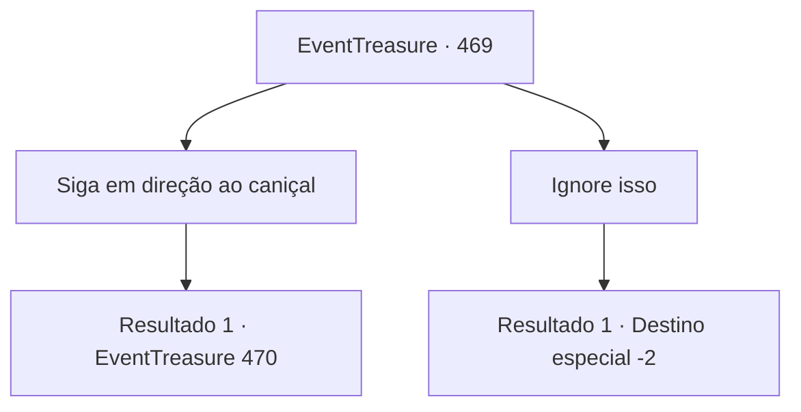

# Eventos de tesouro · 469

[Índice da tabela](index.md) · [Índice geral](../index.md)

ID: `pt:EventTreasure:469` · Fonte: `EventTreasure4` · Versão: 1.2.47.

Mapeamento estático dos arquivos; a disponibilidade e a execução dependem do estado da run.

## Texto do evento

*Sem texto no arquivo.*

## Dados de entrada

```json
{
  "id": 469,
  "grade": 2,
  "place": "",
  "required": ""
}
```

## Mapa das escolhas



## Escolhas e resultados

### Escolha 1

Siga em direção ao caniçal

Requisitos e outros campos da escolha:

```json
{
  "required": ""
}
```

#### Resultado 1.1

Você correu em direção à fonte do cheiro. No coração do campo de juncos, onde corpos jaziam espalhados, estava de pé um homem empunhando uma espada. |drawing_nangin| Ele vestia-se de um modo que você nunca tinha visto. Túnicas soltas, de mangas largas, caíam sobre seu corpo, e em sua mão havia uma longa espada curva, de fio único, que emanava uma aura fria e assassina. Seu cabelo desgrenhado chicoteava ao vento. 

 "Poupe-me! Por favor! Aaaah!!"

 Com a espada na mão, ele se aproximou lentamente de um homem encolhido de medo. Então sua lâmina descreveu um arco impiedoso em direção ao homem.

Continuação registrada: [Evento 470](0470.md) na mesma tabela.

```json
{
  "required": "",
  "chance": "1",
  "nextEvent": 470,
  "type": 2,
  "reward": ""
}
```

### Escolha 2

Ignore isso

Requisitos e outros campos da escolha:

```json
{
  "required": ""
}
```

#### Resultado 2.1

Você ignorou o fedor de sangue e o choque de aço, e caminhou rapidamente na direção oposta.

Continuação registrada: [Destino especial `-2`](../destinos-especiais.md).

```json
{
  "required": "",
  "chance": "1",
  "nextEvent": -2,
  "type": 2,
  "reward": "5_863_9"
}
```

## Referências que chegam a este evento

- [Evento 468 · escolha 1 · resultado 1](0468.md#escolha-1)
