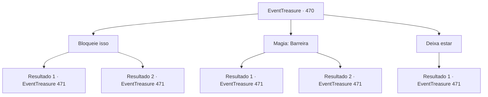

# Eventos de tesouro · 470

[Índice da tabela](index.md) · [Índice geral](../index.md)

ID: `pt:EventTreasure:470` · Fonte: `EventTreasure4` · Versão: 1.2.47.

Mapeamento estático dos arquivos; a disponibilidade e a execução dependem do estado da run.

## Texto do evento

*Sem texto no arquivo.*

## Dados de entrada

```json
{
  "id": 470,
  "grade": 1,
  "place": "",
  "required": ""
}
```

## Mapa das escolhas



## Escolhas e resultados

### Escolha 1

Bloqueie isso

Requisitos e outros campos da escolha:

```json
{
  "required": ""
}
```

#### Resultado 1.1

Você bloqueou o ataque dele, e ele olhou para você com uma expressão como se tivesse encontrado algo interessante. O homem acovardado estremeceu, depois gritou e fugiu em pânico. 

 "Hmm. Bastante habilidoso, não é?"

 Ele nem sequer lançou um olhar ao homem que saiu correndo, limitando-se a sacudir o sangue da espada com um leve movimento de pulso. Um leve sorriso se desenhou em seus lábios. 

 "De qualquer forma, fico feliz por finalmente ter encontrado alguém de verdadeira habilidade. Com uma recompensa sobre a minha cabeça, não tenho tido nada além de peixe pequeno vindo atrás de mim."


Continuação registrada: [Evento 471](0471.md) na mesma tabela.

```json
{
  "required": "",
  "chance": "1|0_5_1|0_6_1",
  "nextEvent": 471,
  "type": 0,
  "reward": "0_3_3"
}
```

#### Resultado 1.2

Você tentou salvar o homem, mas chegou um passo tarde demais. A lâmina do Demônio da Espada decepou seu pescoço, e sangue carmesim espirrou pelos juncos. 

 "Quem é você?"

 Ele nem sequer lançou um olhar para o cadáver que rolava entre os juncos. Em vez disso, sacudiu o sangue da lâmina e a limpou com a manga. 

 "Com uma recompensa pela minha cabeça, só tenho tido peixes pequenos vindo atrás de mim. Você é um deles também?"


Continuação registrada: [Evento 471](0471.md) na mesma tabela.

```json
{
  "required": "",
  "chance": "32",
  "nextEvent": 471,
  "type": 1,
  "reward": ""
}
```

### Escolha 2

Magia: Barreira

Requisitos e outros campos da escolha:

```json
{
  "required": "20_0_1"
}
```

#### Resultado 2.1

Bloqueando o golpe do Demônio da Espada, você olhou para trás. O homem encolhido tremeu, depois gritou e fugiu em pânico. 

 "Que truque intrigante você tem aí."

 Ele nem sequer olhou para o homem que fugiu, limitando-se a sacudir o sangue da espada e limpá-la com a manga. 

 "De qualquer forma, estou feliz por finalmente ter encontrado alguém de verdadeira habilidade. Com uma recompensa pela minha cabeça, só tenho tido peixes pequenos vindo atrás de mim."


Continuação registrada: [Evento 471](0471.md) na mesma tabela.

```json
{
  "required": "",
  "chance": "1|0_7_1|0_12_1",
  "nextEvent": 471,
  "type": 0,
  "reward": "0_3_3"
}
```

#### Resultado 2.2

Você tentou salvar o homem, mas chegou um passo tarde demais. A lâmina do Demônio da Espada decepou seu pescoço, e sangue carmesim espirrou pelos juncos. 

 "Quem é você?"

 Ele nem sequer lançou um olhar para o cadáver que rolava entre os juncos. Em vez disso, sacudiu o sangue da lâmina e a limpou com a manga. 

 "Com uma recompensa pela minha cabeça, só tenho tido peixes pequenos vindo atrás de mim. Você é um deles também?"


Continuação registrada: [Evento 471](0471.md) na mesma tabela.

```json
{
  "required": "",
  "chance": "32",
  "nextEvent": 471,
  "type": 1,
  "reward": ""
}
```

### Escolha 3

Deixa estar

Requisitos e outros campos da escolha:

```json
{
  "required": ""
}
```

#### Resultado 3.1

Você observou silenciosamente as ações dele. A lâmina do Demônio da Espada decepou o pescoço do homem, e sangue carmesim salpicou os juncos. 

 "Quem é você?"

 Ele nem sequer lançou um olhar ao cadáver que rolava entre os juncos. Em vez disso, sacudiu o sangue da lâmina e a limpou com a manga. 

 "Com uma recompensa pela minha cabeça, não tenho visto nada além de peixe pequeno vindo atrás de mim. Você é um deles também?"


Continuação registrada: [Evento 471](0471.md) na mesma tabela.

```json
{
  "required": "",
  "chance": "1",
  "nextEvent": 471,
  "type": 2,
  "reward": ""
}
```

## Referências que chegam a este evento

- [Evento 469 · escolha 1 · resultado 1](0469.md#escolha-1)
