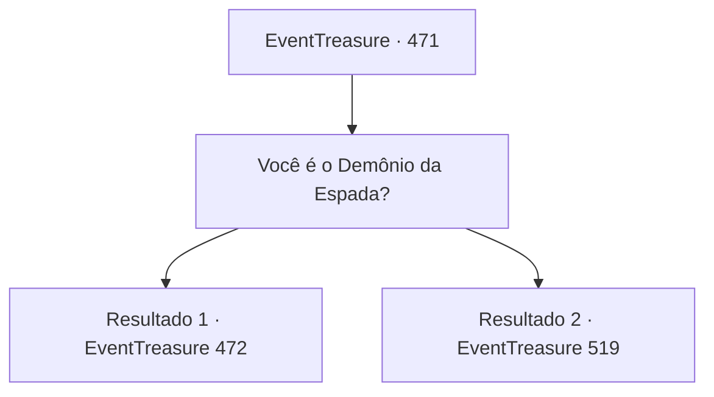

# Eventos de tesouro · 471

[Índice da tabela](index.md) · [Índice geral](../index.md)

ID: `pt:EventTreasure:471` · Fonte: `EventTreasure4` · Versão: 1.2.47.

Mapeamento estático dos arquivos; a disponibilidade e a execução dependem do estado da run.

## Texto do evento

*Sem texto no arquivo.*

## Dados de entrada

```json
{
  "id": 471,
  "grade": 1,
  "place": "",
  "required": ""
}
```

## Mapa das escolhas



## Escolhas e resultados

### Escolha 1

Você é o Demônio da Espada?

Requisitos e outros campos da escolha:

```json
{
  "required": ""
}
```

#### Resultado 1.1

Você lhe perguntou se ele era o Demônio da Espada. Ele assentiu. 

 "O título de Demônio da Espada é mais do que eu mereço, mas todos me chamam assim."

 O Demônio da Espada estalou a língua e continuou. 

 "Vago de lugar em lugar, enfrentando oponentes fortes para aperfeiçoar minha própria arte da espada. Foi assim que vim parar aqui."

 Um vento frio roçou sua bochecha. O Demônio da Espada sorriu de leve. 

 "Diferente dos fracos de antes, você parece ser bem habilidoso com a espada… Mostre-me sua lâmina."

 Com isso, ele desembainhou a espada e investiu contra você, como se nenhuma outra palavra fosse necessária.

Continuação registrada: [Evento 472](0472.md) na mesma tabela.

```json
{
  "required": "23_12_1",
  "chance": "1",
  "nextEvent": 472,
  "type": 2,
  "reward": "6_0_192|5_863_9",
  "place": 14
}
```

#### Resultado 1.2

Você lhe perguntou se ele era o Demônio da Espada. Ele assentiu. 

 "O título de Demônio da Espada é mais do que eu mereço, mas todos me chamam assim."

 O Demônio da Espada estalou a língua e continuou. 

 "Vago de lugar em lugar, enfrentando oponentes fortes para aperfeiçoar minha própria técnica de espada. Foi assim que vim parar aqui."

 Um vento frio roçou sua bochecha. Ele olhou para você e acrescentou: 

 "Você parece manejar muito bem uma espada, mas ao que parece não carrega nenhuma. Então não há motivo para eu me demorar. Adeus."

 Antes que você pudesse detê-lo, ele desapareceu entre os juncos.

Continuação registrada: [Evento 519](0519.md) na mesma tabela.

```json
{
  "required": "24_12_1",
  "chance": "1",
  "nextEvent": 519,
  "type": 2,
  "reward": "5_863_9"
}
```

## Referências que chegam a este evento

- [Evento 470 · escolha 1 · resultado 1](0470.md#escolha-1)
- [Evento 470 · escolha 1 · resultado 2](0470.md#escolha-1)
- [Evento 470 · escolha 2 · resultado 1](0470.md#escolha-2)
- [Evento 470 · escolha 2 · resultado 2](0470.md#escolha-2)
- [Evento 470 · escolha 3 · resultado 1](0470.md#escolha-3)
