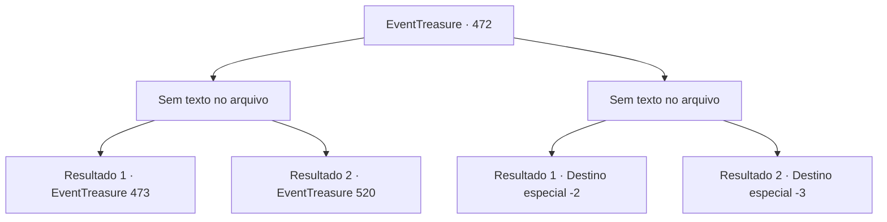

# Eventos de tesouro · 472

[Índice da tabela](index.md) · [Índice geral](../index.md)

ID: `pt:EventTreasure:472` · Fonte: `EventTreasure4` · Versão: 1.2.47.

Mapeamento estático dos arquivos; a disponibilidade e a execução dependem do estado da run.

## Texto do evento

*Sem texto no arquivo.*

## Dados de entrada

```json
{
  "id": 472,
  "grade": 1,
  "place": "",
  "required": ""
}
```

## Mapa das escolhas



## Escolhas e resultados

### Escolha 1

*Sem texto no arquivo; o papel dessa opção depende da interface do jogo.*

Requisitos e outros campos da escolha:

```json
{
  "required": ""
}
```

#### Resultado 1.1

A esgrima do Demônio da Espada era rápida, forte e imprevisível. O que parecia o mesmo ataque muitas vezes trazia variações súbitas, fintas escondidas por trás de defesas, ou golpes direcionados a articulações como o pulso ou o tornozelo. Mas nem tal habilidade pôde resistir à sua lâmina. Você desviou seu golpe, travou sua espada e a lançou ao ar. De joelhos, o Demônio da Espada admitiu a derrota. 

 "Eu perdi. Agora mate-me. Este é o verdadeiro fim de um guerreiro."

 Um sorriso se espalhou por seu rosto. 

 "Foi realmente uma luta prazerosa. Tome a minha cabeça e a minha espada — ela ainda tem sede de batalha."


Continuação registrada: [Evento 473](0473.md) na mesma tabela.

```json
{
  "required": "23_12_1",
  "chance": "1",
  "nextEvent": 473,
  "type": 2,
  "reward": ""
}
```

#### Resultado 1.2

O Demônio da Espada deu um passo para trás e embainhou sua lâmina. Ele franziu a testa. 

 "Você está zombando de mim? Eu pedi para ver sua espada, e é isso que você me mostra?"

 Reclamando do tempo perdido, ele desapareceu entre os juncos.

Continuação registrada: [Evento 520](0520.md) na mesma tabela.

```json
{
  "required": "24_12_1",
  "chance": "1",
  "nextEvent": 520,
  "type": 2,
  "reward": "5_863_9"
}
```

### Escolha 2

*Sem texto no arquivo; o papel dessa opção depende da interface do jogo.*

Requisitos e outros campos da escolha:

```json
{
  "required": ""
}
```

#### Resultado 2.1

A técnica de espada do Demônio da Espada era rápida, forte e em constante mudança. Ele repetia ataques, mas misturava variações inesperadas, escondia emboscadas por trás de sua guarda e golpeava com precisão cada fraqueza. Por fim, você não conseguiu resistir à sua habilidade sobrenatural e fugiu. O Demônio da Espada suspirou, desapontado, e embainhou a lâmina. 

 "Que pena. Desta vez foi até bem divertido…"

 Felizmente, ele não perseguiu você. Você deixou os juncos e retomou sua jornada.

Continuação registrada: [Destino especial `-2`](../destinos-especiais.md).

```json
{
  "required": "1_0_2|1_1_2",
  "chance": "1",
  "nextEvent": -2,
  "type": 2,
  "reward": "0_0_-1|0_1_-1"
}
```

#### Resultado 2.2

A esgrima do Demônio da Espada era rápida, forte e em constante mudança. Ele repetia ataques, mas misturava variações inesperadas, escondia emboscadas por trás de sua guarda e golpeava com precisão cada fraqueza. No fim, você caiu diante de sua habilidade assombrosa. O Demônio da Espada suspirou, desapontado, e então, como um relâmpago, desferiu um corte. 

 "Que pena. Desta vez foi até bastante divertido…"

 A lâmina cortou sua garganta, e o sangue jorrou. O mundo girou uma vez antes de você desabar.

Continuação registrada: [Destino especial `-3`](../destinos-especiais.md).

```json
{
  "required": "-1|2_0_2|2_1_2",
  "chance": "1",
  "nextEvent": -3,
  "type": 2,
  "reward": "0_0_-1|0_1_-1"
}
```

## Referências que chegam a este evento

- [Evento 471 · escolha 1 · resultado 1](0471.md#escolha-1)
