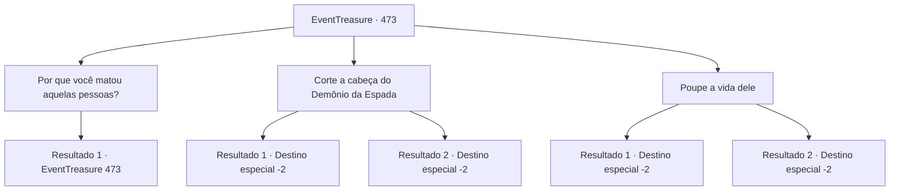

# Eventos de tesouro · 473

[Índice da tabela](index.md) · [Índice geral](../index.md)

ID: `pt:EventTreasure:473` · Fonte: `EventTreasure4` · Versão: 1.2.47.

Mapeamento estático dos arquivos; a disponibilidade e a execução dependem do estado da run.

## Texto do evento

*Sem texto no arquivo.*

## Dados de entrada

```json
{
  "id": 473,
  "grade": 1,
  "place": "",
  "required": ""
}
```

## Mapa das escolhas



## Escolhas e resultados

### Escolha 1

Por que você matou aquelas pessoas?

Requisitos e outros campos da escolha:

```json
{
  "required": "5_864_0"
}
```

#### Resultado 1.1

Em resposta à sua recusa, ele perguntou, perplexo: 

 "Apostamos nossas vidas neste duelo, e ainda assim você não vai me matar? Isso é um grave insulto a um guerreiro."

 Ele insistiu para que você o abatesse. Não havia falsidade em seus olhos.

Continuação registrada: [Evento 473](0473.md) na mesma tabela.

```json
{
  "required": "",
  "chance": "1",
  "nextEvent": 473,
  "type": 2,
  "reward": "5_864_1"
}
```

### Escolha 2

Corte a cabeça do Demônio da Espada

Requisitos e outros campos da escolha:

```json
{
  "required": ""
}
```

#### Resultado 2.1

Você ergueu sua espada e abateu o Demônio da Espada. Ele teve o mesmo fim que todos os que havia matado, mas, mesmo na morte, não perdeu o sorriso. Você pegou a espada que ele brandira. Nesse instante, os guardas da aldeia chegaram. Eles olharam a cena macabra, chocados. 

 "Q-Que… o que é isso? Você matou o Demônio da Espada?"

 Você explicou tudo a eles, detalhando os acontecimentos e o duelo. Os guardas assentiram, compreendendo. 

 "Entendo. Teria sido melhor se ele fosse julgado, mas como aconteceu em combate… Ainda assim, agradecemos."

 Eles expressaram brevemente sua gratidão e começaram a recolher os corpos. Você deixou os juncos para trás.

Continuação registrada: [Destino especial `-2`](../destinos-especiais.md).

```json
{
  "required": "18_973_1",
  "chance": "1",
  "nextEvent": -2,
  "type": 2,
  "reward": "27_60_1|5_863_9|3_374_1"
}
```

#### Resultado 2.2

Você ergueu sua espada e abateu o Demônio da Espada. Ele teve o mesmo fim que todos os que havia matado, mas, mesmo na morte, não perdeu o sorriso. Você pegou a espada que ele brandira. Nesse instante, os guardas da aldeia chegaram. Eles olharam a cena macabra, chocados. 

 "Q-Que… o que é isso? Você matou o Demônio da Espada?"

 Você explicou tudo a eles, detalhando os acontecimentos e o duelo. Os guardas assentiram, compreendendo. 

 "Entendo. Teria sido melhor se ele fosse julgado, mas como aconteceu em combate… Ainda assim, agradecemos."

 Eles expressaram brevemente sua gratidão e começaram a recolher os corpos. Você deixou os juncos para trás.

Continuação registrada: [Destino especial `-2`](../destinos-especiais.md).

```json
{
  "required": "5_973_1",
  "chance": "1",
  "nextEvent": -2,
  "type": 2,
  "reward": "5_863_9|3_374_1"
}
```

### Escolha 3

Poupe a vida dele

Requisitos e outros campos da escolha:

```json
{
  "required": ""
}
```

#### Resultado 3.1

Você escolheu não abater o Demônio da Espada. Ele levantou os olhos para você, o rosto se contorcendo ao perceber que você não iria acabar com ele. 

 "Por quê? Quer me insultar?"

 Nesse momento, os guardas da vila chegaram. Eles olharam para a cena macabra, chocados. 

 "Demônio da Espada! Vamos pôr fim à sua fúria aqui!"

 Eles avançaram e o contiveram. Ele não resistiu, mas fitou você com incredulidade. Você explicou tudo a eles, detalhando os acontecimentos e o duelo. Os guardas assentiram em sinal de compreensão. 

 "Entendo. Você fez o que nós não conseguimos. O povo vivia aterrorizado — graças a você, esse medo se foi."

 Eles expressaram uma breve gratidão e lhe entregaram a recompensa pelo Demônio da Espada. Em seguida, começaram a cuidar dos corpos. Você deixou os juncos para trás.

Continuação registrada: [Destino especial `-2`](../destinos-especiais.md).

```json
{
  "required": "18_973_1",
  "chance": "1",
  "nextEvent": -2,
  "type": 2,
  "reward": "27_60_1|5_863_9|0_4_200"
}
```

#### Resultado 3.2

Você escolheu não abater o Demônio da Espada. Ele levantou os olhos para você, o rosto se contorcendo ao perceber que você não iria acabar com ele. 

 "Por quê? Quer me insultar?"

 Nesse momento, os guardas da vila chegaram. Eles olharam para a cena macabra, chocados. 

 "Demônio da Espada! Vamos pôr fim à sua fúria aqui!"

 Eles avançaram e o contiveram. Ele não resistiu, mas fitou você com incredulidade. Você explicou tudo a eles, detalhando os acontecimentos e o duelo. Os guardas assentiram em sinal de compreensão. 

 "Entendo. Você fez o que nós não conseguimos. O povo vivia aterrorizado — graças a você, esse medo se foi."

 Eles expressaram uma breve gratidão e lhe entregaram a recompensa pelo Demônio da Espada. Em seguida, começaram a cuidar dos corpos. Você deixou os juncos para trás.

Continuação registrada: [Destino especial `-2`](../destinos-especiais.md).

```json
{
  "required": "5_973_1",
  "chance": "1",
  "nextEvent": -2,
  "type": 2,
  "reward": "5_863_9|0_4_200"
}
```

## Referências que chegam a este evento

- [Evento 472 · escolha 1 · resultado 1](0472.md#escolha-1)
- [Evento 473 · escolha 1 · resultado 1](0473.md#escolha-1)
- [Evento 521 · escolha 1 · resultado 1](0521.md#escolha-1)
