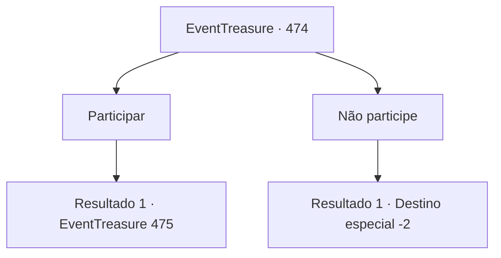

# Eventos de tesouro · 474

[Índice da tabela](index.md) · [Índice geral](../index.md)

ID: `pt:EventTreasure:474` · Fonte: `EventTreasure4` · Versão: 1.2.47.

Mapeamento estático dos arquivos; a disponibilidade e a execução dependem do estado da run.

## Texto do evento

Quando você chegou à pequena aldeia de Brandel, aos pés das Montanhas Alamia, toda a aldeia estava imersa em um clima festivo. Bandeiras coloridas estavam penduradas por toda parte e, na praça central, os aldeões se movimentavam em preparação para algo importante. Entre eles, uma pessoa o cumprimentou calorosamente.  

 "Bem-vindo! Hoje é o dia do nosso torneio anual de arco e flecha! Por que não participar? O prêmio em dinheiro para o vencedor é bastante generoso!"


## Dados de entrada

```json
{
  "id": 474,
  "grade": 2,
  "place": "",
  "required": "5_865_0|1_2_20|26_52_1"
}
```

## Mapa das escolhas



## Escolhas e resultados

### Escolha 1

Participar

Requisitos e outros campos da escolha:

```json
{
  "required": ""
}
```

#### Resultado 1.1

Você se registrou, recebeu uma besta de torneio e dirigiu-se ao campo. Caçadores jovens e velhos aqueciam-se, mas um homem se destacava: William, o renomado atirador que havia vencido os últimos cinco torneios consecutivos.  

 "Aquele é o William."

 "Ele é o atirador mais famoso destas montanhas. Venceu esta competição cinco anos seguidos."

  Logo, começou a primeira rodada — um alvo fixo a 300 pés, cinco disparos por competidor. 

 "Competidores, cada um de vocês fará cinco disparos. As pontuações determinarão a classificação!"


Continuação registrada: [Evento 475](0475.md) na mesma tabela.

```json
{
  "required": "",
  "chance": "1",
  "nextEvent": 475,
  "type": 2,
  "reward": "3_10_1"
}
```

### Escolha 2

Não participe

Requisitos e outros campos da escolha:

```json
{
  "required": ""
}
```

#### Resultado 2.1

Você escolheu não participar e simplesmente passou pela vila animada.

Continuação registrada: [Destino especial `-2`](../destinos-especiais.md).

```json
{
  "required": "",
  "chance": "1",
  "nextEvent": -2,
  "type": 2,
  "reward": "5_865_9"
}
```

## Referências que chegam a este evento

Nenhum `nextEvent` positivo da mesma tabela aponta para este nó. Isso não prova que seja inacessível: sorteio e estado de história podem selecioná-lo.

