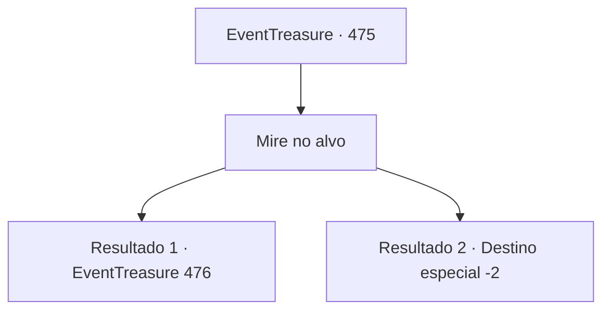

# Eventos de tesouro · 475

[Índice da tabela](index.md) · [Índice geral](../index.md)

ID: `pt:EventTreasure:475` · Fonte: `EventTreasure4` · Versão: 1.2.47.

Mapeamento estático dos arquivos; a disponibilidade e a execução dependem do estado da run.

## Texto do evento

*Sem texto no arquivo.*

## Dados de entrada

```json
{
  "id": 475,
  "grade": 1,
  "place": "",
  "required": ""
}
```

## Mapa das escolhas



## Escolhas e resultados

### Escolha 1

Mire no alvo

Requisitos e outros campos da escolha:

```json
{
  "required": ""
}
```

#### Resultado 1.1

Quando chegou a sua vez, você firmou a mira e disparou. 

 “Thwip—! Thunk!” 

 Cada virote atingiu o alvo, arrancando aplausos.  

 "Oh, um rosto novo, mas muito bom!"

  Você marcou 45 pontos, até chamando a atenção de William. Então William fez sua vez — cada virote atravessou o centro do alvo, quase um sobre o outro, demonstrando foco perfeito.  

 "Como esperado de William!"

  Quando a rodada dele terminou, você se viu entre os oito melhores avançando para as semifinais.  

 "Competidores, a próxima rodada é acertar uma maçã a 400 pés. Cada um tem três tentativas!"


Continuação registrada: [Evento 476](0476.md) na mesma tabela.

```json
{
  "required": "",
  "chance": "1|0_5_1|0_6_1",
  "nextEvent": 476,
  "type": 0,
  "reward": ""
}
```

#### Resultado 1.2

Várias rodadas se passaram, e finalmente chegou a sua vez. Você ergueu a besta, firmou a mira e inspirou fundo. 

 “Thwip—!” 

 Seu virote cortou o ar, mas apenas roçou o alvo. Após disparar o primeiro, o segundo e o último virote, a multidão irrompeu em vaias.  

 "Buuuu~~ Até a minha avó, no túmulo, atiraria melhor do que você!"

  Risos explodiram nas arquibancadas, e você corou de vergonha antes de fugir do recinto do torneio.

Continuação registrada: [Destino especial `-2`](../destinos-especiais.md).

```json
{
  "required": "",
  "chance": "20",
  "nextEvent": -2,
  "type": 1,
  "reward": "4_10_1|5_865_9"
}
```

## Referências que chegam a este evento

- [Evento 474 · escolha 1 · resultado 1](0474.md#escolha-1)
