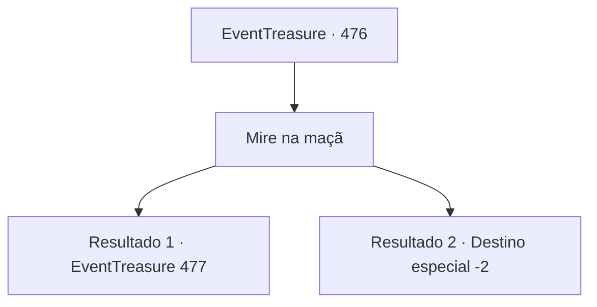

# Eventos de tesouro · 476

[Índice da tabela](index.md) · [Índice geral](../index.md)

ID: `pt:EventTreasure:476` · Fonte: `EventTreasure4` · Versão: 1.2.47.

Mapeamento estático dos arquivos; a disponibilidade e a execução dependem do estado da run.

## Texto do evento

*Sem texto no arquivo.*

## Dados de entrada

```json
{
  "id": 476,
  "grade": 1,
  "place": "",
  "required": ""
}
```

## Mapa das escolhas



## Escolhas e resultados

### Escolha 1

Mire na maçã

Requisitos e outros campos da escolha:

```json
{
  "required": ""
}
```

#### Resultado 1.1

Com a maior distância, o torneio havia se tornado significativamente mais difícil. Muitos concorrentes tiveram dificuldades, alguns nem sequer acertando a maçã. Finalmente, chegou a sua vez. Você ergueu a besta e mirou com o máximo cuidado. 

 “Thwip—!” 

 O primeiro virote roçou o topo da maçã. Você ajustou um pouco mais baixo. 

 “Thwip—!” 

 O segundo virote perfurou a maçã bem no centro. O encarregado aplaudiu e anunciou:  

 "Parabéns! Você avança para a final."

  Ele pediu que você esperasse até que as outras tentativas terminassem. Logo, restaram apenas três concorrentes: você, William e outro caçador veterano. O anunciador bradou:  

 "Agora, a final! Vocês devem acertar o alvo oscilante a 400 pés! Cada competidor tem três virotes, e quem acertar mais vence! Se ninguém conseguir, a disputa continuará até que alguém consiga — o primeiro a acertar será o vencedor!"

  Você seguiu seu gesto e viu um pequeno alvo pendurado em uma árvore, balançando ao vento.

Continuação registrada: [Evento 477](0477.md) na mesma tabela.

```json
{
  "required": "",
  "chance": "1|0_5_1|0_6_1",
  "nextEvent": 477,
  "type": 0,
  "reward": ""
}
```

#### Resultado 1.2

Com a maior distância, o torneio tinha se tornado significativamente mais difícil. Muitos concorrentes tiveram dificuldades, alguns nem chegaram a atingir a maçã. Por fim, chegou a sua vez. Você ergueu a besta, firmou a mira e disparou. 

 “Thwip—!” 

 O primeiro virote passou completamente pela maçã. Você tentou de novo, mirando mais baixo — outro erro. O terceiro virote também errou. As arquibancadas suspiraram em desapontamento.  

 "Ah, que pena. Obrigado por participar. Por favor, devolva a besta na saída."

  Você entregou a besta ao encarregado e saiu silenciosamente do recinto.

Continuação registrada: [Destino especial `-2`](../destinos-especiais.md).

```json
{
  "required": "",
  "chance": "30",
  "nextEvent": -2,
  "type": 1,
  "reward": "4_10_1|5_865_9"
}
```

## Referências que chegam a este evento

- [Evento 475 · escolha 1 · resultado 1](0475.md#escolha-1)
