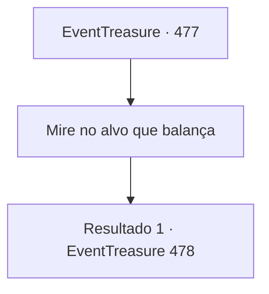

# Eventos de tesouro · 477

[Índice da tabela](index.md) · [Índice geral](../index.md)

ID: `pt:EventTreasure:477` · Fonte: `EventTreasure4` · Versão: 1.2.47.

Mapeamento estático dos arquivos; a disponibilidade e a execução dependem do estado da run.

## Texto do evento

*Sem texto no arquivo.*

## Dados de entrada

```json
{
  "id": 477,
  "grade": 1,
  "place": "",
  "required": ""
}
```

## Mapa das escolhas



## Escolhas e resultados

### Escolha 1

Mire no alvo que balança

Requisitos e outros campos da escolha:

```json
{
  "required": ""
}
```

#### Resultado 1.1

Primeiro, foi a sua vez. Você observou cuidadosamente o movimento do alvo, estudando seu padrão. Quando o alvo veio diretamente ao centro, você apertou o gatilho. No entanto, seu virote errou o alvo por pouco. O caçador veterano que foi em seguida também atirou com cuidado, mas não conseguiu acertar o alvo. A última vez ficou para William. Com precisão calma, ele mirou e, com um único disparo, perfurou o alvo em movimento. O locutor ergueu o braço de William e gritou: 

 "Vejam! Como esperado, o campeão é William!"

 Aplausos e vivas irromperam da multidão, e você se juntou, aplaudindo para parabenizar William.

Continuação registrada: [Evento 478](0478.md) na mesma tabela.

```json
{
  "required": "",
  "chance": "1",
  "nextEvent": 478,
  "type": 2,
  "reward": ""
}
```

## Referências que chegam a este evento

- [Evento 476 · escolha 1 · resultado 1](0476.md#escolha-1)
