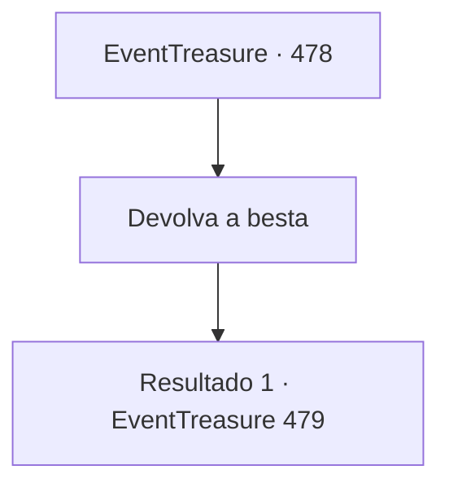

# Eventos de tesouro · 478

[Índice da tabela](index.md) · [Índice geral](../index.md)

ID: `pt:EventTreasure:478` · Fonte: `EventTreasure4` · Versão: 1.2.47.

Mapeamento estático dos arquivos; a disponibilidade e a execução dependem do estado da run.

## Texto do evento

*Sem texto no arquivo.*

## Dados de entrada

```json
{
  "id": 478,
  "grade": 1,
  "place": "",
  "required": ""
}
```

## Mapa das escolhas



## Escolhas e resultados

### Escolha 1

Devolva a besta

Requisitos e outros campos da escolha:

```json
{
  "required": ""
}
```

#### Resultado 1.1

Você devolveu a besta que havia usado no torneio e seguiu para fora. Nesse momento, William se aproximou de você e falou. 

 "Isso foi uma demonstração de habilidade realmente impressionante. Meu nome é William."

 Vocês trocaram cumprimentos. Ele reconheceu sua habilidade e disse que gostaria de compartilhar um pouco do próprio conhecimento. 

 "Você tem o talento de um atirador. Se aprender só alguns truques para cobrir certas fraquezas, pode ficar ainda melhor..."

 Após uma breve pausa, ele fez uma sugestão. 

 "Se tiver tempo, eu gostaria de lhe oferecer alguns conselhos. Amanhã à tarde serve para você?"


Continuação registrada: [Evento 479](0479.md) na mesma tabela.

```json
{
  "required": "",
  "chance": "1",
  "nextEvent": 479,
  "type": 2,
  "reward": "4_10_1"
}
```

## Referências que chegam a este evento

- [Evento 477 · escolha 1 · resultado 1](0477.md#escolha-1)
