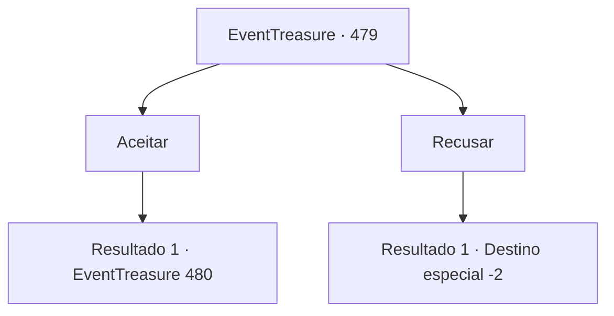

# Eventos de tesouro · 479

[Índice da tabela](index.md) · [Índice geral](../index.md)

ID: `pt:EventTreasure:479` · Fonte: `EventTreasure4` · Versão: 1.2.47.

Mapeamento estático dos arquivos; a disponibilidade e a execução dependem do estado da run.

## Texto do evento

*Sem texto no arquivo.*

## Dados de entrada

```json
{
  "id": 479,
  "grade": 1,
  "place": "",
  "required": ""
}
```

## Mapa das escolhas



## Escolhas e resultados

### Escolha 1

Aceitar

Requisitos e outros campos da escolha:

```json
{
  "required": ""
}
```

#### Resultado 1.1

Na tarde seguinte, você foi ao local de encontro que William havia mencionado. Ele estava esperando em frente a um antigo chalé de caça na beira da floresta, acenando com um sorriso tranquilo. 

 "Ah, você veio. Aqui é onde eu geralmente treino."

 Ao redor do chalé havia alvos, espantalhos e postes de madeira para treinamento. William lhe entregou uma besta e alguns virotes, dizendo: 

 "Pelo que vi na competição de ontem, sua mira é excelente. Mas, se você trabalhar em ler o vento e melhorar seus reflexos, vai ficar muito melhor."

 Então ele demonstrou. Ergueu a besta, semicerrando os olhos, avaliou a direção e a força do vento e puxou o gatilho. ‘Tzip—!’ Um capacete velho e enferrujado pendurado ao longe tilintou alto quando o virote o atingiu. 

 "Viu? Você precisa aprender a ‘sentir’ o vento. Não dependa só dos olhos — use também o som e o movimento ao seu redor."

 Você imitou William, semicerrando os olhos enquanto mirava e atirava. Mas seu virote apenas roçou o capacete. Observando você, William ofereceu incentivo. 

 "Isso não se domina de primeira, então não se preocupe. Vamos, vamos continuar."


Continuação registrada: [Evento 480](0480.md) na mesma tabela.

```json
{
  "required": "",
  "chance": "1",
  "nextEvent": 480,
  "type": 2,
  "reward": "3_10_1"
}
```

### Escolha 2

Recusar

Requisitos e outros campos da escolha:

```json
{
  "required": ""
}
```

#### Resultado 2.1

Você recusou a oferta de William. Parecendo desapontado, ele respondeu: 

 "É mesmo? Uma pena, mas não há o que fazer. Então, adeus."

 Ele se despediu de você e partiu.

Continuação registrada: [Destino especial `-2`](../destinos-especiais.md).

```json
{
  "required": "",
  "chance": "1",
  "nextEvent": -2,
  "type": 2,
  "reward": "5_865_9"
}
```

## Referências que chegam a este evento

- [Evento 478 · escolha 1 · resultado 1](0478.md#escolha-1)
