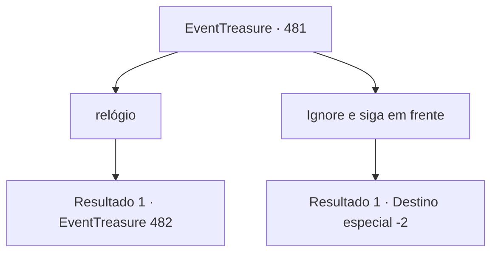

# Eventos de tesouro · 481

[Índice da tabela](index.md) · [Índice geral](../index.md)

ID: `pt:EventTreasure:481` · Fonte: `EventTreasure4` · Versão: 1.2.47.

Mapeamento estático dos arquivos; a disponibilidade e a execução dependem do estado da run.

## Texto do evento

Você mais uma vez chegou a Brandel, a vila onde o torneio de arco e flecha havia sido realizado antes. Na praça central, uma grande multidão tinha se reunido, mas a atmosfera estava longe de ser festiva. Todos exibiam expressões carregadas, os olhares fixos em um único ponto, enquanto leves suspiros e sussurros ansiosos ondulavam pelo ar.  

 "Arrastar até uma criança para isso... quão cruéis podem ser..."

  Você abriu caminho pela multidão reunida até a frente. |drawing_wiliumtell| Lá, no meio da praça, erguia-se um tablado. Sobre ele estava sentado um homem com um suntuoso chapéu emplumado, o rosto retorcido em desdém arrogante. À sua frente, um menino estava amarrado a um poste, uma maçã vermelha pousada no topo de sua cabeça trêmula.  

 "...P-Pai."

  Murmurou o menino, com a voz trêmula.

## Dados de entrada

```json
{
  "id": 481,
  "grade": 2,
  "place": "",
  "required": "5_865_1|1_2_50"
}
```

## Mapa das escolhas



## Escolhas e resultados

### Escolha 1

relógio

Requisitos e outros campos da escolha:

```json
{
  "required": ""
}
```

#### Resultado 1.1

A cerca de 200 pés do menino estava William, segurando uma besta. As mãos lhe tremiam levemente, e o rosto estava mortalmente pálido. Vendo isso, o lorde falou em tom de zombaria. 

 "Muito bem, William. Mostre-nos a melhor destreza de Lamia. Acerte a maçã colocada sobre a cabeça de seu filho. Se conseguir, tanto você quanto o menino viverão. Caso contrário…"

 Ele fez um gesto de cortar a própria garganta.  O homem chamado William falou com voz desesperada. 

 "Meu lorde, por favor… a criança é inocente. Castigue apenas a mim, mas poupe-o…"

  O lorde rugiu de raiva. 

 "Silêncio! Não apenas ousaste deixar de mostrar respeito ao meu chapéu, como ainda me desafias, Bernhardt? Deverias ser grato por tamanha misericórdia!"

  Os moradores reunidos observavam em silêncio. Alguns pareciam querer ajudar, mas os soldados de Bernhardt cercavam a praça, tornando impossível avançar. Com o rosto pálido como um lençol, William pegou a besta, as mãos ainda tremendo.

Continuação registrada: [Evento 482](0482.md) na mesma tabela.

```json
{
  "required": "",
  "chance": "1",
  "nextEvent": 482,
  "type": 2,
  "reward": "5_865_9"
}
```

### Escolha 2

Ignore e siga em frente

Requisitos e outros campos da escolha:

```json
{
  "required": ""
}
```

#### Resultado 2.1

Ignorou as pessoas reunidas e simplesmente passou por elas.

Continuação registrada: [Destino especial `-2`](../destinos-especiais.md).

```json
{
  "required": "",
  "chance": "1",
  "nextEvent": -2,
  "type": 2,
  "reward": "5_865_9"
}
```

## Referências que chegam a este evento

Nenhum `nextEvent` positivo da mesma tabela aponta para este nó. Isso não prova que seja inacessível: sorteio e estado de história podem selecioná-lo.

