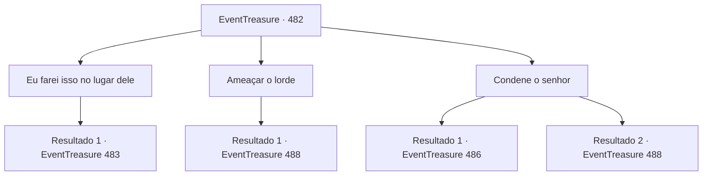

# Eventos de tesouro · 482

[Índice da tabela](index.md) · [Índice geral](../index.md)

ID: `pt:EventTreasure:482` · Fonte: `EventTreasure4` · Versão: 1.2.47.

Mapeamento estático dos arquivos; a disponibilidade e a execução dependem do estado da run.

## Texto do evento

*Sem texto no arquivo.*

## Dados de entrada

```json
{
  "id": 482,
  "grade": 1,
  "place": "",
  "required": ""
}
```

## Mapa das escolhas



## Escolhas e resultados

### Escolha 1

Eu farei isso no lugar dele

Requisitos e outros campos da escolha:

```json
{
  "required": ""
}
```

#### Resultado 1.1

Ao dar um passo à frente, o silêncio caiu sobre a praça. Todos os olhos se voltaram para você. William olhou de volta para você em choque, gratidão misturada com preocupação em seu olhar. Lorde Bernhardt arqueou uma sobrancelha, divertido. 

 "Oh? Alguém quer bancar o herói. E quem seria você?"

  William explicou às pressas. 

 "Meu lorde, este é {1}, o aventureiro que demonstrou grande habilidade em nosso último torneio de arco e flecha. Tive até a honra de ensinar-lhe algumas coisas depois."

  Os olhos de Bernhardt se iluminaram de interesse. Ele o examinou de cima a baixo, com desdém. 

 "Ha! Então é ainda melhor. Se o discípulo foi ensinado pelo mestre, vamos ver se o discípulo o superou."

  Ele ergueu a mão e ordenou a seus soldados. 

 "Ponham este no lugar de William. E vamos acrescentar mais uma condição. William, se este fracassar…"

  O sorriso de Bernhardt tornou-se cruel. 

 "Não apenas você e seu filho, mas também este bravo herói, serão todos executados."


Continuação registrada: [Evento 483](0483.md) na mesma tabela.

```json
{
  "required": "",
  "chance": "1",
  "nextEvent": 483,
  "type": 2,
  "reward": ""
}
```

### Escolha 2

Ameaçar o lorde

Requisitos e outros campos da escolha:

```json
{
  "required": ""
}
```

#### Resultado 2.1

Você sacou sua arma e a apontou para o lorde, gritando para que ele cessasse sua vil crueldade de uma vez. O rosto de Bernhardt contorceu-se de raiva enquanto ele o encarava. 

 "Como se atreve… como ousa desafiar-me!"

 Ele fez um gesto brusco para seus soldados. 

 "Prendam imediatamente aquele miserável insolente!"

 Ao seu comando, os soldados ao redor da praça começaram a mover-se em uníssono.

Continuação registrada: [Evento 488](0488.md) na mesma tabela.

```json
{
  "required": "",
  "chance": "1",
  "nextEvent": 488,
  "type": 2,
  "reward": "6_0_135",
  "place": 4
}
```

### Escolha 3

Condene o senhor

Requisitos e outros campos da escolha:

```json
{
  "required": ""
}
```

#### Resultado 3.1

Com uma presença imponente, você atraiu a atenção de todos. Você condenou em voz alta a crueldade do conde, de modo que não apenas a multidão, mas os soldados e o próprio Bernhardt pudessem ouvir. O rosto do conde ficou vermelho, com veias saltando na testa. 

 "Como ousa… como ousa me desafiar!"

 Ele fez um gesto brusco para seus soldados. 

 "Prendam imediatamente aquele miserável insolente!"

  Mas os soldados hesitaram. Os moradores da cidade, encorajados por suas palavras, contiveram os soldados, empurrando-os para o lado enquanto gritavam protestos furiosos contra o conde. O rosto de Bernhardt passou do vermelho ao pálido, e ele montou no cavalo em pânico. 

 "T-tudo bem! De repente tenho assuntos urgentes a tratar. Considere-se sortudo hoje, William!"

 Ele cravou as esporas em seu pobre corcel branco e fugiu em direção ao castelo.  Os soldados restantes, perdendo a vontade de lutar, dispersaram-se desajeitadamente atrás dele. Fez-se silêncio na praça.  William libertou o filho e então aproximou-se de você com gratidão. 

 "Obrigado por salvar o nosso Tommy…"

 O garoto, Tommy, fez uma profunda reverência. 

 "Obrigado, senhor!"


Continuação registrada: [Evento 486](0486.md) na mesma tabela.

```json
{
  "required": "",
  "chance": "1|0_12_1",
  "nextEvent": 486,
  "type": 0,
  "reward": ""
}
```

#### Resultado 3.2

Você deu um passo à frente mais uma vez, condenando em voz alta a crueldade do senhor. O rosto do senhor ficou rubro, veias saltando na testa. 

 "Como ousa... como ousa desafiar-me!"

 Ele fez um gesto brusco aos seus soldados. 

 "Agarrem aquele miserável insolente imediatamente!"

  Ao seu comando, os soldados ao redor da praça começaram a mover-se em uníssono.

Continuação registrada: [Evento 488](0488.md) na mesma tabela.

```json
{
  "required": "",
  "chance": "30",
  "nextEvent": 488,
  "type": 1,
  "reward": "6_0_135",
  "place": 4
}
```

## Referências que chegam a este evento

- [Evento 481 · escolha 1 · resultado 1](0481.md#escolha-1)
