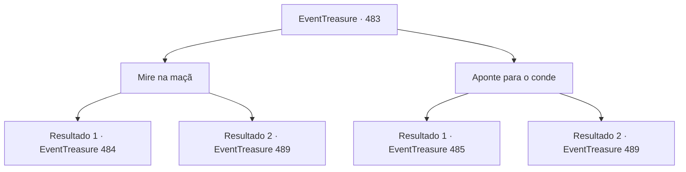

# Eventos de tesouro · 483

[Índice da tabela](index.md) · [Índice geral](../index.md)

ID: `pt:EventTreasure:483` · Fonte: `EventTreasure4` · Versão: 1.2.47.

Mapeamento estático dos arquivos; a disponibilidade e a execução dependem do estado da run.

## Texto do evento

*Sem texto no arquivo.*

## Dados de entrada

```json
{
  "id": 483,
  "grade": 1,
  "place": "",
  "required": ""
}
```

## Mapa das escolhas



## Escolhas e resultados

### Escolha 1

Mire na maçã

Requisitos e outros campos da escolha:

```json
{
  "required": ""
}
```

#### Resultado 1.1

Você tomou o lugar de William. Ao empunhar a besta, seu peso pesado assentou-se em suas mãos. A distância era de 200 pés. Uma brisa leve agitou o ar. Você estabilizou a respiração e firmou a mira. A maçã vermelha empoleirada no topo da cabeça do menino destacava-se nitidamente. Embora tremesse, o menino se esforçava para manter a cabeça imóvel. Você travou a besta contra o ombro e mirou. As técnicas que William um dia lhe ensinara passaram pela sua mente. Prendendo a respiração, acalmando as mãos trêmulas, você puxou o gatilho.  

 Fiu—Tum! 

  O menino apertou os olhos quando seu virote atravessou bem o centro da maçã. A praça silenciou por um batimento antes que suspiros de alívio e exclamações de assombro se espalhassem pela multidão. William desabou de joelhos, olhando para o céu, enquanto o menino, ainda atado ao pilar, voltou os olhos para o pai. O rosto do conde se contorceu de raiva. 

 "Inaceitável! Isto é claramente um truque!"

 Gritou furioso. De súbito, arrancou a besta das mãos de um soldado próximo e apontou-a para você. 

 "Você ousa me humilhar, verme? Morra!"


Continuação registrada: [Evento 484](0484.md) na mesma tabela.

```json
{
  "required": "",
  "chance": "1|0_5_1|0_6_1",
  "nextEvent": 484,
  "type": 0,
  "reward": "16_10_1"
}
```

#### Resultado 1.2

Você tomou o lugar de William. Ao agarrar a besta, o peso pesado assentou-se em suas mãos. A distância era de 200 pés. Uma brisa leve agitou o ar. Você controlou a respiração e firmou a mira. A maçã vermelha pousada no topo da cabeça do garoto destacava-se nitidamente. Embora tremesse, o garoto se esforçava para manter a cabeça imóvel. Você prendeu a besta ao ombro e mirou. As técnicas que William um dia lhe ensinou lampejaram pela mente. Mas suas mãos tremiam violentamente, apesar do esforço para estabilizá-las. Não havia mais tempo para hesitar. Você puxou o gatilho. 

 Thwip—Thud! 

 O garoto fechou os olhos com força quando seu virote passou pela maçã — atravessando o chapéu do Conde Bernhardt de lado a lado. 

 "Meu... meu chapéu!"

 O conde fitou, incrédulo, o chapéu emplumado arruinado. Tremendo, arrancou-o do chão e então lançou um olhar furioso a você. 

 "Você... você...!"

 Mas seus olhos reviraram. Apertando o pescoço, ele desabou para trás. 

 "Meu senhor!"

 Seus soldados correram ao seu lado, colocando-o às pressas sobre um cavalo e escoltando-o de volta em direção ao castelo.  Um silêncio repentino caiu sobre a praça. William libertou o filho e então voltou-se para você com gratidão. 

 "Obrigado... por salvar o nosso Tommy."

 O garoto curvou-se profundamente. 

 "Obrigado!"

 Ainda assim, os rostos dos aldeões permaneciam turvos de inquietação. O chefe da aldeia deu um passo à frente e falou com William. 

 "William... o conde recuou hoje, mas você sabe bem que ele não vai perdoar esta humilhação."

 William assentiu lentamente. 

 "Sim. Eu entendo, chefe. Vou juntar o que puder e deixar a aldeia assim que possível."

 Depois de agradecer aos aldeões, ele se virou para você. 

 "Pode me dar um momento? Quero recompensar você antes de ir."


Continuação registrada: [Evento 489](0489.md) na mesma tabela.

```json
{
  "required": "",
  "chance": "30",
  "nextEvent": 489,
  "type": 1,
  "reward": "16_10_1"
}
```

### Escolha 2

Aponte para o conde

Requisitos e outros campos da escolha:

```json
{
  "required": "2_3_-14"
}
```

#### Resultado 2.1

Você tomou o lugar de William. Ao segurar a besta, o peso dela se acomodou em suas mãos. A distância era de 200 pés. Uma brisa leve agitava o ar. Você controlou a respiração e firmou a mira. A maçã vermelha no topo da cabeça do garoto destacava-se nitidamente. Mas, em vez de mirar na maçã, você virou a besta para o conde. As técnicas que William lhe ensinara um dia passaram pela sua mente. 

 "O-o quê…!"

 Antes que ele pudesse dizer mais alguma coisa, você puxou o gatilho. 

 Thwip—Thud! 

 O garoto apertou os olhos, fechando-os, quando o seu virote cravou-se na testa do conde. 

 "Uh… urgh…"

 Incrédulo, Bernhardt apalpou a haste em sua testa antes que as pernas cedessem e ele tombasse para trás. O silêncio varreu a multidão.

Continuação registrada: [Evento 485](0485.md) na mesma tabela.

```json
{
  "required": "",
  "chance": "1|0_5_1|0_6_1",
  "nextEvent": 485,
  "type": 0,
  "reward": "16_10_1|0_3_-3"
}
```

#### Resultado 2.2

Você tomou o lugar de William. Ao segurar a besta, seu peso pesado assentou-se em suas mãos. A distância era de 200 pés. Uma brisa leve agitava o ar. Você estabilizou a respiração e firmou a mira. A maçã vermelha empoleirada no topo da cabeça do garoto destacava-se claramente. Embora tremesse, o garoto se esforçava para manter a cabeça imóvel. Em vez de mirar na maçã, você virou a besta para o conde. As técnicas que William um dia lhe ensinou passaram pela sua mente. 

 "O-o quê…!"

 Antes que ele pudesse dizer mais, você apertou o gatilho.  

 Thwip—Thud! 

  O garoto apertou os olhos ao máximo quando o seu virote assobiou ao passar pela maçã e atravessou diretamente o chapéu emplumado de Bernhardt. 

 "Meu… meu chapéu!"

 O conde fitou, incrédulo, o chapéu arruinado. Tremendo, agarrou-o e fulminou você com o olhar. 

 "Você… você…!"

 Mas então seus olhos reviraram. Agarrando o pescoço, ele tombou. 

 "Meu senhor!"

 Seus soldados correram para o seu lado, rapidamente o puseram sobre um cavalo e o levaram de volta em direção ao castelo.  Um silêncio súbito tomou a praça. William libertou o filho e então se aproximou de você, grato. 

 "Obrigado… por salvar o nosso Tommy."

 O garoto curvou-se profundamente. 

 "Obrigado!"

 Mas os rostos dos aldeões permaneceram sombrios. Do meio deles, o chefe da aldeia deu um passo à frente. 

 "William… o conde pode ter fugido hoje, mas você sabe que ele não vai perdoar esta humilhação."

 William assentiu lentamente. 

 "Sim… eu entendo, chefe. Vou juntar minhas coisas e deixar a aldeia assim que puder."

 Depois de agradecer aos aldeões, ele se voltou para você. 

 "Você poderia me conceder um momento? Quero retribuir antes de ir."


Continuação registrada: [Evento 489](0489.md) na mesma tabela.

```json
{
  "required": "",
  "chance": "20",
  "nextEvent": 489,
  "type": 1,
  "reward": "16_10_1|0_3_-3"
}
```

## Referências que chegam a este evento

- [Evento 482 · escolha 1 · resultado 1](0482.md#escolha-1)
