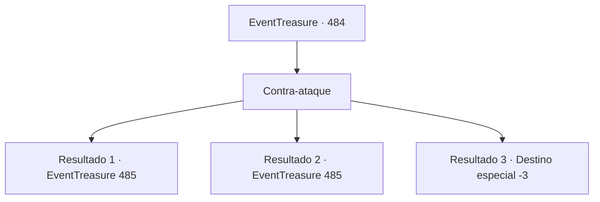

# Eventos de tesouro · 484

[Índice da tabela](index.md) · [Índice geral](../index.md)

ID: `pt:EventTreasure:484` · Fonte: `EventTreasure4` · Versão: 1.2.47.

Mapeamento estático dos arquivos; a disponibilidade e a execução dependem do estado da run.

## Texto do evento

*Sem texto no arquivo.*

## Dados de entrada

```json
{
  "id": 484,
  "grade": 1,
  "place": "",
  "required": ""
}
```

## Mapa das escolhas



## Escolhas e resultados

### Escolha 1

Contra-ataque

Requisitos e outros campos da escolha:

```json
{
  "required": ""
}
```

#### Resultado 1.1

Você levantou a besta num movimento rápido e disparou no mesmo gesto.  Clang!  Os dois virotes colidiram no ar. O disparo do conde se estilhaçou em pedaços que tilintaram ao cair no chão, enquanto o seu virote foi desviado pelo impacto e se cravou na testa de Bernhardt. 

 "Uh… urgh…"

 Incrédulo, o conde apalpou debilmente a haste cravada na testa antes que as pernas lhe cedessem e ele tombasse para trás. Um pesado silêncio se abateu sobre a multidão.

Continuação registrada: [Evento 485](0485.md) na mesma tabela.

```json
{
  "required": "",
  "chance": "1|0_5_1|0_6_1",
  "nextEvent": 485,
  "type": 0,
  "reward": "27_61_1"
}
```

#### Resultado 1.2

Você tentou recarregar e atirar novamente, mas foi tarde demais. O virote de Bernhardt atingiu seu ombro com força, e uma dor lancinante o obrigou a deixar cair a besta. 

 "Seu cão imundo!"

 Ao ver isso, William rugiu de fúria, ergueu sua própria besta e atirou contra o conde. 

 "Uh… urgh…"

 O conde cambaleou quando o virote se cravou em sua testa. Ele tentou arrancá-lo, incrédulo, antes de tombar para trás.  A praça mergulhou em silêncio. William abaixou a besta e caiu de joelhos diante dos soldados. 

 "Se têm de levar alguém, levem-me. Mas poupem meu filho… e {1}."

 Os soldados trocaram olhares inquietos, e nenhum ousou se mover.

Continuação registrada: [Evento 485](0485.md) na mesma tabela.

```json
{
  "required": "1_0_2",
  "chance": "30",
  "nextEvent": 485,
  "type": 1,
  "reward": "0_0_-1"
}
```

#### Resultado 1.3

Você tentou recarregar e atirar novamente, mas era tarde demais. O virote de Bernhardt atingiu seu pescoço, e sua consciência deslizou rapidamente para a escuridão.

Continuação registrada: [Destino especial `-3`](../destinos-especiais.md).

```json
{
  "required": "2_0_2",
  "chance": "30",
  "nextEvent": -3,
  "type": 1,
  "reward": "0_0_-1"
}
```

## Referências que chegam a este evento

- [Evento 483 · escolha 1 · resultado 1](0483.md#escolha-1)
