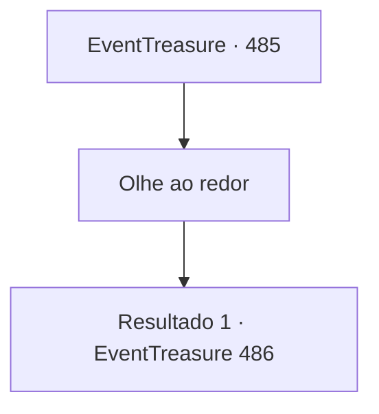

# Eventos de tesouro · 485

[Índice da tabela](index.md) · [Índice geral](../index.md)

ID: `pt:EventTreasure:485` · Fonte: `EventTreasure4` · Versão: 1.2.47.

Mapeamento estático dos arquivos; a disponibilidade e a execução dependem do estado da run.

## Texto do evento

*Sem texto no arquivo.*

## Dados de entrada

```json
{
  "id": 485,
  "grade": 1,
  "place": "",
  "required": ""
}
```

## Mapa das escolhas



## Escolhas e resultados

### Escolha 1

Olhe ao redor

Requisitos e outros campos da escolha:

```json
{
  "required": ""
}
```

#### Resultado 1.1

Você olhou ao redor, observando as reações das pessoas. Nem os aldeões nem os soldados mostravam qualquer sinal de luto pela morte do Conde. Se algo, suas expressões carregavam o alívio de quem se livrou de uma dor que supurava havia muito tempo. Dentre eles, o ancião da aldeia adiantou-se e disse: 

 "Concordemos assim. O Conde veio aqui inspecionar os preparativos para nossa competição de tiro com arco e quis testar sua própria habilidade."

  Ele colocou um elmo velho e amassado na cabeça do filho de William. 

 "O Conde pôs este elmo de torneio no garoto e então disparou ele mesmo."

  O ancião engoliu em seco e continuou: 

 "Mas, por ter atirado de muito perto, o azarado virote ricocheteou no elmo e atingiu o Conde em seu lugar."

  Seu dedo traçou um caminho do elmo na cabeça do garoto até o virote cravado na testa do Conde. 

 "Portanto, isso não passou de um trágico acidente. Todos entenderam?"

  Ninguém o contradisse, e os aldeões apenas trocaram olhares. Depois de percorrer a multidão com o olhar, o ancião assentiu. 

 "Agora. Vamos limpar isso."

  Os aldeões e os soldados, seguindo a liderança do ancião, começaram a retirar o corpo do Conde. Enquanto isso, William aproximou-se de você e curvou-se profundamente em gratidão. 

 "Obrigado, de verdade, por salvar a mim e ao meu filho Tommy. Não consigo nem começar a expressar o quão grato estou."


Continuação registrada: [Evento 486](0486.md) na mesma tabela.

```json
{
  "required": "",
  "chance": "1",
  "nextEvent": 486,
  "type": 2,
  "reward": ""
}
```

## Referências que chegam a este evento

- [Evento 483 · escolha 2 · resultado 1](0483.md#escolha-2)
- [Evento 484 · escolha 1 · resultado 1](0484.md#escolha-1)
- [Evento 484 · escolha 1 · resultado 2](0484.md#escolha-1)
