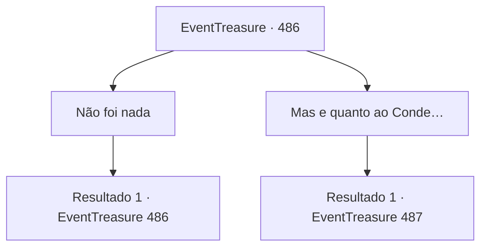

# Eventos de tesouro · 486

[Índice da tabela](index.md) · [Índice geral](../index.md)

ID: `pt:EventTreasure:486` · Fonte: `EventTreasure4` · Versão: 1.2.47.

Mapeamento estático dos arquivos; a disponibilidade e a execução dependem do estado da run.

## Texto do evento

*Sem texto no arquivo.*

## Dados de entrada

```json
{
  "id": 486,
  "grade": 1,
  "place": "",
  "required": ""
}
```

## Mapa das escolhas



## Escolhas e resultados

### Escolha 1

Não foi nada

Requisitos e outros campos da escolha:

```json
{
  "required": "5_866_0"
}
```

#### Resultado 1.1

Você minimizou humildemente, dizendo que não foi nada — que qualquer um no seu lugar teria feito o mesmo. O rosto de William tornou-se sério, tomado pela emoção. 

 "De forma alguma… e você continua humilde mesmo agora. Palavras não podem descrever esta dívida. Por favor, conceda-me a chance de retribuir."

  Insistindo, ele convidou você para sua casa. Seguindo-o, você chegou a uma pequena cabana à beira da floresta. O chalé de madeira trazia todas as marcas de uma casa de caçador: arcos e bestas pendiam das paredes, e ferramentas para limpar a caça estavam arrumadas ordenadamente sob o beiral. |drawing_hunterHouse| William recebeu você, acendendo a lareira.  Tommy correu imediatamente para a mãe, relatando os acontecimentos do dia com uma excitação ofegante. Ela afagou os cabelos dele e conduziu você até a mesa. 

 "Você é o salvador da nossa família. Não sei como poderíamos agradecer. A refeição é modesta, mas, por favor, permita-nos prepará-la para você. Só um instante."

  A esposa de William, Marta, desapareceu na despensa ao lado da cozinha.

Continuação registrada: [Evento 486](0486.md) na mesma tabela.

```json
{
  "required": "",
  "chance": "1",
  "nextEvent": 486,
  "type": 2,
  "reward": "5_866_1"
}
```

### Escolha 2

Mas e quanto ao Conde…

Requisitos e outros campos da escolha:

```json
{
  "required": "5_866_1|5_867_0"
}
```

#### Resultado 2.1

Quando você perguntou sobre o Conde, William suspirou e respondeu em voz baixa. 

 "Conde Bernhardt... ele era um homem cruel e perverso. Ele atormentava as pessoas com exigências estranhas e cruéis."

  Ele apontou para o chapéu com plumas que ainda estava na plataforma da praça. 

 "Está vendo aquilo? Cada vez que alguém passava por ele, era obrigado a fazer uma reverência. Reverência muito rasa, e você pagava uma multa. Deixar de se curvar de todo significava prisão... ou coisa pior."

  Sua voz ficou mais cortante. 

 "E não era só isso. Se sequer uma pedra estivesse no caminho por onde passava, ele arrancava de casa o morador mais próximo e o fazia varrer a rua com as mãos nuas. Quando a chuva deixava a estrada enlameada, fazia as pessoas deitar nela para que suas botas não se sujassem."

  William sacudiu a cabeça, enumerando mais atrocidades. 

 "Às vezes, se as crianças brincassem alto demais, ele decretava que ninguém na aldeia podia rir ou levantar a voz até o pôr do sol. Se alguma criança quebrasse a regra, seus pais ficavam de joelhos na praça o dia inteiro como punição."

  Ele lançou um olhar para Tommy com um sorriso amargo. 

 "Hoje de manhã, fui punido simplesmente porque não o recebi quando chegou. Eu estava treinando para a competição — eu nem sabia que ele viria."

  William soltou um suspiro pesado. 

 "Por isso, não é de se estranhar que ninguém o lamente. Pelo contrário... talvez agora a paz finalmente volte a esta aldeia."


Continuação registrada: [Evento 487](0487.md) na mesma tabela.

```json
{
  "required": "",
  "chance": "1",
  "nextEvent": 487,
  "type": 2,
  "reward": "5_867_1"
}
```

## Referências que chegam a este evento

- [Evento 482 · escolha 3 · resultado 1](0482.md#escolha-3)
- [Evento 485 · escolha 1 · resultado 1](0485.md#escolha-1)
- [Evento 486 · escolha 1 · resultado 1](0486.md#escolha-1)
