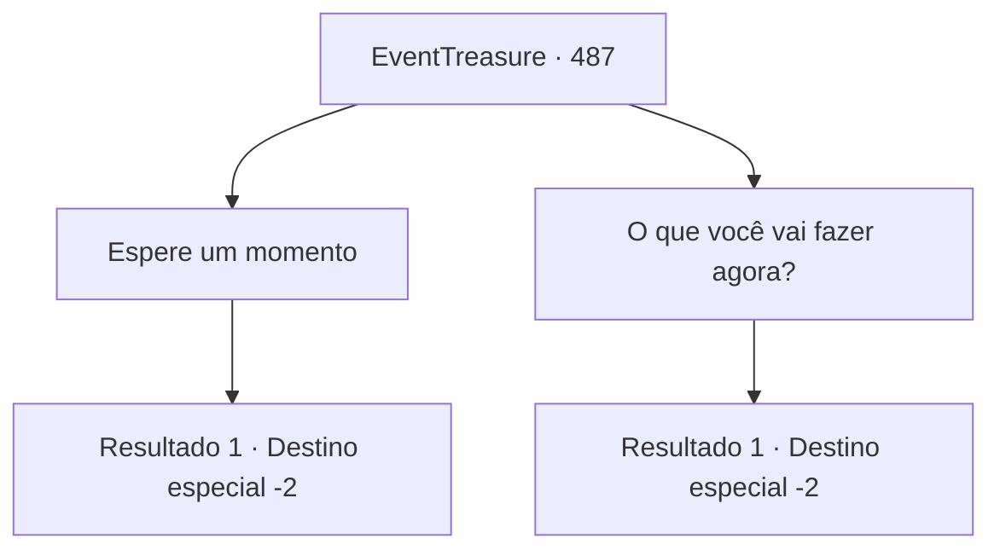

# Eventos de tesouro · 487

[Índice da tabela](index.md) · [Índice geral](../index.md)

ID: `pt:EventTreasure:487` · Fonte: `EventTreasure4` · Versão: 1.2.47.

Mapeamento estático dos arquivos; a disponibilidade e a execução dependem do estado da run.

## Texto do evento

*Sem texto no arquivo.*

## Dados de entrada

```json
{
  "id": 487,
  "grade": 1,
  "place": "",
  "required": ""
}
```

## Mapa das escolhas



## Escolhas e resultados

### Escolha 1

Espere um momento

Requisitos e outros campos da escolha:

```json
{
  "required": "18_869_1"
}
```

#### Resultado 1.1

Um pouco depois, William e Marta trouxeram um jantar cuidadosamente preparado: linguiças recém-grelhadas, queijo aromático e um vinho caseiro rústico, mas substancioso. Marta observou atentamente sua expressão. 

 "É uma refeição simples, mas espero que lhe agrade. Mais uma vez, obrigada por salvar nossa família."

  Embora modesto, era claramente o melhor que o lar deles podia oferecer. Você compartilhou a refeição, conversou calorosamente com a família de William e depois descansou no quarto que lhe ofereceram.  Na manhã seguinte, William lhe entregou sua própria besta. 

 "Confiei nesta arma por muitos anos. Por favor, não a recuse — é o meu sinal de gratidão."

  Com respeito, ele a apertou em suas mãos. Você aceitou o presente e se despediu.  Ao passar pela praça da aldeia, você notou os aldeões inclinando-se silenciosamente enquanto passava. Não disseram nada em voz alta, mas seus olhos irradiavam gratidão e respeito.  Um homem de meia-idade finalmente encontrou coragem para falar: 

 "Atirador... que sua jornada seja segura."

  Os outros acenaram com a cabeça suavemente em concordância enquanto se despediam de você. E assim, deixando para trás a agora pacífica aldeia de Brandel, você partiu mais uma vez em sua aventura.

Continuação registrada: [Destino especial `-2`](../destinos-especiais.md).

```json
{
  "required": "",
  "chance": "1",
  "nextEvent": -2,
  "type": 2,
  "reward": "0_0_1|0_1_1|3_373_1"
}
```

### Escolha 2

O que você vai fazer agora?

Requisitos e outros campos da escolha:

```json
{
  "required": "5_869_1"
}
```

#### Resultado 2.1

Quando você perguntou o que ele faria agora, William suspirou. 

 "O ancião tinha razão. O Conde não deixará isso impune. Se eu insistir em ficar, os aldeões certamente sofrerão por isso."

  Ele olhou para a sua besta e continuou: 

 "Mas não estou muito preocupado. Não importa para onde formos, posso sustentar minha família."

  Enquanto você falava, Marta trouxe comida: salsichas recém-grelhadas, queijo perfumado e um vinho caseiro rústico, porém encorpado. Ela observou seu rosto e disse: 

 "É uma refeição simples, mas espero que lhe agrade. Mais uma vez, obrigada por salvar nossa família."

  Embora modesta, era claramente o melhor que podiam oferecer. Você jantou com a família de William, conversou e por fim despediu-se deles.  

 "Cuide-se, {1}. Desejamos-lhe boa sorte."

  Eles acenaram enquanto você partia.

Continuação registrada: [Destino especial `-2`](../destinos-especiais.md).

```json
{
  "required": "",
  "chance": "1",
  "nextEvent": -2,
  "type": 2,
  "reward": "0_0_1|0_1_1|0_2_1|5_865_9"
}
```

## Referências que chegam a este evento

- [Evento 486 · escolha 2 · resultado 1](0486.md#escolha-2)
- [Evento 489 · escolha 1 · resultado 1](0489.md#escolha-1)
