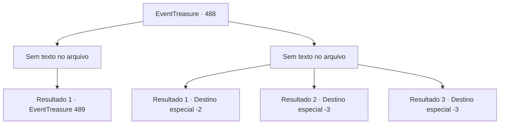

# Eventos de tesouro · 488

[Índice da tabela](index.md) · [Índice geral](../index.md)

ID: `pt:EventTreasure:488` · Fonte: `EventTreasure4` · Versão: 1.2.47.

Mapeamento estático dos arquivos; a disponibilidade e a execução dependem do estado da run.

## Texto do evento

*Sem texto no arquivo.*

## Dados de entrada

```json
{
  "id": 488,
  "grade": 1,
  "place": "",
  "required": ""
}
```

## Mapa das escolhas



## Escolhas e resultados

### Escolha 1

*Sem texto no arquivo; o papel dessa opção depende da interface do jogo.*

Requisitos e outros campos da escolha:

```json
{
  "required": ""
}
```

#### Resultado 1.1

Você derrubou os soldados de Bernhardt. Com isso, o rosto do Conde empalideceu. Apressadamente montou em seu cavalo, como se fugisse, gritando: 

 "O– oh, de repente surgiu um assunto urgente. Vou deixar por isso mesmo hoje. Considere-se com sorte, William!"

  Esporeou com força seu pobre corcel branco e galopou em direção ao castelo. Ao ver isso, os soldados restantes perderam a vontade de lutar e fugiram desajeitadamente atrás dele.  Um silêncio repentino caiu sobre a praça. William libertou o filho e, em seguida, aproximou-se de você para expressar sua gratidão. 

 "Obrigado… por salvar o nosso Tommy…"

  Ainda assim, as expressões dos aldeões estavam longe de ser animadas. Dentre eles, o ancião da aldeia adiantou-se e dirigiu-se a William. 

 "William… embora o Conde tenha recuado hoje, você sabe que ele não deixará tal humilhação sem resposta."

  William assentiu lentamente. 

 "Você tem razão. Eu entendo, Ancião. Farei os preparativos para deixar a aldeia o quanto antes."

  Despediu-se do ancião e dos aldeões que o haviam ajudado ao longo dos anos. Então, voltando-se para você, disse: 

 "Você poderia me conceder um pouco do seu tempo? Antes de partirmos, eu gostaria de retribuir-lhe adequadamente."


Continuação registrada: [Evento 489](0489.md) na mesma tabela.

```json
{
  "required": "",
  "chance": "1",
  "nextEvent": 489,
  "type": 2,
  "reward": "5_869_1"
}
```

### Escolha 2

*Sem texto no arquivo; o papel dessa opção depende da interface do jogo.*

Requisitos e outros campos da escolha:

```json
{
  "required": ""
}
```

#### Resultado 2.1

Você enfrentou os soldados de Bernhardt, mas suas lanças e lâminas foram demais. No fim, você foi forçado a fugir, deixando William e seu filho para trás.  O Conde Bernhardt riu, zombando de sua retirada. 

 "Ha-ha-ha! Lembre-se bem disso! Se não pode morder, nem se dê ao trabalho de latir!"


Continuação registrada: [Destino especial `-2`](../destinos-especiais.md).

```json
{
  "required": "1_0_2|1_1_2",
  "chance": "1",
  "nextEvent": -2,
  "type": 2,
  "reward": "0_0_-1|0_1_-1|5_865_9"
}
```

#### Resultado 2.2

Você enfrentou os soldados de Bernhardt, mas suas lanças e lâminas foram demais. No fim, você foi forçado a se ajoelhar diante dele.  

 "Vejam! Isto é o que acontece com aqueles que me desafiam!"

  Arrancando a besta das mãos de um soldado ao seu lado, o Conde a apontou para você e disparou. O virote atingiu sua cabeça.

Continuação registrada: [Destino especial `-3`](../destinos-especiais.md).

```json
{
  "required": "2_0_2",
  "chance": "1",
  "nextEvent": -3,
  "type": 2,
  "reward": "0_0_-1|0_1_-1"
}
```

#### Resultado 2.3

Você enfrentou os soldados de Bernhardt, mas suas lanças e lâminas foram demais. No fim, você foi forçado a se ajoelhar diante dele.  

 "Vejam! Isto é o que acontece com aqueles que me desafiam!"

  Arrancando a besta das mãos de um soldado ao seu lado, o Conde a apontou para você e disparou. O virote atingiu sua cabeça.

Continuação registrada: [Destino especial `-3`](../destinos-especiais.md).

```json
{
  "required": "2_1_2",
  "chance": "1",
  "nextEvent": -3,
  "type": 2,
  "reward": "0_0_-1|0_1_-1"
}
```

## Referências que chegam a este evento

- [Evento 482 · escolha 2 · resultado 1](0482.md#escolha-2)
- [Evento 482 · escolha 3 · resultado 2](0482.md#escolha-3)
