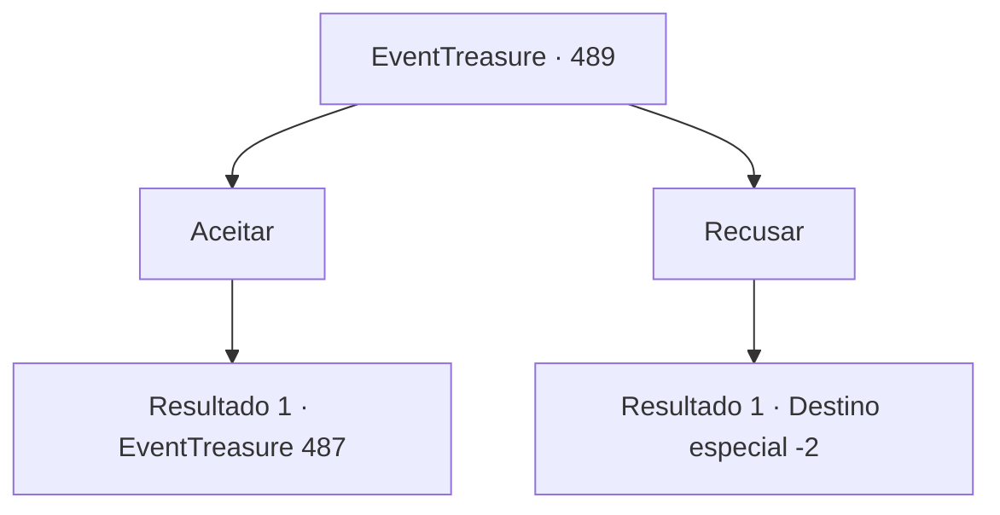

# Eventos de tesouro · 489

[Índice da tabela](index.md) · [Índice geral](../index.md)

ID: `pt:EventTreasure:489` · Fonte: `EventTreasure4` · Versão: 1.2.47.

Mapeamento estático dos arquivos; a disponibilidade e a execução dependem do estado da run.

## Texto do evento

*Sem texto no arquivo.*

## Dados de entrada

```json
{
  "id": 489,
  "grade": 1,
  "place": "",
  "required": ""
}
```

## Mapa das escolhas



## Escolhas e resultados

### Escolha 1

Aceitar

Requisitos e outros campos da escolha:

```json
{
  "required": ""
}
```

#### Resultado 1.1

Você seguiu William até a casa dele. A casa dele ficava um pouco fora da aldeia, na orla de uma floresta densa. A aconchegante cabana de madeira parecia a típica morada de um caçador. Arcos e bestas de vários tipos pendiam das paredes, enquanto ferramentas para preparar caça estavam ordenadas sob o beiral. |drawing_hunterHouse| William recebeu você e acendeu a lareira. Assim que chegaram, Tommy correu até a mãe, contando ansiosamente os acontecimentos do dia. Ela afagou Tommy com carinho e conduziu você até a mesa. 

 "Você é o salvador de nossa família. Não sei como poderemos lhe agradecer... Não temos muito a oferecer, mas vou preparar uma refeição para você. Por favor, aguarde um instante."

 A esposa de William, Marta, entrou na despensa ao lado da cozinha.

Continuação registrada: [Evento 487](0487.md) na mesma tabela.

```json
{
  "required": "",
  "chance": "1",
  "nextEvent": 487,
  "type": 2,
  "reward": ""
}
```

### Escolha 2

Recusar

Requisitos e outros campos da escolha:

```json
{
  "required": ""
}
```

#### Resultado 2.1

Você recusou a oferta de William. Ele pareceu arrependido e disse, 

 "É mesmo. Uma pena, mas eu entendo. Então vou me retirar."

 Ele se despediu de você e partiu.

Continuação registrada: [Destino especial `-2`](../destinos-especiais.md).

```json
{
  "required": "",
  "chance": "1",
  "nextEvent": -2,
  "type": 2,
  "reward": "5_865_9"
}
```

## Referências que chegam a este evento

- [Evento 483 · escolha 1 · resultado 2](0483.md#escolha-1)
- [Evento 483 · escolha 2 · resultado 2](0483.md#escolha-2)
- [Evento 488 · escolha 1 · resultado 1](0488.md#escolha-1)
